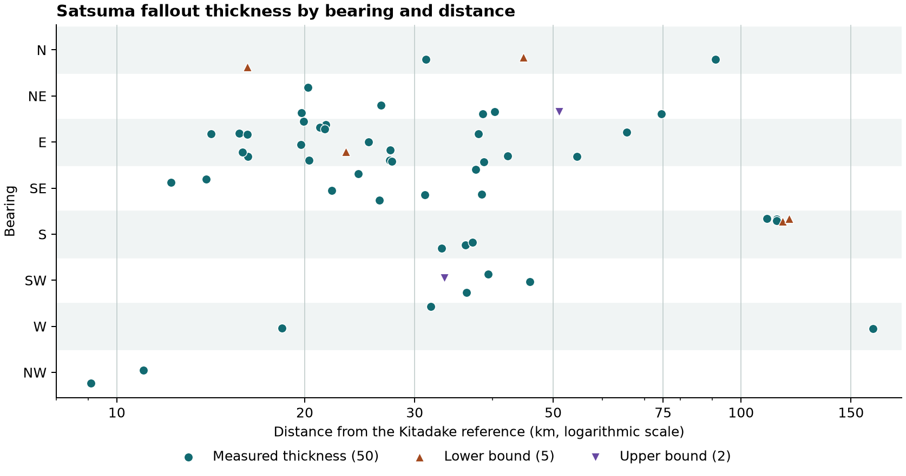

# Satsuma primary fallout evidence

**Fifty measured thicknesses, five lower bounds and two upper bounds** enter the four models. There are at least two measured beds in every 45° sector from the Kitadake reference. The 202-row ledger covers all 65 field sections, all 132 archaeological sites and five additional literature records. Each accepted row has a unique site coordinate and an identifier that follows it into the fits. [Accepted data](../../eruptions/Sakurajima_Satsuma.csv) · [Full ledger](selection.csv) · [Source files and fingerprints](../../sources/sakurajima-satsuma/README.md)

## What enters the fit

| Evidence source | Measured thickness | Lower bound | Upper bound | Interpretation |
|---|---:|---:|---:|---|
| Field team’s Table S2 | 18 | 0 | 0 | Pumice-fall thickness measured at field sections with numerical coordinates |
| GSJ 737 | 30 | 5 | 2 | Positive thicknesses or limits from written field descriptions and tables |
| Moriwaki et al. | 2 | 0 | 0 | Two geochemically correlated distal beds, the East China Sea core and the Tanegashima outcrop |

The target is the combined primary airborne deposit from the 12.8 ka eruption. It includes the broad first dispersal and the later westward and eastward fallout. The sources measure the preserved bed at each site. Erosion, compaction, subunits too thin to recognize, and local concentration affect how well that thickness represents deposition. Exact in the data schema means a reported numeric thickness with the source’s precision. [Field study](https://doi.org/10.3389/feart.2022.988373) · [Seventeen-unit stratigraphy](https://doi.org/10.18940/kazan.69.3_115)

**Density currents.** Konoo et al. trace P14B about 10–18 km from Sakurajima. Five proximal archaeological totals (1B-11, -18, -25, -26 and -27) lack a verified fallout subtotal. Table S2 lists 169 cm at Loc. 9-3, where the authors also document a current deposit. These six values remain in the ledger pending a separation of facies. The 50 cm value at 1B-07 also remains outside the fit because the available excavation description reports faulting and fissure infill. The written 10 cm at 1B-10 refers specifically to early fall unit Sa-1pfa and enters as a lower bound. [GSJ site descriptions](https://www.gsj.jp/publications/pub/openfile/openfile0737.html) · [Density-current reach](https://doi.org/10.18940/kazan.69.3_115)

**Drawings and limits.** Fourteen archaeological sites with numeric P14 entries rely on a drawn section, ruler, WebPlotDigitizer or schematic profile. The audit also sets aside legacy column extractions and traced isopachs in the wider literature. At 1A-17, 1C-07 and 1C-08 the reports give ranges of 10–20, 15–20 and 10–20 cm, respectively. The shared one-sided observation likelihood uses the lower endpoint as a floor for the preserved site range. The upper endpoints remain in the ledger and do not enter the likelihood. The other bounds are published inequalities above 6 cm and below 60 and 10 cm, plus the partial fall unit at 1B-10. [Source decisions and original values](selection.csv)

**Unquantified horizons.** A blank entry, an unconfirmed correlation, isolated clasts, a zero code, and a dispersed-glass horizon have different meanings. The ledger retains them separately. At 1B-05, laboratory work failed to identify P14 particles in the sampled horizon. Establishing a numerical upper limit would require recovery and detection information. Tawaraishi and Kuwanoki report dispersed material. At Huguangyan the authors sampled a glass-shard peak per 0.5 g of dry sediment, with 1 cm samples around peaks. Core-slice thickness, shard concentration and the thickness of the original airborne deposit have different physical units. No measured local recovery, bulk density and size-fraction calibration ties these readings to a maximum local fallout thickness. The five archive probes supply independent local predictions. [Archive locations and source judgments](archive-probes.json) · [Chinese lake study](https://doi.org/10.1029/2020GL090582)

At Tawaraishi the investigators identified Sz-S in soil layer IV. At Kuwanoki they describe high-refractive-index glass and orthopyroxene within sediment on a river terrace, and marked local variation in the preservation of other tephras. Neither report supplies an original Sz-S bed thickness or the fraction retained in the sampled soil. A model prediction of a centimetre-scale bed at Kuwanoki is a local discrepancy worth testing against a preserved neighbouring section. [Tawaraishi, printed pp. 11–12](https://doi.org/10.24484/sitereports.3272) · [Kuwanoki, printed pp. 5–6](https://doi.org/10.24484/sitereports.3454)

## Coverage and leverage

Measured beds span **9.1 to 162.6 km** and **0.8 to 95 cm**. The widest angular gap between measured sites is **43.6°** across all distances. It reaches **106.9° beyond 50 km** and **250.8° beyond 100 km**. Both northwest measurements come from 9–11 km. In the west, there are measurements of 70 cm at 18.4 km, 15 cm at 31.9 km and 0.8 cm at 162.6 km. Southwest measurements span only 36–46 km. [Counts and radial extent by direction](coverage.csv)

The 8 mm western marine bed is lenticular. Its upper and lower contacts at 9.120 and 9.128 m give the same thickness as the authors’ description. Local sediment redistribution could affect that reading. The nearby U1429C Sz-S sample records ash occurrence, while its sampled slice does not resolve total bed thickness. The two records cannot be averaged. Both global families were independently refitted with that one lenticular bed omitted. [Primary marine measurements](https://doi.org/10.1016/j.quaint.2011.03.046) · [Omission results](../../../eruptions/sakurajima-satsuma/results/source-audit/README.md)

Earlier work proposed a western vent. Konoo et al. found P14B to the east as well and considered the exact position unresolved within Sakurajima. Moving the JMA reference 3 km toward each of eight bearings preserves at least one measured site in every sector. The greatest circular gap ranges from 40.3° to 59.7°. The 3 km offsets illustrate how bearing classifications depend on source location. They are a geometry check. The volumes condition on the JMA reference, and their intervals omit vent-position uncertainty. [Reference positions and counts](source-position-check.csv) · [JMA reference](https://www.data.jma.go.jp/vois/data/fukuoka/506_Sakurajima/506_index.html) · [Vent interpretation](https://doi.org/10.18940/kazan.69.3_115)

## Reproduce the audit

Run `python -m benchmarks.sakurajima_satsuma` from the repository root to reproduce and compare the source ledger, accepted input, eight-sector counts, reference-position checks and occurrence probes. The optional `--gsj-zip FILE` checks the native acquisition notes and exact workbook bytes against the original archive. The optional `--marine-paper FILE` verifies the two printed beds against the pinned manuscript using `pdftotext`. Adding `--figure` rebuilds the coverage plot. [Source download and member fingerprints](../../sources/sakurajima-satsuma/source-files.json) · [Model input identity](provenance.json) · [Four-method results](../../../eruptions/sakurajima-satsuma/README.md)
