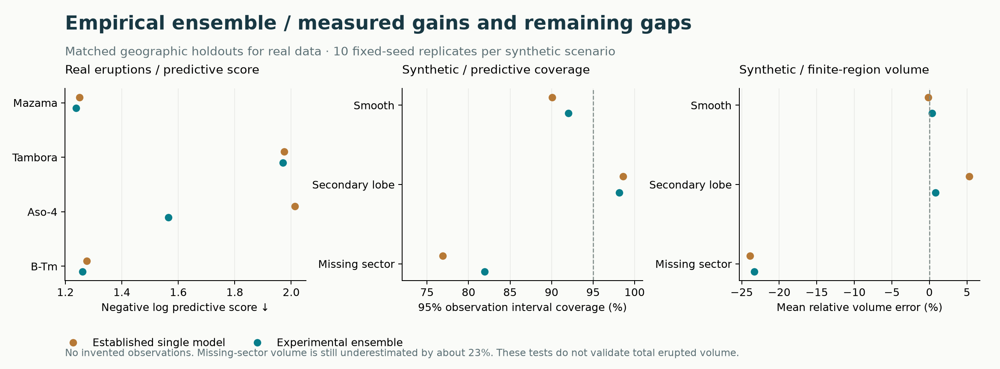

# Gaussian-process ensemble

**Current use:** the GP ensemble is one peer in the [regional GP/spline comparison](regional-comparison.md). The version-0.4 release discussion and legacy `fit --method` commands below describe its development history; the new `compare` command always evaluates both current families.

[Method overview](../METHODS.md) · [Validation catalogue](../validation/README.md)

Version 0.4 adds an **experimental spatial predictive ensemble** to the fit workflow. It removes the need to choose a single thinning configuration by hand and carries disagreement among data-supported candidates into maps and joint volume draws. The single-GP `selected` strategy remains the default; use `--method stacked`.

This is an application and extension of existing statistical ideas, not a claim to have invented predictive stacking. It does not eliminate scientific assumptions or make unobserved deposit structure identifiable. The four bundled eruptions and synthetic scenarios are development benchmarks, not independent external validation.



## What replaces pseudo-data?

The distinction is the information source, not whether a point looks plausible on a map:

| Input | Statistical treatment |
|---|---|
| Measured positive thickness | Measurement likelihood, with optional known log-scale measurement error |
| Documented non-detection with a positive detection limit | Censored likelihood integrating below that limit; never a zero-thickness point |
| Unsampled location, manually drawn contour or model-generated value | Prediction target; never additional independent evidence |
| Genuinely independent external evidence | Requires its own observation model, uncertainty, correlation and provenance |

Legacy pseudo rows continue to be excluded before fitting, validation and domain construction. Predicted virtual points are exported as a **joint mixture distribution**, preserving their dependence on the same observations. Adding more prediction locations therefore supplies no new observations and does not increase the fitted data count. The separate normalized spline-prior estimator remains available; this release does not modify it.

## 1. Learn a predictive combination from withheld regions

Each component retains the existing constrained directional mean and Matérn spatial residual model. The candidate grid is fixed: two tail families, three correlation-length factors and three residual-noise ratios. All scale estimation and fitting happen again inside each training fold. Colocated observations stay in one geographic fold. An optional distance buffer excludes nearby training locations.

For observation \(i\), candidate \(k\) supplies an out-of-fold predictive density \(p_{ik}\). A documented upper limit contributes its predictive CDF instead; a documented lower bound contributes the survival probability. Retain the three lowest equal-region negative-log-score candidates per tail family, at most six total. Fit weights by

\[
\widehat w=\arg\max_{w_k\geq0,\ \sum_k w_k=1}
\sum_{b=1}^{B}\frac1B\sum_{i\in b}\frac1{n_b}
\log\!\left(\sum_k w_k p_{ik}\right).
\]

Equal region mass prevents a densely sampled geographic fold from automatically dominating this objective. It does not solve preferential sampling within a region. The simplex optimization is deterministic; weights at or below `1e-7` are dropped and the retained weights renormalized. Removed numerical mass is reported. Ties follow the fixed candidate order.

Refit retained components on all accepted observations. The result is a predictive mixture, **not posterior probabilities that the models are true**. A family may receive zero weight; the algorithm does not force both families to survive. Its benefit can also come from averaging correlation-length or noise candidates within one family.

Whole-fold Dirichlet reweighting (64 draws, fixed seed 1729) refits weights to the saved out-of-fold scores. Reported 5–95% ranges reveal weight instability. They condition on the fitted candidate predictions and screening decision; they are neither Bayesian credible intervals nor frequentist confidence intervals. They are not propagated as an additional source of surface uncertainty.

The statistical basis is predictive-distribution stacking under proper scoring rules, as developed by [Yao, Vehtari, Simpson and Gelman (2018)](https://doi.org/10.1214/17-BA1091). This implementation uses actual geographic refits and conditional Gaussian/Laplace components, rather than their leave-one-out posterior approximation. Geographic validation follows the dependence concerns discussed by [Roberts et al. (2017)](https://doi.org/10.1111/ecog.02881).

## 2. Preserve the distribution through maps and volume calculations

Let component log thickness have mean \(\mu_k(x)\) and covariance \(C_k\). The predictive field is a mixture of these joint distributions. Its expected thickness is

\[
E[T(x)]=\sum_k w_k\exp\{\mu_k(x)+C_k(x,x)/2\}.
\]

Pointwise medians and interval endpoints solve the mixture CDF, rather than using a Gaussian approximation to its moments. Consequently the median isopach surface can differ from the exponential of the mean log surface. Covariance exports use the law of total covariance, including between-component mean differences.

The following simulation describes the retained **regional** diagnostic; the current [global integral](global-volume.md) evaluates mixture expectations and has no global probability interval. For each volume realization, draw **one component for the entire spatial field**, draw its correlated log surface, exponentiate, and integrate over the explicit rectangle. Selecting a different component independently for every cell would change the model and suppress important volume dependence. Integrating pointwise interval endpoints is also invalid.

`virtual_predictions.npz` contains component weights, means and covariance matrices, plus mixture mean/covariance moments. The latter alone do not define the mixture. Do not feed that moment export into a Gaussian conditioning routine as though it were an exact Gaussian law, or feed any virtual values back into training. Marginal maps and finite-region integrals share the same exact mixture summaries.

These calculations represent conditional spatial uncertainty and retained-model disagreement. They do **not** integrate fitted mean/covariance parameters, learned weights, candidate screening, vent error, field preservation or sampling-process uncertainty. Power-tail extrapolation and finite-region volume remain assumption-dependent. Numerical integration refinement does not establish geological correctness or convergence of sampled volume quantiles.

## 3. Test an additional observation-discrepancy layer separately

An empirical diagnostic estimates nonnegative extra variance \(\tau^2\) by scoring the same training out-of-fold mixture after replacing each observation variance \(v_{ik}\) with \(v_{ik}+\tau^2\). This is additional independent variation for a **new observation**, not latent spatial structure.

The numerical search uses 81 logarithmically spaced positive variance values plus zero, then bounded refinement around the best grid value. The upper bound is `max(1, 4 × mean squared out-of-fold detection error)`. Both endpoints are considered and boundary hits reported. This deterministic one-dimensional search is an approximation, not a proof of a global optimum for every mixture. The cap, grid, candidate screen and covariance families are declared algorithmic choices; they are not elicited separately for each eruption.

The diagnostic does not change the primary intervals, maps, mixture weights or volume draws. It is labelled `discrepancy_adjusted` in validation and `diagnostic_adjusted_observation_*` in the CSV. The report compares coverage, interval width and negative log score for both versions. Increased coverage obtained solely by making intervals wider is insufficient evidence of improvement.

This layer is **not conformal prediction** and provides no distribution-free coverage guarantee under spatial dependence. In the current real-data benchmark it worsens predictive scores on every eruption relative to the raw ensemble, so it has not been adopted as the reported default. It also does not cure missing-sector extrapolation.

## Evaluation performed

Outer validation withholds four geographic regions. Within each outer training set, three geographic folds select/screen candidates, fit weights and estimate discrepancy. No outer response enters those decisions. The final all-data fit uses four folds. Reported accuracy therefore evaluates the complete fitting procedure, with the usual training-size difference between validation and deployment. Small or buffered folds with insufficient measurements fail visibly.

Coverage and RMSE use detections only; upper and lower bounds contribute predictive scores. The repository's legacy `mean_log_score` key means **negative** log predictive score: lower is better. Tables below pool observations; equal-region scores are also saved. These are descriptive comparisons with four eruptions and ten synthetic replicates per scenario, not significance tests.

| Eruption | Negative log score: selected → stacked | 95% observation coverage: selected → stacked | Log RMSE: selected → stacked |
|---|---:|---:|---:|
| Mazama | 1.249 → 1.237 | 93.3% → 93.3% | 0.907 → 0.926 |
| Tambora | 1.975 → 1.970 | 92.3% → 92.3% | 1.484 → 1.483 |
| Aso-4 | 2.013 → 1.565 | 79.3% → 87.4% | 1.137 → 1.076 |
| B-Tm | 1.275 → 1.261 | 97.6% → 97.6% | 0.885 → 0.892 |

The score improved on all four datasets, but point prediction did not improve uniformly, and Aso-4 remains undercovered. Discrepancy adjustment gave scores 1.237, 2.173, 1.626 and 1.346, respectively, with no coverage gain at displayed precision. Wider intervals were usually worse by the proper scoring rule. Inspecting these development results influenced the decision to leave discrepancy adjustment diagnostic; the comparison is not a preregistered external test.

The 30 synthetic runs exactly match the prior benchmark's three surfaces and ten seeds. They use 60 training locations, 400 independent test locations per run and observation noise SD 0.25 in natural logs. All methods see identical training/test data. Surfaces are not sampled from the fitted GP.

| Scenario | Negative log score: selected → stacked | 95% observation coverage: selected → stacked | Mean relative finite-region volume error: selected → stacked |
|---|---:|---:|---:|
| Smooth | 0.167 → 0.134 | 90.1% → 92.0% | −0.2% → +0.4% |
| Secondary lobe | 0.751 → 0.661 | 98.6% → 98.2% | +5.3% → +0.8% |
| Missing sector | 1.749 → 1.130 | 76.9% → 81.9% | −23.9% → −23.3% |

Volume comparisons use the same Monte Carlo locations for truth and estimated expected thickness; they are not tests of volume interval coverage. The hidden-lobe failure remains substantial. An empirical procedure cannot discover arbitrary structure absent from the observed sectors. Physics, independently justified external evidence or new sampling would be needed to constrain that case.

Machine-readable results and source/input hashes: [benchmark JSON](../../archive/validation/ensemble/benchmark.json), [real comparison CSV](../../archive/validation/ensemble/real_comparison.csv), [synthetic comparison CSV](../../archive/validation/ensemble/synthetic_comparison.csv). Full fold-level records are produced by the benchmark command below. A four-eruption stacked report build also completed with all expected/median regional integrals meeting the 0.5% refinement rule at all three region sizes; unresolved 0.1 cm Aso-4/B-Tm contours remained explicitly omitted.

## Reproduce and use

```sh
python -m pytest -q
python -m benchmarks.empirical --output results/empirical --repeats 10
python -m benchmarks.summarize_empirical results/empirical/benchmark.json --output results/comparison
tephra-isopachs fit Minoan --output results/minoan-ensemble --method stacked --nested-cv
python -m src.probabilistic_isopach fit path/to/measurements.csv --output results/new-eruption --method stacked --nested-cv
```

Keep the selected GP as a comparison: run the same file into a fresh output folder with `--method selected`. Do not choose whichever method has favorable coverage for a desired conclusion. Keep unfavorable holdout results and domain sensitivity with the reported estimate. Before promoting the ensemble to the default, evaluate fresh eruptions, alternative geographic partitions/buffers, preservation/sampling bias, and fitted-parameter uncertainty.


## Historical and current YTT applications

The [archived 43-record YTT comparison](../../archive/reports/ytt/archive/2026-11-02/README.md) uses 43 audited records and matched buffered geographic holdouts. It does not support promoting the ensemble: negative log score worsens from 2.130 to 2.167, coverage remains 39/43, and log RMSE improves from 1.394 to 1.336. Both all-data fits select the same single exponential component. That archived report preserves the 38- and 45-record sensitivity cases and the four western holdout failures. The [current YTT report](../../eruptions/ytt/README.md) uses 46 reviewed observations; its newer scores must not be confused with this historical comparison.


The [Minoan combined-fallout application](../../eruptions/minoan/README.md) keeps the selected-GP default. Both methods see the same 101 location constraints, comprising 92 exact totals and nine lower bounds. The ensemble does not improve the predictive log score or point RMSE on matched outer holdouts.
