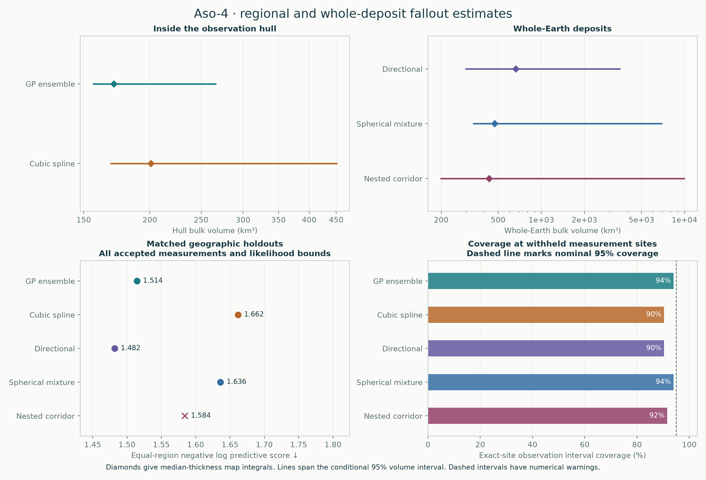

# Aso-4 fallout reconstruction

The accepted dataset contains 83 exact measurements, 3 lower bounds and 1 upper bound. The regional fits share an observation hull of 3,482,991 km². [Accepted thickness CSV](../../data/eruptions/Aso-4_reviewed.csv) · [Row-level source audit](../../data/audits/Aso-4/README.md)

## Bulk fallout volume

| Model | Area | Volume summary (km³) | Conditional 95% volume interval (km³) |
|---|---|---:|---:|
| [Directional ensemble](results/directional/README.md) | Whole Earth | Median-map integral **740.0** · complete-field median 882.7 | 397.5–2,931.7 |
| [Spherical mixture](results/spherical-mixture/README.md) | Whole Earth | Posterior median **1,466.0** | 501.0–44,172.9 |
| GP ensemble | Observation hull | Expected **202.65** | 155.87–266.97 |
| Cubic spline | Observation hull | Expected **248.15** | 168.43–452.02 |

The directional interval summarizes complete simulated deposits. Measured interpolation triangles hold **3.3%** of the central directional map’s volume. The regional intervals condition on the fitted settings. [Paired regional maps and held-out tests](results/README.md)

## Evidence and limitations

The reviewed input corrects two cruise locations and retains the Biwa source conflict and the Hokkaido erosion interpretation. The nearest accepted site is 88 km from the vent. The southeast, south and west have two, two and zero exact measurements. The large spherical-mixture total remains questioned. Omitting all 28 source-labelled marine records raises its median to about 3,184 km³. A regional deletion also makes the spline partial volume unstable. [Source, geometry and influence experiments](../../comparisons/aso-4-audit/README.md)

The standard local-support footprint covers 711,348 km². No complete isopach band passed the support and deletion checks. [Support map, partial volumes and rejected contours](results/support/README.md)
