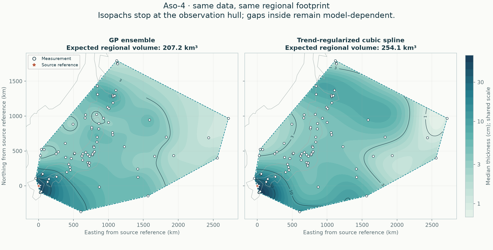

# Aso-4: data, global and regional results

[Regional fit](results/README.md) · [Local support](results/support/README.md) · [Conditional global estimate](results/global/README.md)

[All eruptions](../README.md) · [Active methods](../../methods/README.md) · [Source audit and experiments](../../comparisons/aso-4-audit/README.md)

## Global fallout

The source-qualified reference posterior is **1,466 km³ [501–44,173]**, a conditional median and 95% credible interval for whole-Earth **bulk fallout**. Its high total remains questioned. All accepted fallout fans are fitted together; no closing pseudo-data, calculation rectangle or contour cutoff sets the volume. [Global assumptions, seven sensitivity refits and numerical checks](results/global/README.md).

**Two cruise-coordinate errors are corrected**, moving observations by about 444 and 512 km while retaining their measured thicknesses. Four source-qualified bounds are encoded. The Biwa source conflict and the Hokkaido erosion interpretation remain explicit; 35 separately supplied records are not all independently certified. [Primary sources and every decision](../../data/audits/Aso-4/README.md).

A tighter fan-position prior gives **777 km³ [403–6,382]** and improves the matched geographic prediction score from **1.632 to 1.540**. It is published as a development alternative, not a demonstrated correction of the missing global mass. Removing all 28 source-labelled marine records instead raises the reference median to **3,184 km³** and broadens its interval. Ocean transport is plausible but does not justify an arbitrary reduction of core thickness. [All alternatives, influence checks and the Kuroshio literature](../../comparisons/aso-4-audit/README.md).

The [previous 1,836 km³ calculation](../../comparisons/aso-4-audit/reference/results/global/README.md) remains in the required study reference. Its two coordinate errors and exact-value interpretations are not carried silently into the current reference.

## Regional reconstruction

GP ensemble and automatic cubic spline remain regional peers, using identical accepted data, geographic holdouts and the same observation hull. The input contains **83 exact measurements, three lower bounds and one upper bound**; six legacy pseudo rows are ignored.

| Quantity | GP ensemble | Cubic spline |
|---|---:|---:|
| Expected regional bulk fallout (km³) | 202.65 | 248.15 |
| Conditional 95% interval (km³) | 155.87–266.97 | 168.43–452.02 |
| Equal-region negative log predictive score ↓ | 1.514 | 1.662 |
| Exact-observation 95% coverage | 94.0% | 90.4% |

These volumes cover the **3,482,991 km² observation hull**, which includes unsampled gaps. They are not total eruption volume or dense-rock equivalent. Their conditional intervals omit fitted-parameter and selection uncertainty. [Full regional comparison and tuning](results/README.md).

**No complete supported isopach band passes.** The standard local footprint covers **711,348 km²**, with partial volumes of 27.94 and 26.90 km³. A geographic omission causes an extreme spline partial-volume estimate near 192,882 km³; that instability remains visible. [Support, contour and deletion checks](results/support/README.md). The support screen is a local diagnostic, not a veto on the separately qualified global calculation.

## Evidence and calculation

| Follow the calculation | File |
|---|---|
| Current source-qualified input | [Reviewed observations](../../data/eruptions/Aso-4_reviewed.csv) |
| Unchanged supplied input | [Original observations](../../data/eruptions/Aso-4_tephra.csv) |
| Source decisions, conflicts and hashes | [Audit](../../data/audits/Aso-4/README.md) |
| Diagnosis and all targeted experiments | [Aso-4 evidence report](../../comparisons/aso-4-audit/README.md) |
| Whole-deposit posterior | [Global report](results/global/README.md) |
| Regional fits and provenance | [Complete numerical record](results/report.json) |
| Row-by-row predictions | [Held-out predictions](results/heldout_predictions.csv) |
| Numerical and preservation checks | [Revision verification](../../comparisons/aso-4-audit/verification.json) |

## Related evidence and history

[Validation and targeted studies](../../comparisons/README.md) · [Earlier calculations in Git history](../../docs/HISTORY.md)
