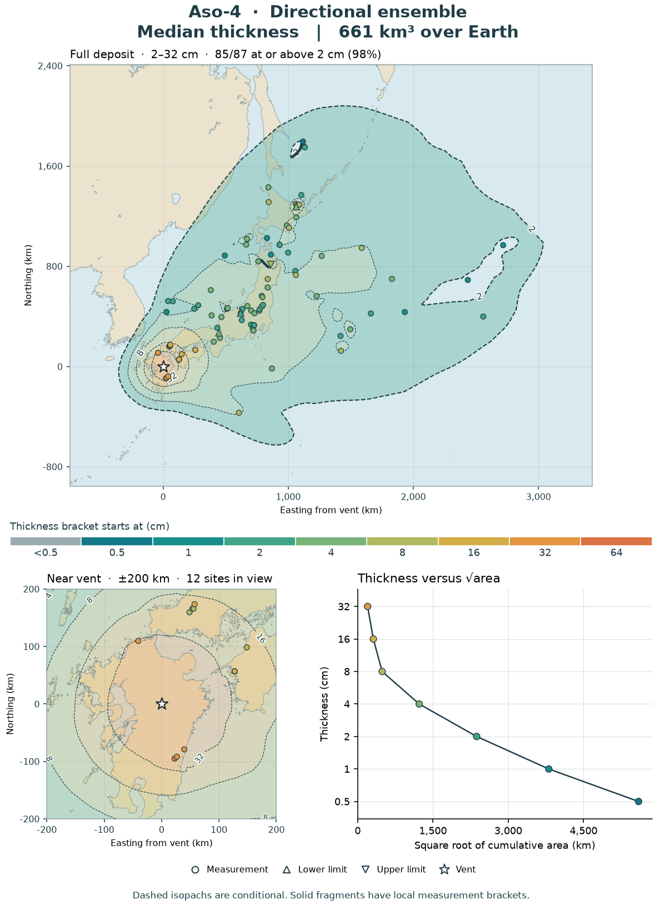
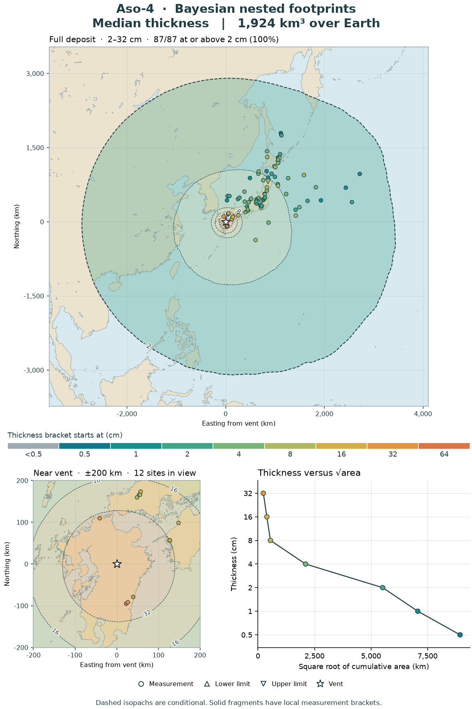
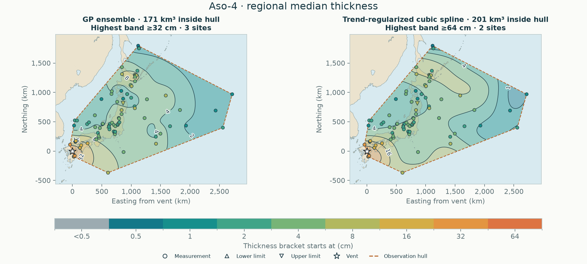

# Aso-4 fallout reconstruction

The accepted dataset contains 83 exact measurements, 3 lower bounds and 1 upper bound. The regional fits share an observation hull of 3,482,991 km². [Accepted thickness CSV](../../data/eruptions/Aso-4_reviewed.csv) · [Row-level source audit](../../data/audits/Aso-4/README.md)

In the whole-area sensitivity, the median modeled area above 1 mm covers 44.3% of the Earth. With the farthest fifth of sites withheld, its predictive score worsens from 1.757 to 1.836. That test and the inferred footprint make the 2,007 km³ whole-area median-map integral a highly extrapolated scenario. The compass-sector test shows what happens when the unknown fan can turn west or south. [Distal and angular sensitivities](results/nested-whole-area/bearing-study/README.md) · [Known-volume and distal holdout tests](../../comparisons/nested-isopachs/whole-area-study.md)

In that whole-area fit, the 1 cm marine bed at MR98-05 St.6PC sets the outermost sampled rank in 70% of draws. The site and cluster deletions test how strongly the distal shape depends on that survey. The large volume persists because the fitted contour shape spreads the sampled centimetre-scale thicknesses over a much broader area. The western sector has no exact measurements and receives a median 12.5% of the modeled volume. [Source-to-core correspondence](../../data/audits/Aso-4/record-review.csv) · [Refit without the controlling core](results/nested-whole-area/edge-deletion/README.md)

Takarada and Hoshizumi reconstructed 590–920 km³ of bulk Aso-4 fallout from manual isopachs on 71 sites. Their reconstruction shares source evidence with this audit. It provides a geological comparison and supplied no prior target. [Original fallout-volume reconstruction](https://www.frontiersin.org/journals/earth-science/articles/10.3389/feart.2020.00170/full)

The revised nested footprint assigns **29%** of its 1,924 km³ median-map volume to the three unobserved western sectors. The 538–16,846 km³ interval depends strongly on whole-area and distal continuation. [Sector allocation and evidence](results/nested-isopachs/footprints/sector-volumes.csv)

## Volumes and geographic prediction

Each estimate integrates the median thickness on its map. The conditional range integrates the pointwise 25th and 75th percentiles of thickness over the same area. The 50% probability refers to thickness at each location. A single probability for total volume does not follow from these endpoints.

| Method | Integration area | Median map (km³) | Q25–Q75 thickness maps (km³) | Held-out score ↓ | 95% predictive coverage |
|---|---|---:|---:|---:|---:|
| GP ensemble | observation hull | **171** | 118–249 | 1.514 | 94.0% |
| Cubic spline | observation hull | **201** | 146–289 | 1.662 | 90.4% |
| [Directional ensemble](results/directional/README.md) | whole Earth | **661** | 343–1,313 | 1.482 | 90.4% |
| [Spherical mixture](results/spherical-mixture/README.md) | whole Earth | **473** | 282–942 | 1.636 | 94.0% |
| [Bayesian nested footprints](results/nested-isopachs/README.md) | whole Earth | **1,924** | 802–5,577 | 1.352 | 92.8% |

Lower scores indicate better geographic prediction. Coverage counts exact withheld measurements. A dagger marks a fit, integration or validation warning.

## Full deposits and near-vent detail

Each full map follows the thickest power-of-two contour enclosing at least 95% of the fitted locations, with a 1 cm minimum. The title gives the actual count, including when that minimum prevents 95% coverage. Global volumes include the thinner tail. The innermost line is the thickest doubling level enclosing an accepted location. The near-vent window expands from the proximal sites until eligible contours are visible. The curve sums all patches at each displayed thickness.

## Inside the observation hull

The GP and spline integrate over the dashed hull. Gaps inside it can still be poorly constrained. [Regional fits and numerical checks](results/README.md)

The current global fits use the same audited rows. [What changed in the maps, volumes and validation](../../comparisons/global-extent/README.md) · [Continuation rules](../../docs/methods/finite-spread.md)

## Evidence and limitations

The reviewed input corrects two cruise locations and retains the Biwa source conflict and the Hokkaido erosion interpretation. The nearest accepted site is 88 km from the vent. The southeast, south and west have two, two and zero exact measurements. The large spherical-mixture total remains questioned. In the earlier broad spherical fit, omitting all 28 source-labelled marine records gave a conditional 95% volume interval of 536–143,867 km³. A regional deletion also makes the spline partial volume unstable. [Source, geometry and influence experiments](../../comparisons/aso-4-audit/README.md)

In the [preceding reconstruction](../../archive/2026-11-22-global-extent/README.md), the spherical 10 cm footprint contracts to the south, southeast and west. The displaced-kernel map still places its near-source grid maximum southeast of the volcano, away from the closest measurements. Its location and the large upper volume tail depend on extrapolation. The south and southwest 10 cm areas retain numerical warnings. [Near-source spherical map](results/spherical-mixture/source.png) · [Matched isopach areas and known-deposit tests](../../comparisons/spherical-mixture/README.md#where-the-map-changes)

The standard local-support footprint covers 711,348 km². No complete isopach band passed the support and deletion checks. [Support map, partial volumes and rejected contours](results/support/README.md)

In the [preceding reconstruction](../../archive/2026-11-22-global-extent/README.md), the western sector has no measured thickness and its median 1 cm footprint changes from 6.32 million to 48,000 km². On a separate test, 28 actual submarine cores were better predicted by the broader fit. [Whole-area continuation sensitivity](results/nested-whole-area/README.md)
