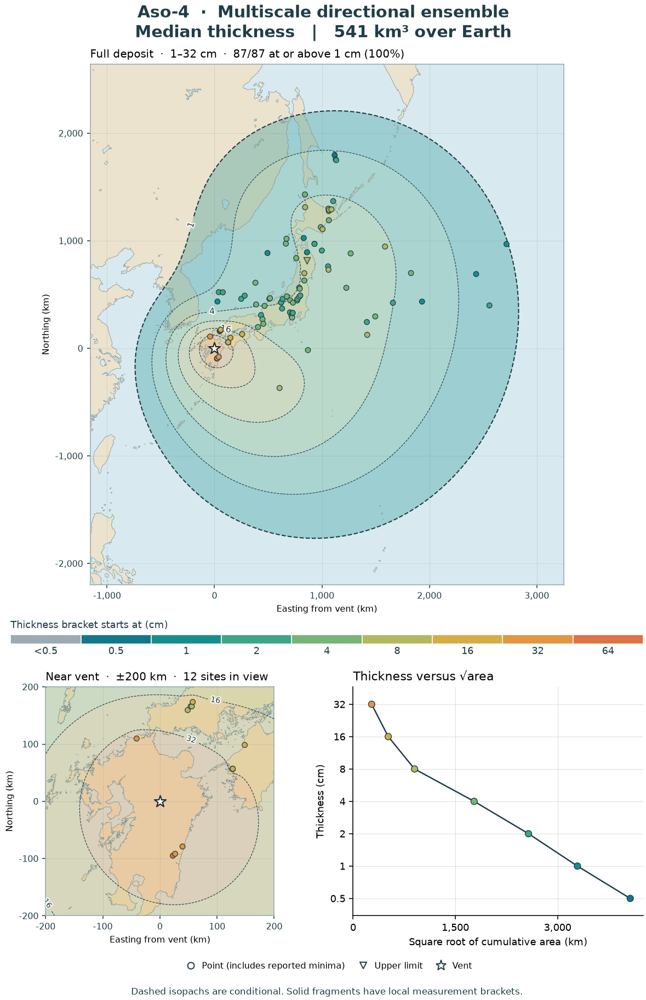
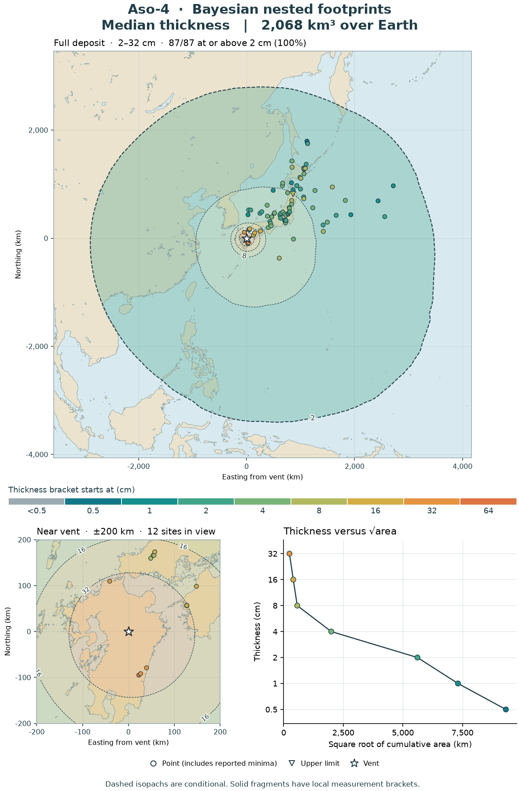

# Aso-4

## Principal thickness dataset

The principal input contains **88 localities**, including 84 measured thicknesses, 3 reported lower limits and 1 upper limit. The new observation is **27 cm** of Aso-4 ash at IODP Hole U1429B in the East China Sea, about 243 km southwest of the vent. The fitting table encodes the recovered thickness as a measured point. The core log and tephra correlation identify the bed, with marine redistribution and compaction remaining sources of geological uncertainty. [Reported table](../../data/eruptions/Aso-4_reviewed_u1429.csv) · [Fitting table](../../data/eruptions/Aso-4_reviewed_u1429_minimum_fit.csv) · [U1429 source audit](../../data/audits/Aso-4/u1429/README.md)

## Published fits on the preceding input

The maps, volumes and validation below use the preceding **87-locality** input with 83 measured thicknesses, 3 lower limits fitted at their reported minima and 1 upper limit. Its fitting CSV has SHA-256 `70359023574c18aec962366991cc913800e51252a0f16b9559c420ecd4b9a624`. [Preceding published case](https://github.com/siyulai21/tephra-fallout-isopachs/tree/d115f2a699870c826752fd26b0b4d86ff42130f8/eruptions/aso-4) · [Fitting CSV for the maps](../../data/eruptions/Aso-4_reviewed_minimum_fit.csv)

The preceding fit’s site table pairs each source classification with its fitting value, geographic fold, mapped thickness and held-out score. It includes the predictive median or cumulative probability at the site value where the method saves it. A fitted minimum can underestimate total fallout at an incomplete section. [Reported and fitted sites](results/minimum-fit-2026-11-25/reported-and-fitted-sites.csv) · [Changes by method and coverage by source type](results/minimum-fit-2026-11-25/minimum-fit-comparison.csv) · [Fitting convention](../../docs/methods/reported-minimum-fitting.md)

## Volumes and geographic prediction

Each estimate integrates the median thickness on its map. The conditional range integrates the pointwise 25th and 75th percentiles of thickness over the same area. The 50% probability refers to thickness at each location. A single probability for total volume does not follow from these endpoints.

| Method | Integration area | Median map (km³) | Q25–Q75 thickness maps (km³) | Held-out score ↓ | 95% predictive coverage |
|---|---|---:|---:|---:|---:|
| GP ensemble | observation hull | **171** | 119–244 | 1.531 | 93.0% |
| Cubic spline | observation hull | **198** | 144–285 | 1.694 | 90.7% |
| [Multiscale directional ensemble](results/minimum-fit-2026-11-25/directional/README.md) | whole Earth | **541** | 333–1,049 | 1.225 | 97.7% |
| [Spherical mixture](results/minimum-fit-2026-11-25/spherical-mixture/README.md) | whole Earth | **449** | 267–916 | 1.600 | 94.2% |
| [Bayesian nested footprints](results/minimum-fit-2026-11-25/nested-isopachs/README.md) | whole Earth | **2,201** | 1,099–5,647 | 1.372 | 93.0% |

Lower scores indicate better geographic prediction. Coverage counts held-out measurements and reported minima fitted as points. A dagger marks a fit, integration or validation warning.

## Full deposits and near-vent detail

Each full map follows the thickest power-of-two contour enclosing at least 95% of the fitted locations, with a 1 cm minimum. The title gives the actual count, including when that minimum prevents 95% coverage. Global volumes include the thinner tail. The innermost line is the thickest doubling level enclosing an accepted location. The near-vent window expands from the proximal sites until eligible contours are visible. The curve sums all patches at each displayed thickness.

## Inside the observation hull

The GP and spline integrate over the dashed hull. Gaps inside it can still be poorly constrained. [Regional fits and numerical checks](results/minimum-fit-2026-11-25/README.md)

## Nested geometry and field agreement

This is the weakest geometric change. The 64 cm proximal contour remains nearly circular, with a small southward offset, and the 32–8 cm contours retain a broadly concentric relationship. They connect smoothly to the outer field without crossings or detached rings. The outer 1–2 cm contours become somewhat less southward, but still extend thousands of kilometres into poorly sampled western and southern directions. Their broad curvature is a conditional model result, not a mapped deposit edge. The actual deposit plate starts at 2 cm; the matched review also shows the 1 cm continuation. Neither justifies a precise western cutoff.

Northern rows 85 and 88 improve slightly, while row 49 (1 cm, 436 km north) remains substantially overpredicted. Southeastern row 37 (15 cm at 709 km) remains underpredicted. These contrasting observations help explain why a simple narrow northeastern fan is inadequate, but do not establish the opposite side of a full perimeter. Measured log RMSE changes from 0.677 to 0.678 and median absolute log error from 0.401 to 0.407. The sole upper limit, row 43, receives a slightly higher event probability. Geographic score changes from 1.364 to 1.372, and the independent survey transfer worsens. The larger full fit passes the site, field-population and mapped-quartile checks; numerical stability does not remove this geological uncertainty.

[Three-scale comparison, site identities and contour diagnostics](../../comparisons/nested-isopachs/adaptive-growth/visual-review.md#aso-4)

## Evidence and checks

[Matched predictions by locality](results/minimum-fit-2026-11-25/geographic-site-validation.csv) · [Numerical checks and file identities](results/minimum-fit-2026-11-25/release.json) · [Spherical fits and computing revisions](results/minimum-fit-2026-11-25/spherical-mixture/workflow-provenance.json) · [Regional support](results/minimum-fit-2026-11-25/support/README.md) · [Whole-area sensitivity](results/minimum-fit-2026-11-25/nested-whole-area/README.md)

[Previous maps and geological assessment](previous-minimum-treatment.md) · [Change at all distances across eruptions](../../comparisons/reported-minima/README.md)
