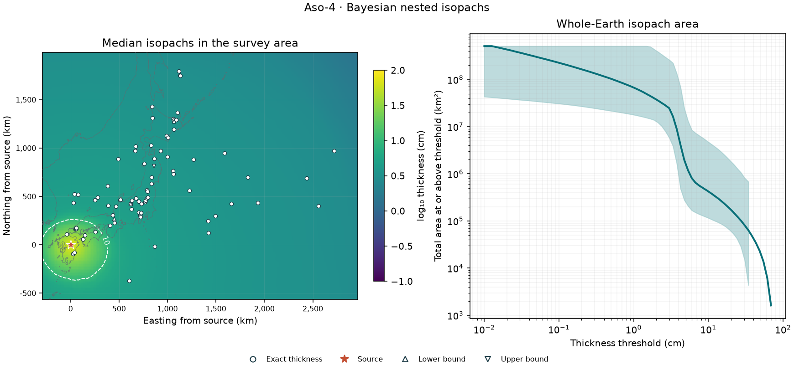
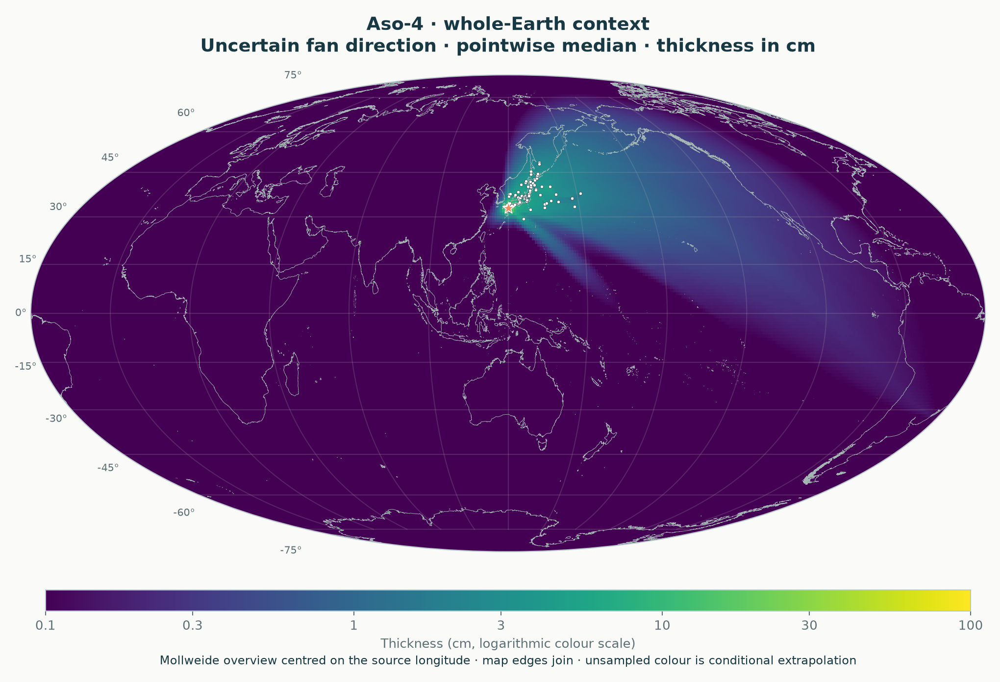
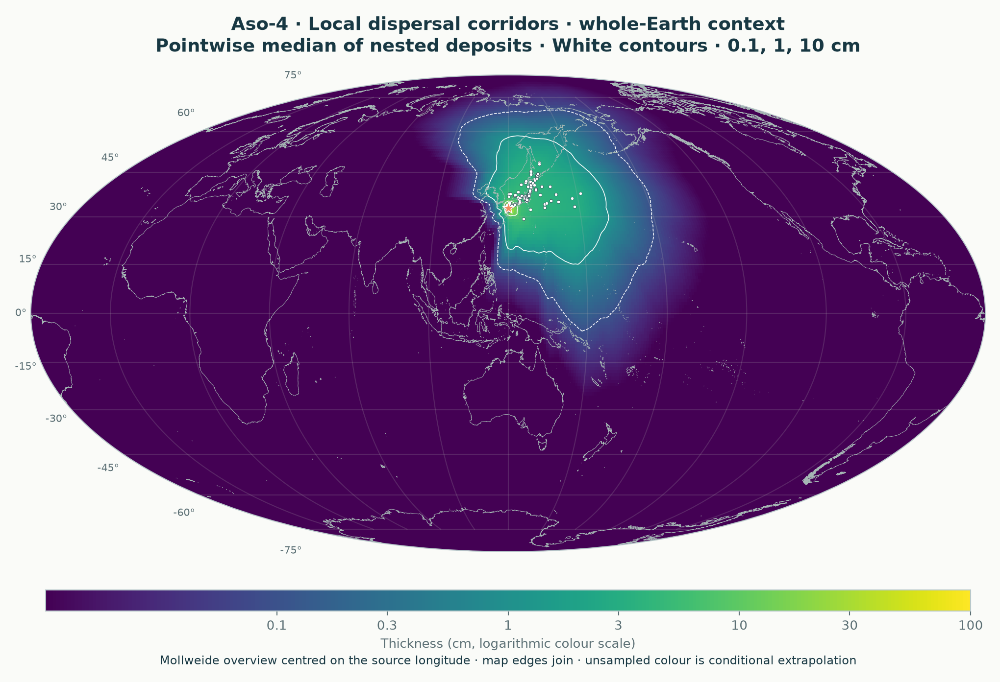
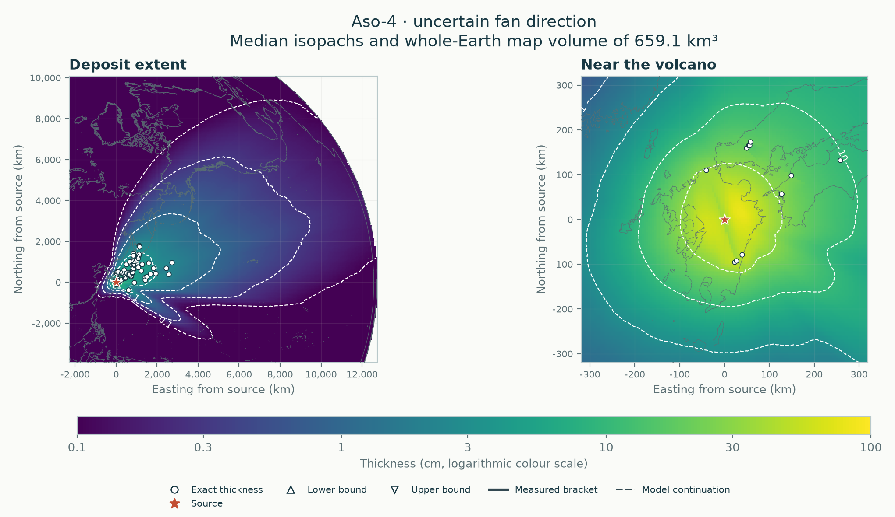

# Aso-4 fallout reconstruction

**Principal Bayesian nested estimate.** The corridor model gives 652.5 km³ of bulk fallout (conditional 95% interval 249.5–9,990.1), compared with 2,513.9 km³ under the whole-area continuation. The western sector has no measured thickness and its median 1 cm footprint changes from 6.32 million to 48,000 km². On a separate test, 28 actual submarine cores were better predicted by the broader fit. [Corridor map, volume and checks](results/nested-isopachs/README.md) · [Full-compass isopachs](results/nested-isopachs/compass.png)

The accepted dataset contains 83 exact measurements, 3 lower bounds and 1 upper bound. The regional fits share an observation hull of 3,482,991 km². [Accepted thickness CSV](../../data/eruptions/Aso-4_reviewed.csv) · [Row-level source audit](../../data/audits/Aso-4/README.md)

In the whole-area sensitivity, the median modeled area above 1 mm covers 44.3% of the Earth. With the farthest fifth of sites withheld, its predictive score worsens from 1.757 to 1.836. That test and the inferred footprint make the 2,514 km³ median a highly extrapolated scenario. The compass-sector test shows what happens when the unknown fan can turn west or south. [Distal and angular sensitivities](results/nested-whole-area/bearing-study/README.md) · [Known-volume and distal holdout tests](../../comparisons/nested-isopachs/whole-area-study.md)

In that whole-area fit, the 1 cm marine bed at MR98-05 St.6PC sets the outermost sampled rank in 70% of draws. Withholding that bed gives 2,439 km³. The large volume persists because the fitted contour shape spreads the sampled centimetre-scale thicknesses over a much broader area. The western sector has no exact measurements and receives a median 12.5% of the modeled volume. [Source-to-core correspondence](../../data/audits/Aso-4/record-review.csv) · [Refit without the controlling core](results/nested-whole-area/edge-deletion/README.md)

Takarada and Hoshizumi reconstructed 590–920 km³ of bulk Aso-4 fallout from manual isopachs on 71 sites. Their reconstruction shares source evidence with this audit. It provides a geological comparison and supplied no prior target. [Original fallout-volume reconstruction](https://www.frontiersin.org/journals/earth-science/articles/10.3389/feart.2020.00170/full)

## Isopach fits

On the nested map, solid contour segments have a local thickness bracket and at least 90% posterior crossing probability. Dashes show conditional continuation. [Corridor estimate, support and uncertainties](results/nested-isopachs/README.md)

All four maps use the same frame, contour levels and thickness scale. Thickness below the first colour-bar tick shares the lowest shade. The dashed line encloses the observation hull. The regional fits stop there. The global fits also show how thickness continues into unsampled ground. On the directional map, solid white segments connect thicknesses bracketed by measured sites in a supported triangle. White dashes on the global maps show conditional isopachs. Gaps inside the hull can still be poorly constrained.

## Volume and predictive performance

| Method | Bulk volume (km³) | Conditional 95% interval (km³) | Held-out score ↓ | 95% coverage |
|---|---|---:|---:|---:|
| GP ensemble | Hull mean **202.65** | 155.87–266.97 | 1.514 | 94.0% |
| Cubic spline | Hull mean **248.15** | 168.43–452.02 | 1.662 | 90.4% |
| [Directional ensemble · uncertain fan direction](results/directional/README.md) | Whole-Earth median map **659.1** · volume median 916.3 | 297.9–3,511.5 | 1.502 | 90.4% |
| [Spherical mixture](results/spherical-mixture/README.md) | Whole-Earth volume median **1,069.7** | 402.9–27,836.6 | 1.632 | 95.2% |
| [Bayesian nested · corridor](results/nested-isopachs/README.md) | Whole-Earth volume median **652.5** | 249.5–9,990.1 | 1.556 † | 91.6% |

The nested corridor assigns a median 4.1% of bulk volume to the retained exact-site triangles and 29.3% beyond the farthest exact site. Its median map integrates to 544.7 km³. 3/4 buffered fits passed their numerical checks. [Whole-area sensitivity](results/nested-whole-area/README.md) · [Paired median isopachs](results/nested-isopachs/paired-isopachs.png) · [Five-family volume and geographic prediction plot](results/overview.png)

A lower negative log predictive score means better prediction across withheld regions. Each region gets equal weight. Coverage is the share of exact held-out observations inside the 95% predictive interval. † A geographic fit had a numerical warning or incomplete scoring.

The directional map integrates pointwise median thickness. Measured interpolation triangles account for **3.8%** of its volume. The directional volume interval comes from complete posterior deposit draws. The spherical mixture reports the median integrated volume across broad and uncertain fan continuations. The regional intervals condition on fitted settings. [Regional maps, fits and diagnostics](results/README.md)

Compare the three whole-Earth maps

| Uncertain fan direction | Spherical mixture | Nested corridor |
|---|---|---|
|  |  |  |

Each map is centred on the vent longitude and has its own thickness key.

With the same observations and structure weights, fixing the fan directions gives a median-map volume of **779.7 km³**.

View the directional deposit extent and source area

## Evidence and limitations

The reviewed input corrects two cruise locations and retains the Biwa source conflict and the Hokkaido erosion interpretation. The nearest accepted site is 88 km from the vent. The southeast, south and west have two, two and zero exact measurements. The large spherical-mixture total remains questioned. In the earlier broad spherical fit, omitting all 28 source-labelled marine records raised its median to about 3,184 km³. A regional deletion also makes the spline partial volume unstable. [Source, geometry and influence experiments](../../comparisons/aso-4-audit/README.md)

The spherical 10 cm footprint contracts to the south, southeast and west. The displaced-kernel map still places its near-source grid maximum southeast of the volcano, away from the closest measurements. Its location and the large upper volume tail depend on extrapolation. The south and southwest 10 cm areas retain numerical warnings. [Near-source spherical map](results/spherical-mixture/source.png) · [Matched isopach areas and known-deposit tests](../../comparisons/spherical-mixture/README.md#where-the-map-changes)

The standard local-support footprint covers 711,348 km². No complete isopach band passed the support and deletion checks. [Support map, partial volumes and rejected contours](results/support/README.md)
