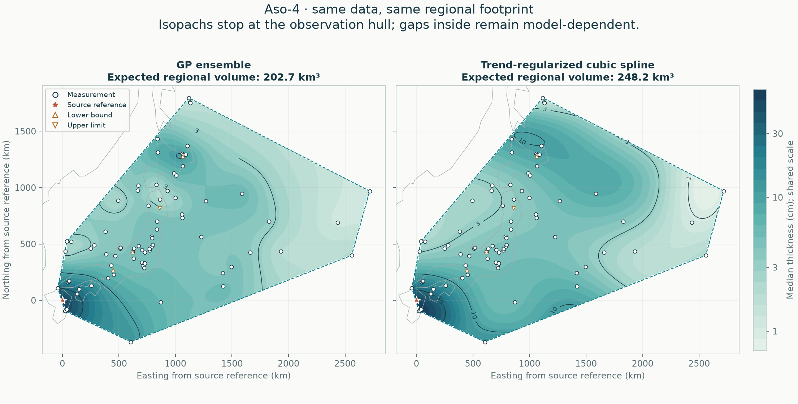
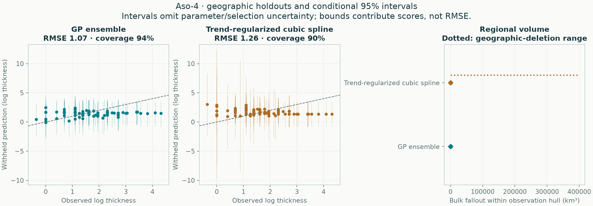

# Aso-4: empirical methods on one regional footprint

All methods use the same accepted observations, geographic holdouts and integration area. No method is designated preferred.

**83 exact measurements, 3 lower bounds, 1 upper limits.** The observation hull covers 3,482,991 km². The automatic validation buffer is 41.74 km.



| Quantity | GP ensemble | Trend-regularized cubic spline |
|---|---:|---:|
| Expected regional bulk fallout (km³) | 202.65 | 248.15 |
| Integral of median thickness surface (km³) | 170.96 | 200.94 |
| Conditional 95% volume interval (km³) | 155.87–266.97 | 168.43–452.02 |
| Outer equal-region negative log score ↓ | 1.514 | 1.662 |
| Outer log-thickness RMSE ↓ | 1.074 | 1.257 |
| Outer 95% observation-interval coverage | 94.0% | 90.4% |

Lower predictive score and RMSE are better. Coverage must be read with interval width and predictive score; wider intervals alone are not improvement.



## Scope

The footprint is the convex hull of measured/bounded locations, with no source point or invented observations added. It can contain large unsampled gaps and can exclude proximal deposits. These are **regional bulk fallout volumes, not total eruption volumes or dense-rock equivalents**. No global extrapolation enters this comparison.

The mean volume integrates expected thickness. The median-surface integral is a separate quantity; it is not the median volume. Volume intervals come from complete correlated surface draws, not sums of pointwise interval endpoints.

## Fitted methods

### GP ensemble

```json
{
  "candidate": {
    "tail": "stacked"
  },
  "components": [
    {
      "weight": 0.8378187849979807,
      "model": {
        "candidate": {
          "tail": "power",
          "length_factor": 0.25,
          "noise_ratio": 0.75
        },
        "beta": [
          3.1489166874013916,
          2.2830849470306083,
          0.2822378176018054,
          0.021870879767620973
        ],
        "radius_scale_km": 897.1034093330701,
        "length_km": 193.4935359781289,
        "amplitude_log": 0.8291423795114937,
        "noise_log": 0.6218567846336203,
        "jitter": 6.874770855019819e-10,
        "trend_on_constraint_boundary": true,
        "uncertainty": "conditional Laplace"
      }
    },
    {
      "weight": 0.16218121500201932,
      "model": {
        "candidate": {
          "tail": "power",
          "length_factor": 0.75,
          "noise_ratio": 0.75
        },
        "beta": [
          3.1489166874013916,
          2.2830849470306083,
          0.2822378176018054,
          0.021870879767620973
        ],
        "radius_scale_km": 897.1034093330701,
        "length_km": 580.4806079343867,
        "amplitude_log": 0.8291423795114937,
        "noise_log": 0.6218567846336203,
        "jitter": 6.874770855019819e-10,
        "trend_on_constraint_boundary": true,
        "uncertainty": "conditional Laplace"
      }
    }
  ],
  "dominant_tail": "power",
  "observation_discrepancy_variance_log": 0.0,
  "trend_on_constraint_boundary": true,
  "uncertainty": "Predictive mixture; includes disagreement among retained candidates, conditional on each fit and estimated weights. Fitted-parameter uncertainty is not integrated."
}
```

### Trend-regularized cubic spline

```json
{
  "method": "spline",
  "candidate": {
    "tail": "power",
    "knot_intervals": 4,
    "tension": 1.0,
    "smoothing": 0.01,
    "trend_strength": 1.0,
    "noise_ratio": 0.75
  },
  "bounds_km": [
    -178.70979458182308,
    -476.9677020899797,
    2855.4377928649897,
    1904.0099657279166
  ],
  "knot_intervals_xy": [
    4,
    3
  ],
  "n_coefficients": 42,
  "noise_log": 0.6148007490204961,
  "amplitude_log": 0.819734332027328,
  "trend_beta": [
    2.924932796414287,
    0.9274117594892165,
    -0.49729932023918755,
    -0.7828052777709201
  ],
  "trend_radius_scale_km": 897.1034093330701,
  "trend_on_constraint_boundary": true,
  "effective_df_exact": 18.89479130474338,
  "newton_decrement": 5.584383097151699e-19,
  "newton_iterations": 2,
  "quadrature_order": 6,
  "uncertainty": "Conditional Laplace",
  "uncertainty_omits": [
    "fitted trend",
    "noise and smoothing estimation",
    "knot/trend selection",
    "sampling and preservation bias",
    "vent location error"
  ],
  "pseudo_observations": 0
}
```

Every explored candidate is retained in the selection tables. All response-dependent choices are retuned within training folds; no hand-placed pseudo-data enter the likelihood.

## Reliability checks

- All probability intervals condition on fitted parameters and selected settings; they omit parameter/selection and preservation/sampling uncertainty.
- Four geographic outer folds evaluate the entire tuning procedure; this is development evidence, not independent external validation.
- Geographic-deletion volume ranges show refitting sensitivity and are not confidence intervals.

## Reproduce and inspect

```sh
tephra-isopachs compare Aso-4 --output results/new-regional-run
```

[Complete numerical report](report.json) · [Withheld predictions](heldout_predictions.csv) · [Accepted observation semantics](accepted_observations.csv) · [Selection tables](selection/README.md)

The JSON records input/source hashes, package versions, all fold memberships, regional integration refinements, conditional-volume sampling precision and geographic-deletion sensitivity. Historical GP global calculations remain separate.

## Which parts are actually supported?

Read the [local support and complete-contour audit](support/README.md) before extrapolating these hull volumes. It screens unsampled gaps, tests closure under geographic deletion, and separates interpolation from proximal/distal assumptions.
