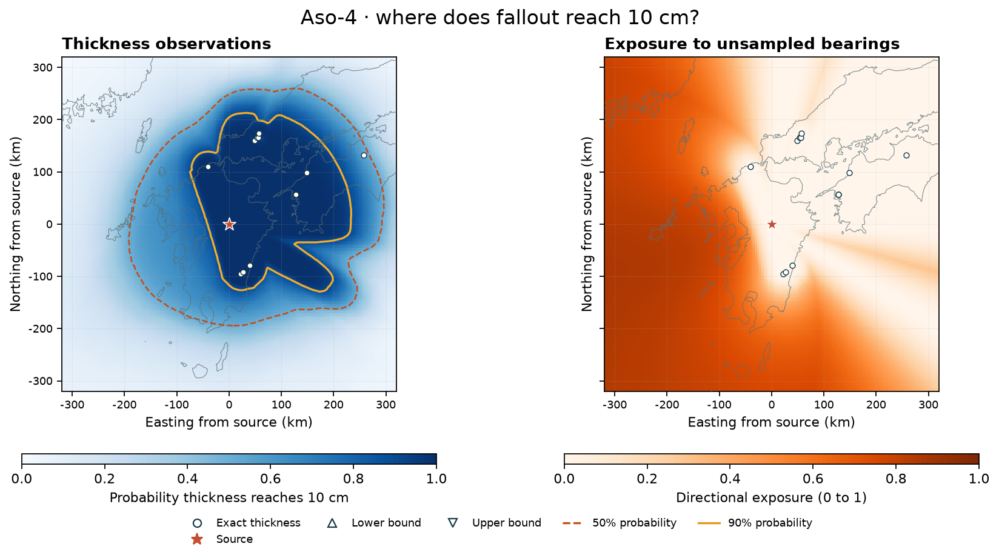

# Aso-4 · Directional ensemble

The principal bulk volume is **661 km³**, the whole-Earth integral of the median-thickness map. The conditional 95% interval for total fallout volume is **293–3.58e+03 km³** across complete posterior draws.

Each circle shows a measurement. Bounded sites take the colour of their stated limit. The curve counts every patch at or above each thickness. The volume also includes thinner fallout beyond the 0.5 cm line. [Thickness and cumulative area](thickness-area.csv) · [Map integral, resolution and source hashes](deposit.json)

The principal map uses the geographic continuation evaluated on all registered eruptions. [Geographic holdouts, structural alternatives and numerical checks](extent/report.json) · [Complete contour decisions](extent/support.json.gz) · [Predictions at withheld observations](extent/heldout.csv.gz)

## Earlier continuation and its diagnostics

The following figures and statistics describe the fitted parent and its broader continuation. The principal estimate and its interval appear above.

## Reach from the volcano

Distances are great-circle kilometres to the first outward crossing on each compass ray. The area columns give the entire 10 cm footprint in the corresponding 45° sector, including detached areas. Together they distinguish a long point on a contour from an entire broad lobe.

| Bearing | Fixed 10 cm reach (km) | Uncertain 10 cm reach (km) | Fixed ≥10 cm area (km²) | Uncertain ≥10 cm area (km²) |
|---|---:|---:|---:|---:|
| N | 249.7 | 248.9 | 24,521 | 22,755 |
| NE | 301.6 | 300.9 | 35,173 | 35,173 |
| E | 292.3 | 292.5 | 32,061 | 31,591 |
| SE | 241.8 | 229.9 | 23,681 | 22,187 |
| S | 218.1 | 194.2 | 18,765 | 14,733 |
| SW | 231.8 | 199.1 | 20,339 | 15,454 |
| W | 218.8 | 189.1 | 19,026 | 14,152 |
| NW | 214.4 | 191.9 | 18,041 | 14,442 |

The 50% and 90% probability lines answer different questions. At a location on the 90% line, nine in ten model draws reach 10 cm. These are pointwise probabilities conditional on the model. Joint confidence over an entire region requires a different calculation.

## Withheld observations

Each row averages negative log predictive scores over equally weighted folds. Lower scores predict the withheld thicknesses and limits better. The passing-only columns exclude numerical failures. Coverage counts exact withheld thicknesses inside the uncertain-direction 95% predictive interval. A dash marks an unavailable score or coverage.

| Deletion | All estimable folds | Fixed | Uncertain | Passing folds | Fixed, passing | Uncertain, passing | Exact-site 95% coverage |
|---|---:|---:|---:|---:|---:|---:|---:|
| Geographic regions | 4 | 1.500 | 1.502 | 4 | 1.500 | 1.502 | 75/83 (90.4%) |
| Source quadrants | 3 | 1.302 | 1.566 | 3 | 1.302 | 1.566 | 78/83 (94.0%) |

[Predictions for every estimable held-out site](azimuth/heldout.csv). The numerical record includes all planned folds, row identities, unscorable directions, fit warnings and phase-integration checks.

## Checks and reproducibility

The shared contour audit found eligible bands under none of the screened support policies. Audit status is completed. [All contour decisions and deletion failures](azimuth/complete-contour-audit.json)

The spatial integration check passed at 8,192 points per scramble. The map used up to 64 posterior draws per chain and structure. Resolved contour areas passed the split-packet check. The joint-volume quantiles passed the split check.

All six full fits passed their sampling diagnostics.

[Numerical report, all sector volumes and sensitivities](azimuth/report.json) · [Complete fields and per-field volumes](azimuth/fields.npz) · [Principal map grids](azimuth/median-grids.npz) · [Near-source comparison grids](azimuth/map-grid.npz) · [Fragment decisions](azimuth/fragment-decisions.csv) · [Bracketed coordinates](azimuth/bracketed-fragments.csv) · [File hashes](azimuth/artifacts.json)

## Related directional studies

- [Earlier fixed-direction ensemble and its separate calibration](ensemble/README.md)
- [Single-structure and proximal-cap sensitivities](single-structure/README.md)
