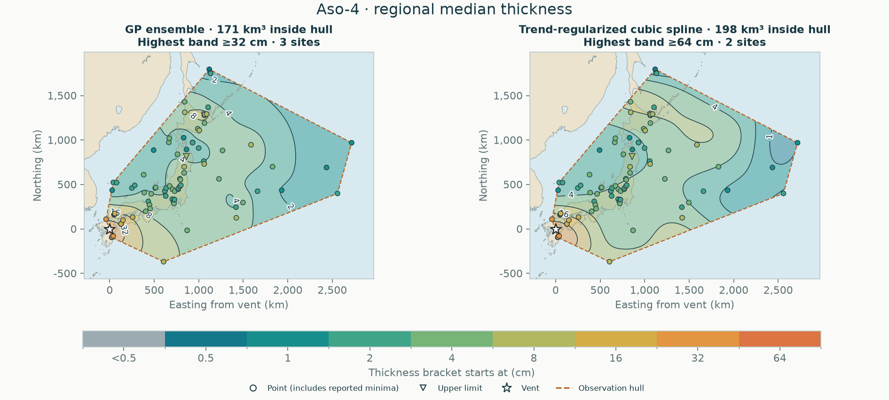
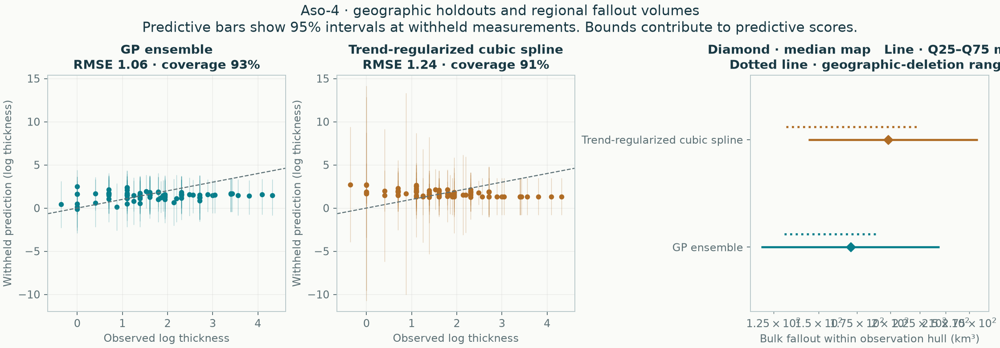

# Aso-4: empirical methods on one regional footprint

All methods use the same accepted observations, geographic holdouts and integration area. No method is designated preferred.

**83 reported measurements and 3 reported minima fitted as points, 0 lower-censored fits, 1 upper limits.** The observation hull covers 3,482,991 km². The automatic validation buffer is 41.74 km.



The full observation hull and every accepted location are in view. The coloured field is clipped to the exact hull; fine coastlines are context only. [Map frame and rendering provenance](map-display.json).

| Quantity | GP ensemble | Trend-regularized cubic spline |
|---|---:|---:|
| Principal median-map volume inside hull (km³) | 170.56 | 198.18 |
| Integrated Q25–Q75 thickness (km³) | 119.01–243.75 | 143.84–284.53 |
| Outer equal-region negative log score ↓ | 1.531 | 1.694 |
| Outer log-thickness RMSE ↓ | 1.062 | 1.236 |
| Outer 95% observation-interval coverage | 93.0% | 90.7% |

Lower predictive score and RMSE are better. Coverage must be read with interval width and predictive score; wider intervals alone are not improvement.



## Scope

The footprint is the convex hull of measured/bounded locations, with no source point or invented observations added. It can contain large unsampled gaps and can exclude proximal deposits. These are **regional bulk fallout volumes, not total eruption volumes or dense-rock equivalents**. No global extrapolation enters this comparison.

Volume integrates pointwise median thickness over the observation hull. The endpoints integrate the pointwise 25th and 75th percentiles of latent thickness over that same area. [Band integrals and refinements](thickness-bands.json)

## Fitted methods

### GP ensemble

```json
{
  "candidate": {
    "tail": "stacked"
  },
  "components": [
    {
      "weight": 0.7533609305807553,
      "model": {
        "candidate": {
          "tail": "power",
          "length_factor": 0.25,
          "noise_ratio": 0.75
        },
        "beta": [
          3.1257559640785395,
          2.1138683325114735,
          0.11333674553982405,
          0.010979595790359708
        ],
        "radius_scale_km": 893.0491392095195,
        "length_km": 192.69389449546503,
        "amplitude_log": 0.8265009504420722,
        "noise_log": 0.6198757128315542,
        "jitter": 6.831038210816488e-10,
        "trend_on_constraint_boundary": true,
        "uncertainty": "conditional Laplace"
      }
    },
    {
      "weight": 0.2466390694192448,
      "model": {
        "candidate": {
          "tail": "power",
          "length_factor": 0.75,
          "noise_ratio": 0.75
        },
        "beta": [
          3.1257559640785395,
          2.1138683325114735,
          0.11333674553982405,
          0.010979595790359708
        ],
        "radius_scale_km": 893.0491392095195,
        "length_km": 578.0816834863951,
        "amplitude_log": 0.8265009504420722,
        "noise_log": 0.6198757128315542,
        "jitter": 6.831038210816488e-10,
        "trend_on_constraint_boundary": true,
        "uncertainty": "conditional Laplace"
      }
    }
  ],
  "dominant_tail": "power",
  "observation_discrepancy_variance_log": 0.0,
  "trend_on_constraint_boundary": true,
  "uncertainty": "Predictive mixture; includes disagreement among retained candidates, conditional on each fit and estimated weights. Fitted-parameter uncertainty is not integrated."
}
```

### Trend-regularized cubic spline

```json
{
  "method": "spline",
  "candidate": {
    "tail": "power",
    "knot_intervals": 4,
    "tension": 1.0,
    "smoothing": 0.01,
    "trend_strength": 1.0,
    "noise_ratio": 0.75
  },
  "bounds_km": [
    -178.70979458182308,
    -476.9677020899797,
    2855.4377928649897,
    1904.0099657279166
  ],
  "knot_intervals_xy": [
    4,
    3
  ],
  "n_coefficients": 42,
  "noise_log": 0.6118375092648268,
  "amplitude_log": 0.8157833456864357,
  "trend_beta": [
    2.8915080972073652,
    0.8917135652879792,
    -0.5193811559417344,
    -0.7248410266746805
  ],
  "trend_radius_scale_km": 893.0491392095195,
  "trend_on_constraint_boundary": true,
  "effective_df_exact": 19.069764472939944,
  "newton_decrement": 4.7153635238729614e-27,
  "newton_iterations": 2,
  "quadrature_order": 6,
  "uncertainty": "Conditional Laplace",
  "uncertainty_omits": [
    "fitted trend",
    "noise and smoothing estimation",
    "knot/trend selection",
    "sampling and preservation bias",
    "vent location error"
  ],
  "pseudo_observations": 0
}
```

Every explored candidate is retained in the selection tables. All response-dependent choices are retuned within training folds; no hand-placed pseudo-data enter the likelihood.

## Reliability checks

- All probability intervals condition on fitted parameters and selected settings; they omit parameter/selection and preservation/sampling uncertainty.
- Four geographic outer folds evaluate the entire tuning procedure; this is development evidence, not independent external validation.
- Geographic-deletion volume ranges show refitting sensitivity and are not confidence intervals.

## Reproduce and inspect

```sh
tephra-isopachs compare Aso-4 --output results/new-regional-run
```

[Complete numerical report](report.json) · [Withheld predictions](heldout_predictions.csv) · [Accepted observation semantics](accepted_observations.csv) · [Selection tables](selection/README.md)

The JSON records input/source hashes, package versions, all fold memberships, regional integration refinements, conditional-volume sampling precision and geographic-deletion sensitivity. Historical GP global calculations remain separate.

## Which parts are actually supported?

Read the [local support and complete-contour audit](support/README.md) before extrapolating these hull volumes. It screens unsampled gaps, tests closure under geographic deletion, and separates interpolation from proximal/distal assumptions.
