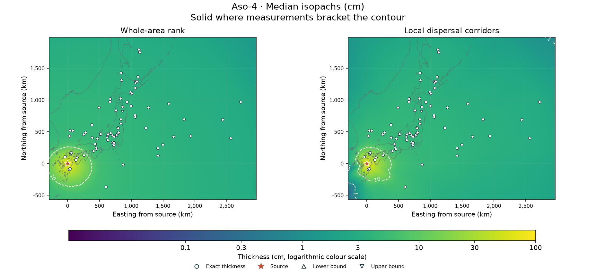
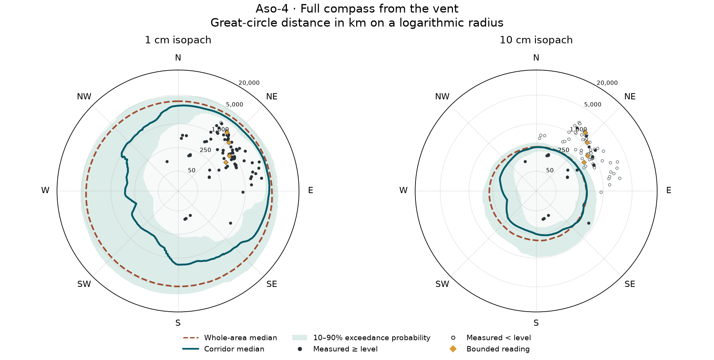

# Aso-4 · Geographic reach of nested isopachs

The conditional bulk fallout estimate is **652.5 km³** (95% interval **249.5–9,990.1**). The median thickness map integrates to 544.7 km³. The earlier whole-area rank gives 2,513.9 km³ (648.8–15,969.9).

Solid portions cross a retained triangle with thicknesses on either side at distinct measured sites and at least 90% posterior crossing probability. Dashed portions depend on the continuation. The triangles diagnose spatial coverage. The shared contour screen also checks thickness bracketing and deletion stability. [Whole-Earth field](world.png) · [Every local bracket](local-brackets.csv.gz) · [Complete contour checks](support.json)

The buffered geographic score is 1.556, compared with 1.540 previously. Lower scores indicate better predictions at withheld sites. 3 of 4 geographic fits passed their sampling checks. The full-data proposal and importance check passed, the final volume populations passed, and the integration check passed. The shared screen accepted a complete contour band under 0 policies. [Prediction scores and row identities](report.json) · [Full fit diagnostics](full.json)

## Where the volume lies

The full-compass view includes all bearings through the antipode. Its logarithmic distance scale makes the proximal flanks visible. Areas in the table use the physical equal-area integral.

| Compass sector | Exact sites | Bounded sites | Old 1 cm area (km²) | Revised 1 cm area (km²) | Revised volume (km³), median [95%] |
|---|---:|---:|---:|---:|---:|
| N | 8 | 0 | 4,859,178 | 2,237,534 | 84.7 [21.1–748.6] |
| NE | 60 | 4 | 5,661,925 | 4,253,288 | 153.7 [93.9–780.1] |
| E | 11 | 0 | 7,852,889 | 5,127,468 | 184.5 [88.9–1,032.4] |
| SE | 2 | 0 | 10,464,919 | 1,913,533 | 112.7 [17.2–1,601.3] |
| S | 2 | 0 | 9,962,320 | 442,462 | 34.1 [2.9–1,796.6] |
| SW | 0 | 0 | 8,021,379 | 58,336 | 6.3 [0.5–1,717.6] |
| W | 0 | 0 | 6,319,337 | 48,254 | 5.4 [0.3–1,347.0] |
| NW | 0 | 0 | 5,163,476 | 244,672 | 22.3 [1.9–1,007.5] |

At 1 cm, the two median maps enclose 58,305,423 and 14,325,546 km² across Earth. Of these, 57,600,434 and 13,620,556 km² fall outside the retained exact-site triangles. An unsampled sector can contain ash. Its allocation depends on the assumed continuation.

The prior assigns 25% to continuation across all bearings. The remaining probability spans three fan widths and three down-range extensions. The fitted probability of whole-bearing continuation is 25.0%. The widths and extensions are shared structural assumptions. A bound supplies a likelihood event. Only positive evidence supplies a potential dispersal corridor.

[Volume and sector draws](volume-budget.npz) · [Complete field draws](full.npz) · [Areas, assumptions, bounds and diagnostics](report.json)

## Structural uncertainty

| Prior probability of broad continuation | Median bulk volume, km³ [conditional 95%] |
|---:|---:|
| 10% | 559.3 [246.1–4,976.9] |
| 25% | 652.5 [249.5–9,990.1] |
| 50% | 1,030.0 [258.8–14,616.6] |
| 75% | 1,676.8 [278.0–15,558.3] |

The prior odds vary under the same observed likelihood. The numerical report also gives the volume by individual corridor law where the saved draws resolve it.
