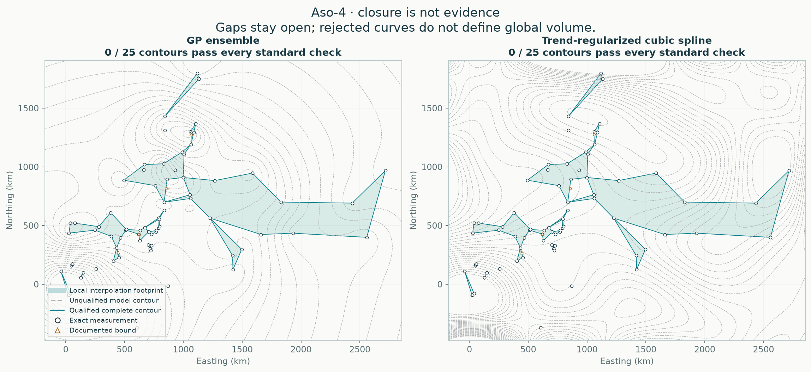

# Aso-4: which parts of the deposit are supported?

**A closed or smooth isopach is not sufficient evidence for its enclosed area or a global volume.** This audit applies the same geometric screen to both model families, then checks their contours separately. It does not change the observations or refit to pseudo-data.

## Local interpolation volumes

The common footprint keeps well-connected triangles between exact measurement sites and removes long bridges and thin triangles. Its holes remain holes. Bounds still enter both model likelihoods, but do not count as exact thickness sites for this geometric screen.

| Policy | Area (km²) | Method | Expected bulk volume (km³) | Median-surface integral (km³) | Deletion range (km³) |
|---|---:|---|---:|---:|---:|
| strict | 283,821 | GP ensemble | 8.25 | 7.17 | 7.43–10.03 |
| strict | 283,821 | Trend-regularized cubic spline | 7.64 | 7.04 | 9.77–192551.23 |
| standard | 711,348 | GP ensemble | 27.94 | 23.97 | 21.65–31.18 |
| standard | 711,348 | Trend-regularized cubic spline | 26.90 | 25.15 | 27.83–192882.17 |
| permissive | 1,393,308 | GP ensemble | 58.66 | 50.14 | 46.43–64.68 |
| permissive | 1,393,308 | Trend-regularized cubic spline | 59.03 | 54.12 | 54.51–302133.85 |

These are **partial bulk fallout volumes**, not complete eruption volumes, dense-rock equivalents or certified lower bounds. The footprint depends on the sampling design and an explicit spacing rule. The three policies are sensitivity analyses; their range and the four geographic-deletion values are **not confidence intervals**. The median-surface integral is not the median of total volume.

## Complete-contour gate

Every candidate must close without touching the calculation boundary, have its entire perimeter inside the local footprint, be bracketed by at least three distinct exact sites on each required side, converge under map refinement, and remain closed and shape-stable after each of four fully retuned geographic deletions. All islands and holes count. A usable band also needs three consecutive qualifying contours spanning at least a factor of two in thickness, with no unsupported area between them.

| Method | Policy | Passing contours / 25 | Usable bands | Extension status |
|---|---|---:|---:|---|
| GP ensemble | strict | 0 / 25 | 0 | no_supported_stable_band |
| GP ensemble | standard | 0 / 25 | 0 | no_supported_stable_band |
| GP ensemble | permissive | 0 / 25 | 0 | no_supported_stable_band |
| Trend-regularized cubic spline | strict | 0 / 25 | 0 | no_supported_stable_band |
| Trend-regularized cubic spline | standard | 0 / 25 | 0 | no_supported_stable_band |
| Trend-regularized cubic spline | permissive | 0 / 25 | 0 | no_supported_stable_band |

Eligibility is a conservative development rule, not a 95% confidence statement. Spacing factors 1.5, 2 and 3 and deletion-shape tolerances 10%, 25% and 50% are fixed for every eruption. A 49-level sensitivity is recorded in the JSON. No failing threshold is relaxed for a particular eruption.

## Extrapolation and pseudo-data

No preferred global volume is reported by this audit. Where a band qualifies, its geographic volume is integrated directly, with a separate layer-cake check; endpoint-matched proximal and distal continuations are conditional scenarios only. Nonintegrable power tails are refused rather than cut off at an arbitrary distance. Where no band qualifies, no continuation is fitted.

The existing spline trend/derivative penalties regularize unsampled space; their numerical quadrature is not extra evidence. Neither those penalties nor GP mean reversion validate closure. Missing sites are not zeros, predictions are not observations, and multiple curves derived from one surface are not independent data.

## Withheld checks and numerical limitations

- GP ensemble: 3 exact outer-test sites inside training-only support; 80 outside. See the JSON for separate errors/coverage and row identities; sparse strata do not establish calibration.
- Trend-regularized cubic spline: 3 exact outer-test sites inside training-only support; 80 outside. See the JSON for separate errors/coverage and row identities; sparse strata do not establish calibration.

The contour gate uses fitted responses and model deletion stability. Its selected band has no selection-adjusted confidence interval. Geographic holdouts test prediction at observed sites, not an unobserved distal tail. Even smooth positive finite-mass fields can agree at every sampled site yet have arbitrarily different missing volume.

[Every contour and rejection reason](contour_audit.csv) · [Full numerical and provenance record](report.json) · [Original matched-hull comparison](../README.md)
