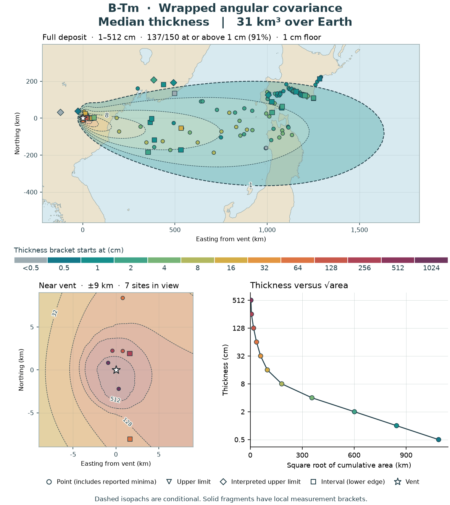
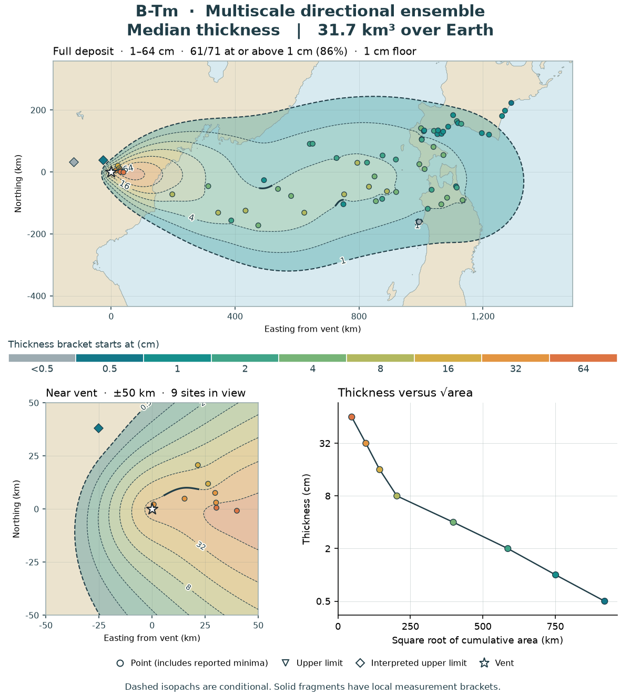
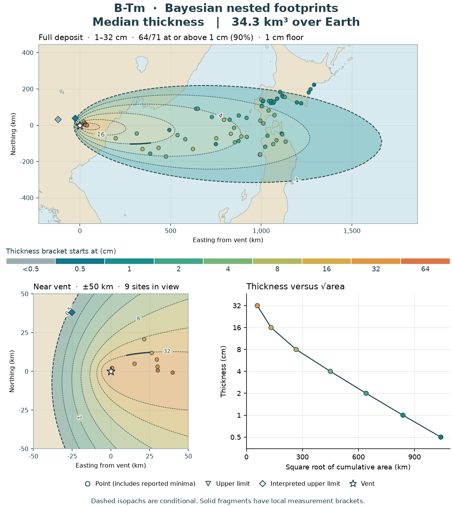

# 946 CE Millennium Eruption (B-Tm)

[Principal input maps and numbered detail plates](observations/README.md)

The current principal dataset contains **150 localities** for total fallout from both phases. It includes the widespread upper fallout that Sun et al. (2017) originally assigned to later eruptions. The source classifications are 75 measurements, 34 lower-only bounds, 28 intervals and 13 upper bounds. The fitting input uses every reported minimum as a point, and preserves paired interval endpoints and upper censoring. [Second field audit](../../data/audits/B-Tm/two-phase/README.md) · [Reported observations](../../data/eruptions/B-Tm_two_phase.csv) · [Fitting input](../../data/eruptions/B-Tm_two_phase_minimum_fit.csv)

The revised field record includes two rim minima of 1,500 and 1,200 cm, separate Tianwen exposures of about 150 cm and 385–475 cm, and a southern section bounded at 80–90 cm. Pan’s 70 m southern-summit exposure is documented with its field photographs and its sector location. The audit records the separate 70 m northern-rim report, six additional peatland profiles and newly traced marine, coastal and archaeological sections. [Numbered source figures](../../data/audits/B-Tm/two-phase/figures/README.md) · [Site decisions](../../data/audits/B-Tm/two-phase/sites.csv) · [Thicknesses with unresolved station positions](../../data/audits/B-Tm/two-phase/unlocated-thicknesses.csv)

[Wrapped angular covariance at three scales](results/two-phase-2026-11-26/wrapped-angular-covariance/three-scales.png) · [Geological review and matched validation](../../comparisons/wrapped-angular-covariance/evidence.md)

## Volumes and geographic prediction

Each estimate integrates the median thickness on its map. The conditional range integrates the pointwise 25th and 75th percentiles of thickness over the same area. The 50% probability refers to thickness at each location. A single probability for total volume does not follow from these endpoints.

| Method | Integration area | Median map (km³) | Q25–Q75 thickness maps (km³) | Held-out score ↓ | 95% predictive coverage |
|---|---|---:|---:|---:|---:|
| [Wrapped angular covariance](results/two-phase-2026-11-26/wrapped-angular-covariance/README.md) | whole Earth | **31** | 20.9–44.4 | 1.407 | 95.8% |

Lower scores indicate better geographic prediction. Coverage counts held-out measurements and reported minima fitted as points. A dagger marks a fit, integration or validation warning.

## Full deposits and near-vent detail

Each full map follows the thickest power-of-two contour enclosing at least 95% of the fitted locations, with a 1 cm minimum. The title gives the actual count, including when that minimum prevents 95% coverage. Global volumes include the thinner tail. The innermost line is the thickest doubling level enclosing an accepted location. The near-vent window expands from the proximal sites until eligible contours are visible. The curve sums all patches at each displayed thickness.

## Published reconstructions of the preceding 71-locality edition

The 150-locality input is registered for future calculations. All maps, volumes and scores below were fitted to the 71-locality input published on 25 November 2026, SHA-256 `c7698d6b6ecbe7d0fe18b5ccc4a6cb180f78bcb61f168dce3bda8e1a51ba928a`. [Immutable case release](https://github.com/siyulai21/tephra-fallout-isopachs/tree/d115f2a699870c826752fd26b0b4d86ff42130f8/eruptions/b-tm)

The four reconstructions use the same 71 accepted fallout localities. Field reports give 64 measured thicknesses, 3 lower limits, 4 upper limits and 0 two-sided ranges. Each lower limit enters the fit as a point at its reported value, including the 2 beyond 25 km. Upper limits and ranges retain their respective one-sided and two-sided probabilities. [71-locality source audit](../../data/audits/B-Tm/README.md#preceding-71-locality-cryptotephra-edition) · [Reported table](../../data/eruptions/B-Tm_cryptotephra.csv) · [Fitting table](../../data/eruptions/B-Tm_cryptotephra_minimum_fit.csv)

The site table pairs each source classification with its fitting value, geographic fold, mapped thickness and held-out score. It includes the predictive median or cumulative probability at the site value where the method saves it. A fitted minimum can underestimate total fallout at an incomplete section. [Reported and fitted sites](results/minimum-fit-2026-11-25/reported-and-fitted-sites.csv) · [Changes by method and coverage by source type](results/minimum-fit-2026-11-25/minimum-fit-comparison.csv) · [Fitting convention](../../docs/methods/reported-minimum-fitting.md)

## Volumes and geographic prediction

Each estimate integrates the median thickness on its map. The conditional range integrates the pointwise 25th and 75th percentiles of thickness over the same area. The 50% probability refers to thickness at each location. A single probability for total volume does not follow from these endpoints.

| Method | Integration area | Median map (km³) | Q25–Q75 thickness maps (km³) | Held-out score ↓ | 95% predictive coverage |
|---|---|---:|---:|---:|---:|
| GP ensemble | observation hull | **24.4** | 19.4–30.7 | 1.485 | 89.6% |
| Cubic spline | observation hull | **51.5** | 32.3–91.2 | 4.184 | 82.1% |
| [Multiscale directional ensemble](results/minimum-fit-2026-11-25/directional/README.md) | whole Earth | **31.7** | 21.3–48.2 | 1.414 | 94.0% |
| [Bayesian nested footprints](results/minimum-fit-2026-11-25/nested-isopachs/README.md) | whole Earth | **34.3** | 27.7–43.4 | 1.362 | 94.0% |

Lower scores indicate better geographic prediction. Coverage counts held-out measurements and reported minima fitted as points. A dagger marks a fit, integration or validation warning.

## Full deposits and near-vent detail

Each full map follows the thickest power-of-two contour enclosing at least 95% of the fitted locations, with a 1 cm minimum. The title gives the actual count, including when that minimum prevents 95% coverage. Global volumes include the thinner tail. The innermost line is the thickest doubling level enclosing an accepted location. The near-vent window expands from the proximal sites until eligible contours are visible. The curve sums all patches at each displayed thickness.

## Inside the observation hull

The GP and spline integrate over the dashed hull. Gaps inside it can still be poorly constrained. [Regional fits and numerical checks](results/minimum-fit-2026-11-25/README.md)

## Nested geometry and field agreement

The proximal contours now turn and tighten towards the northwest instead of carrying thick ash far upwind as nearly parallel rounded fronts. Their eccentricity and unequal spacing evolve continuously into the eastward fan; the full view shows the compact proximal structure as part of that fan rather than as a separate circular cap. The distal axis bends slightly southeast, and the thinner southern and eastern contours extend farther. This is a redistribution of supported and conditional thickness, not uniform shrinkage of the deposit. The contours remain connected and ordered, without artificial lobe seams.

The Quanyang interpreted upper bound improves from a log event probability of −5.545 to −0.607, and Longgang from −0.989 to −0.019. Neither is exceeded by the final median. The other two upper limits remain satisfied. Across all bounds the negative log probability improves from 1.641 to 0.166. Median absolute measured log error improves from 0.522 to 0.420, while measured RMSE worsens from 0.759 to 0.788, including greater overprediction at Oga-san. Geographic score is essentially unchanged (1.357 to 1.362). The joint posterior fallback resolves the fourth fold's numerical disagreement; its failed particle refinements remain in the record. The independent three-site survey score improves, but that separate revised training fit retains a numerical warning at the common auxiliary ceiling.

[Three-scale comparison, site identities and contour diagnostics](../../comparisons/nested-isopachs/adaptive-growth/visual-review.md#b-tm)

## Evidence and checks

[Matched predictions by locality](results/minimum-fit-2026-11-25/geographic-site-validation.csv) · [Numerical checks and file identities](results/minimum-fit-2026-11-25/release.json) · [Regional support](results/minimum-fit-2026-11-25/support/README.md) · [Whole-area sensitivity](results/minimum-fit-2026-11-25/nested-whole-area/README.md)

[Previous maps and geological assessment](previous-minimum-treatment.md) · [Change at all distances across eruptions](../../comparisons/reported-minima/README.md)
