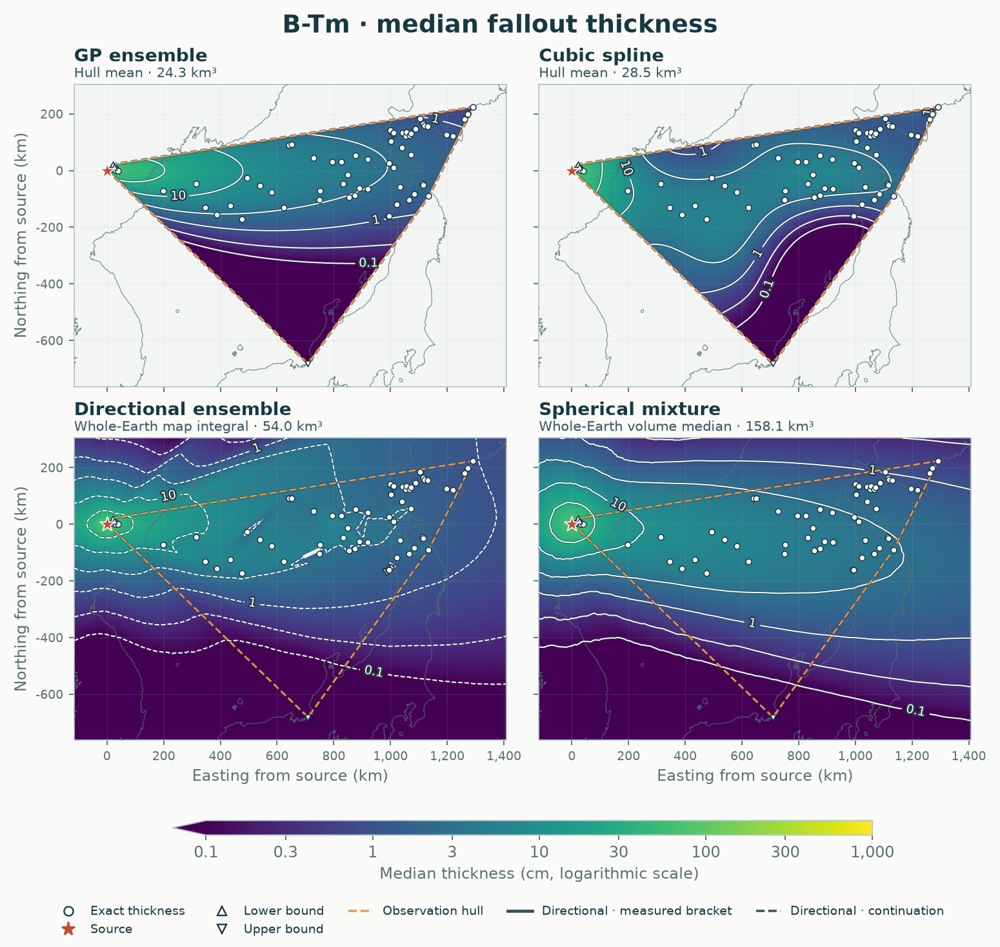
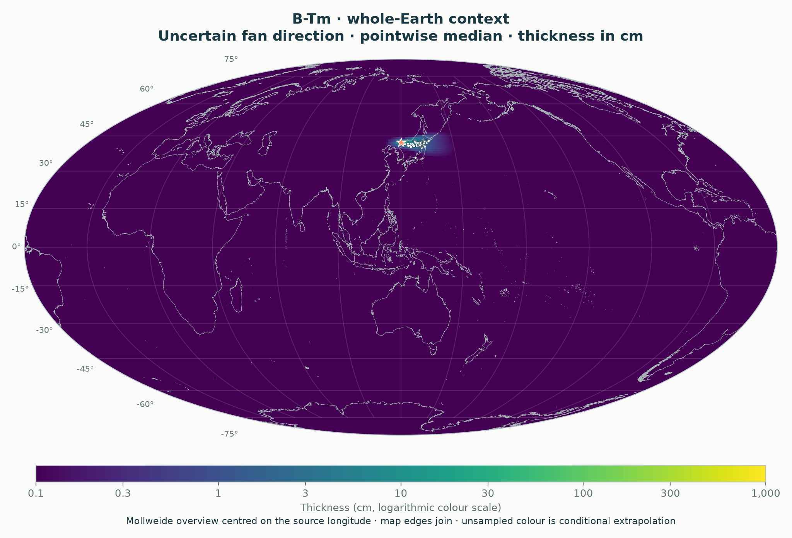

# B-Tm fallout reconstruction

**Geographic reach of nested isopachs.** Limiting the lateral and down-range reach of each positive site gives 35.9 km³ of bulk fallout (conditional 95% interval 26.6–50.2), compared with 90.4 km³ under the whole-area continuation. Predicting the three interpreted upper limits from the other 68 rows strongly favors finite reach. At Lake Sihailongwan the withheld event probability rises from 0.18% to 97.85%. The full-data proposal retained a numerical warning. [Paired maps, volumes and checks](results/nested-reach/README.md) · [Full-compass isopachs](results/nested-reach/compass.png)

The 946 CE Millennium eruption of Paektu / Changbaishan deposited fallout in two phases. The four families fit their combined airborne deposit using **64 measured thicknesses, three reported lower bounds, one reported upper bound and three interpreted upper bounds**. The gold diamonds locate the interpreted cores. [Accepted observations](../../data/eruptions/B-Tm_cryptotephra.csv) · [Source descriptions and calculations](../../data/audits/B-Tm/README.md)

The principal uncertain-direction median map integrates to **33.6 km³**. At Lake Sihailongwan, west of the volcano, its median thickness falls from **8.02 cm to 0.0146 cm**. The conditional limits used at Sihailongwan, Quanyang and Kushu are 0.06, 0.64 and 0.45 cm. The peat and lakes require different transfer assumptions. [Before-and-after contours, weaker assumptions and the independent marine check](results/cryptotephra/README.md)

## Five fits with interpreted archive limits

All four maps use the same frame, contour levels and thickness scale. Thickness below the first colour-bar tick shares the lowest shade. The dashed line encloses the observation hull. The regional fits stop there. The global fits also show how thickness continues into unsampled ground. On the directional map, solid white segments connect thicknesses bracketed by measured sites in a supported triangle. White dashes on the global maps show conditional isopachs. Gaps inside the hull can still be poorly constrained.

## Volume and predictive performance

| Method | Bulk volume (km³) | Conditional 95% interval (km³) | Held-out score ↓ | 95% coverage |
|---|---|---:|---:|---:|
| GP ensemble | Hull mean **29.59** | 18.88–46.13 | 1.459 | 89.1% |
| Cubic spline | Hull median map **50.75** · volume median 64.64 · unstable mean 6.1e+11 | 33.03–664.44 | 4.295 | 75.0% |
| [Directional ensemble · uncertain fan direction](results/directional/README.md) | Whole-Earth median map **33.6** · volume median 37.2 | 23.5–77.1 | 1.243 † | 93.8% |
| [Spherical mixture](results/spherical-mixture/README.md) | Whole-Earth volume median **47.0** | 30.2–275.5 | 1.487 † | 93.8% |
| [Bayesian nested isopachs](results/nested-isopachs/README.md) | Whole-Earth volume median **90.4** | 52.0–534.5 | 1.570 | 93.8% |

[Nested median isopachs and the area–thickness curve](results/nested-isopachs/isopachs.png) · [Nested whole-Earth map](results/nested-isopachs/world.png) · [Nested sensitivity in poorly sampled bearings](results/nested-isopachs/bearing-study/README.md) · [Uncertain gap amount](results/directional/sensitivity-study/README.md) · [Soft source displacement](results/spherical-mixture/sensitivity-study/README.md)

The nested estimate puts a median 4.9% of the fallout volume inside the retained exact-site triangles and 21.7% beyond the farthest exact measurement. 4/4 geographic refits passed the independent-population check.

A lower negative log predictive score means better prediction across withheld regions. Each region gets equal weight. Coverage is the share of exact held-out observations inside the 95% predictive interval. † A geographic fit had a numerical warning or incomplete scoring.

The directional map integrates pointwise median thickness. Measured interpolation triangles account for **13.9%** of its volume. The directional volume interval comes from complete simulated deposits. The spherical mixture reports the median integrated volume across broad and uncertain fan continuations. The regional intervals condition on fitted settings. [Regional maps, fits and diagnostics](results/README.md)

Compare the two whole-Earth maps

| Uncertain fan direction | Spherical mixture |
|---|---|
|  |  |

Both maps use the vent longitude as their central meridian. Read the thickness key under each map.

With the same observations and structure weights, fixing the fan directions gives a median-map volume of **34.6 km³**.

View the directional deposit extent and source area

## Directional assumptions

Both fits include the same interpreted archive limits. The measured-fan sensitivity fixes the directions of the continuation to the sampled bearings.

| Fan direction | Evidence assumption | Median-map volume (km³) | Complete-deposit median (km³) | Conditional 95% interval (km³) |
|---|---|---:|---:|---:|
| Measured fan directions | Thicknesses and bounds | 34.2 | 36.9 | 23.6–62.7 |

View agreement between the directional sensitivities

[Measured-fan maps, held-out tests and site evidence](results/directional/bearing/README.md)

## Evidence, coverage and history

The exact sites define a standard interpolation footprint of 96,131 km². The three bounds constrain the likelihood across the larger 796,162 km² observation hull. The complete global field also includes deposits in unsampled ground. [Footprint and support decisions](results/support/README.md) · [How an occurrence without a measured bed can constrain a fit](../../docs/methods/sites-without-measured-thickness.md)

The spline's arithmetic mean is dominated by an extremely uncertain area near Suigetsu. Geographic cross-validation and 20,000 complete-surface draws quantify the effect. [Spline analysis and other sensitivities](results/cryptotephra/README.md#regional-footprint-and-the-splines-upper-tail) · [Archived 68-site fit](../../archive/2026-11-19-b-tm-thickness-only/README.md)
