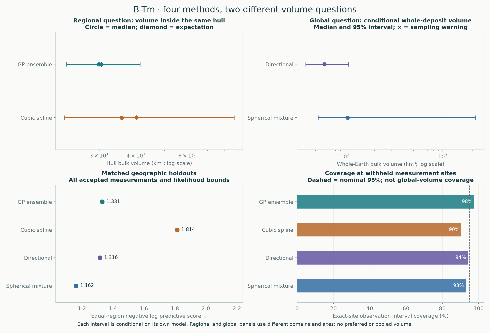

# B-Tm fallout reconstruction

The accepted dataset contains 84 exact measurements. The regional fits share an observation hull of 963,645 km². [Accepted thickness CSV](../../data/eruptions/B-Tm_tephra.csv) · [Input provenance](../../data/eruptions/README.md)

## Bulk fallout volume

| Model | Area | Volume summary (km³) | Conditional 95% volume interval (km³) |
|---|---|---:|---:|
| [Directional ensemble](results/directional/README.md) | Whole Earth | Median-map integral **59.3** · complete-field median 71.0 | 42.2–410.0 |
| [Spherical mixture](results/spherical-mixture/README.md) | Whole Earth | Posterior median **106.3** | 53.2–2,159.2 |
| GP ensemble | Observation hull | Expected **30.46** | 23.22–41.28 |
| Cubic spline | Observation hull | Expected **40.16** | 22.81–86.18 |

The directional interval summarizes complete simulated deposits. Measured interpolation triangles hold **3.6%** of the central directional map’s volume. The regional intervals condition on the fitted settings. [Paired regional maps and held-out tests](results/README.md)

## Evidence and limitations

The principal calculation treats all 84 supplied thicknesses as exact. The spherical mixture uses source-focused fans. A recovered source table identifies an upper bound at Suigetsu and unquantified cryptotephra at Kushu. The two-site sensitivity gives a spherical-mixture median of about 100 km³. One or more spherical prior refits carry a numerical warning. [Source review and two-site sensitivity](../../comparisons/source-revision/btm-input-sensitivity/README.md)

The standard local-support footprint covers 52,431 km². No complete isopach band passed the support and deletion checks. [Support map, partial volumes and rejected contours](results/support/README.md)
