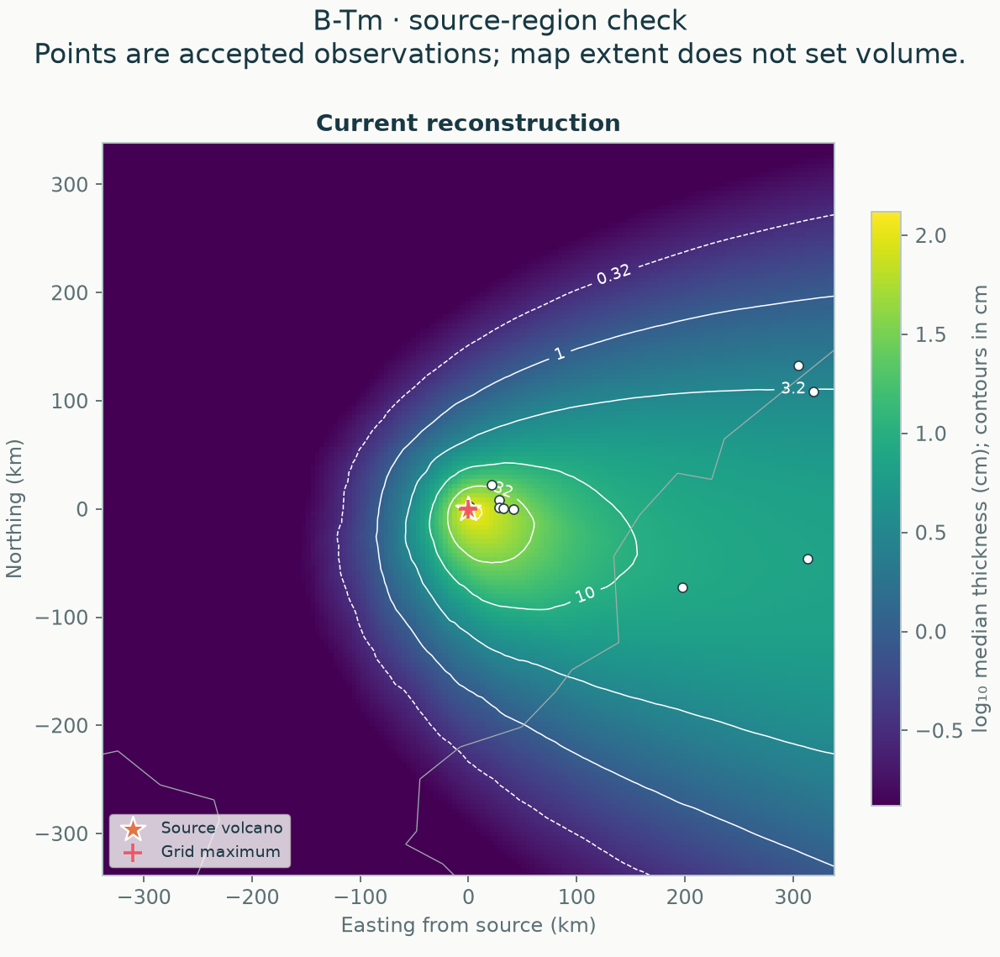
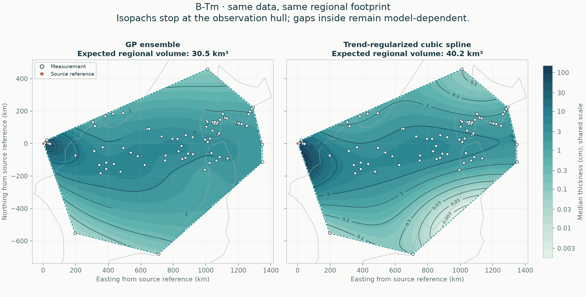

# B-Tm: data, global and regional results

[Regional fit](results/README.md) · [Local support](results/support/README.md) · [Conditional global estimate](results/global/README.md)

[All eruptions](../README.md) · [Active methods](../../methods/README.md) · [Add or revise data](../../docs/NEW_ERUPTION.md)

## Global fallout

The source-focused joint posterior has median **106 km³** and a **53.2–2,159 km³ conditional 95% credible interval** for bulk fallout. Its highest contours now surround the supplied volcano; the preceding displaced field placed its maximum about 94 km southwest in an unsampled area. All accepted fans are fitted together, with no closing pseudo-data or arbitrary calculation region. [Read the corrected global report and sensitivity refits](results/global/README.md) · [Compare every tested geometry and the earlier result](../../comparisons/source-revision/README.md). The broad upper tail remains a material uncertainty.

The geometry comparison preserves the accepted input. A [recovered published source table](../../comparisons/source-revision/input-inventory/b-tm-workbook-review/README.md) identifies lost thickness qualifications in some entries. The [two-site observation sensitivity](../../comparisons/source-revision/btm-input-sensitivity/README.md) treats Suigetsu's documented upper bound and Kushu's unquantified cryptotephra separately, giving **100 km³ (46–2,390 km³)**. The contour correction does not establish that every accepted thickness is an exact primary-deposit measurement.

**Local support audit:** no complete isopach band passes the support and deletion checks. The standard local footprint covers 52,431 km². Read the [local partial volumes and rejected-contour checks](results/support/README.md) before interpreting the broader hull results below. The separate [conditional global analysis](results/global/README.md) now estimates the whole deposit under explicit assumptions; this contour-screen decision is unchanged.

## Regional reconstruction

**GP ensemble and automatic cubic spline are reported as peers.** Both use the same accepted data, geographic holdouts and observation hull.

[Read the full comparison](results/README.md) · [Compare all six eruptions](../../comparisons/regional/README.md) · [Method definitions](../../docs/METHODS.md)

84 exact measurements and 0 lower bounds; regional area 963,645 km².

| Quantity | GP ensemble | Cubic spline |
|---|---:|---:|
| Expected regional bulk fallout (km³) | 30.46 | 40.16 |
| Outer equal-region negative log score ↓ | 1.331 | 1.814 |

These volumes cover only the observation hull. It can include unsampled gaps and exclude proximal deposits; it is not total eruption volume or dense-rock equivalent. Conditional intervals omit fitted-parameter and selection uncertainty. Read withheld coverage and geographic-deletion sensitivity in the full report.

## Evidence and calculation

| Follow the calculation | File |
|---|---|
| Accepted input | [Thickness observations](../../data/eruptions/B-Tm_tephra.csv) |
| Source decisions | [Audit or supplied-flag status](../../data/eruptions/README.md) |
| Whole-deposit mass and uncertainty | [Global posterior report](results/global/README.md) |
| Local maps and partial volumes | [Regional report](results/README.md) |
| Fits, validation and provenance | [Complete numerical record](results/report.json) |
| Row-by-row outer predictions | [Held-out predictions](results/heldout_predictions.csv) |
| Automatic tuning | [Candidate tables](results/selection/README.md) |

The 2026-11-04 regional rerun reproduced accepted inputs, fitted settings, held-out predictions and matched-hull volumes exactly. The new global companion is published separately. [Rerun verification](../../comparisons/global/verification.json).

## Related evidence and history

[Validation and targeted studies](../../comparisons/README.md) · [Earlier calculations in Git history](../../docs/HISTORY.md)
