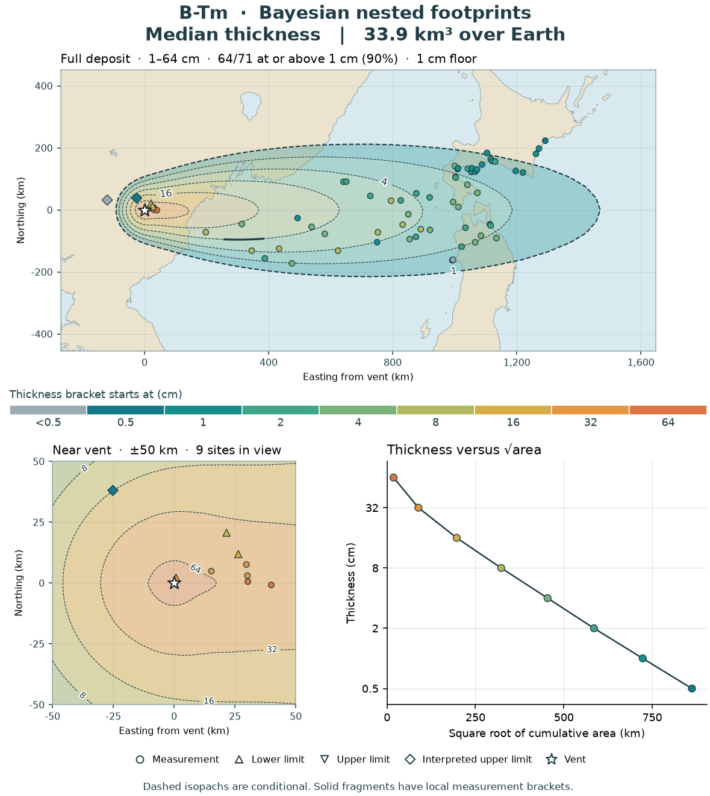

# B-Tm fallout reconstruction

The 946 CE Millennium eruption of Paektu / Changbaishan deposited fallout in two phases. The five families fit their combined airborne deposit using **64 measured thicknesses, three reported lower bounds, one reported upper bound and three interpreted upper bounds**. Diamonds locate the interpreted upper bounds. [Accepted observations](../../data/eruptions/B-Tm_cryptotephra.csv) · [Source descriptions and calculations](../../data/audits/B-Tm/README.md)

The earlier fan-direction sensitivity integrated to **33.5 km³**. The current directional estimate below also applies the finite-spread calibration. At Lake Sihailongwan, west of the volcano, its median thickness falls from **8.02 cm to 0.0146 cm**. The conditional limits used at Sihailongwan, Quanyang and Kushu are 0.06, 0.64 and 0.45 cm. The peat and lakes require different transfer assumptions. [Before-and-after contours, weaker assumptions and the independent marine check](results/cryptotephra/README.md)

## Volumes and geographic prediction

Each estimate integrates the median thickness on its map. The conditional range integrates the pointwise 25th and 75th percentiles of thickness over the same area. The 50% probability refers to thickness at each location. A single probability for total volume does not follow from these endpoints.

| Method | Integration area | Median map (km³) | Q25–Q75 thickness maps (km³) | Held-out score ↓ | 95% predictive coverage |
|---|---|---:|---:|---:|---:|
| GP ensemble | observation hull | **27.6** † | 21.6–35.4 | 1.459 | 89.1% |
| Cubic spline | observation hull | **50.7** | 32.1–88.4 | 4.295 | 75.0% |
| [Directional ensemble](results/directional/README.md) | whole Earth | **32.5** | 21.9–49.2 | 1.233 † | 93.8% |
| [Spherical mixture](results/spherical-mixture/README.md) | whole Earth | **37.1** | 26–58 | 1.496 † | 93.8% |
| [Bayesian nested footprints](results/nested-isopachs/README.md) | whole Earth | **33.9** | 27.3–43.7 | 1.270 † | 93.8% |

Lower scores indicate better geographic prediction. Coverage counts exact withheld measurements. A dagger marks a fit, integration or validation warning.

## Full deposits and near-vent detail

Each full map follows the thickest power-of-two contour enclosing at least 95% of the fitted locations, with a 1 cm minimum. The title gives the actual count, including when that minimum prevents 95% coverage. Global volumes include the thinner tail. The innermost line is the thickest doubling level enclosing an accepted location. The near-vent window expands from the proximal sites until eligible contours are visible. The curve sums all patches at each displayed thickness.

## Inside the observation hull

The GP and spline integrate over the dashed hull. Gaps inside it can still be poorly constrained. [Regional fits and numerical checks](results/README.md)

The current global fits use the same audited rows. [What changed in the maps, volumes and validation](../../comparisons/global-extent/README.md) · [Continuation rules](../../docs/methods/finite-spread.md)

## Evidence, coverage and history

The exact sites define a standard interpolation footprint of 96,131 km². The three bounds constrain the likelihood across the larger 796,162 km² observation hull. The complete global field also includes deposits in unsampled ground. [Footprint and support decisions](results/support/README.md) · [How an occurrence without a measured bed can constrain a fit](../../docs/methods/sites-without-measured-thickness.md)

The spline's arithmetic mean is dominated by an extremely uncertain area near Suigetsu. Geographic cross-validation and 20,000 complete-surface draws quantify the effect. [Spline analysis and other sensitivities](results/cryptotephra/README.md#regional-footprint-and-the-splines-upper-tail) · [Archived 68-site fit](../../archive/2026-11-19-b-tm-thickness-only/README.md)

Predicting the three interpreted upper limits from the other 68 rows strongly favors finite reach. At Lake Sihailongwan the withheld event probability rises from 0.18% to 97.85%. The full-data proposal retained a numerical warning. [Whole-area continuation sensitivity](results/nested-whole-area/README.md)
