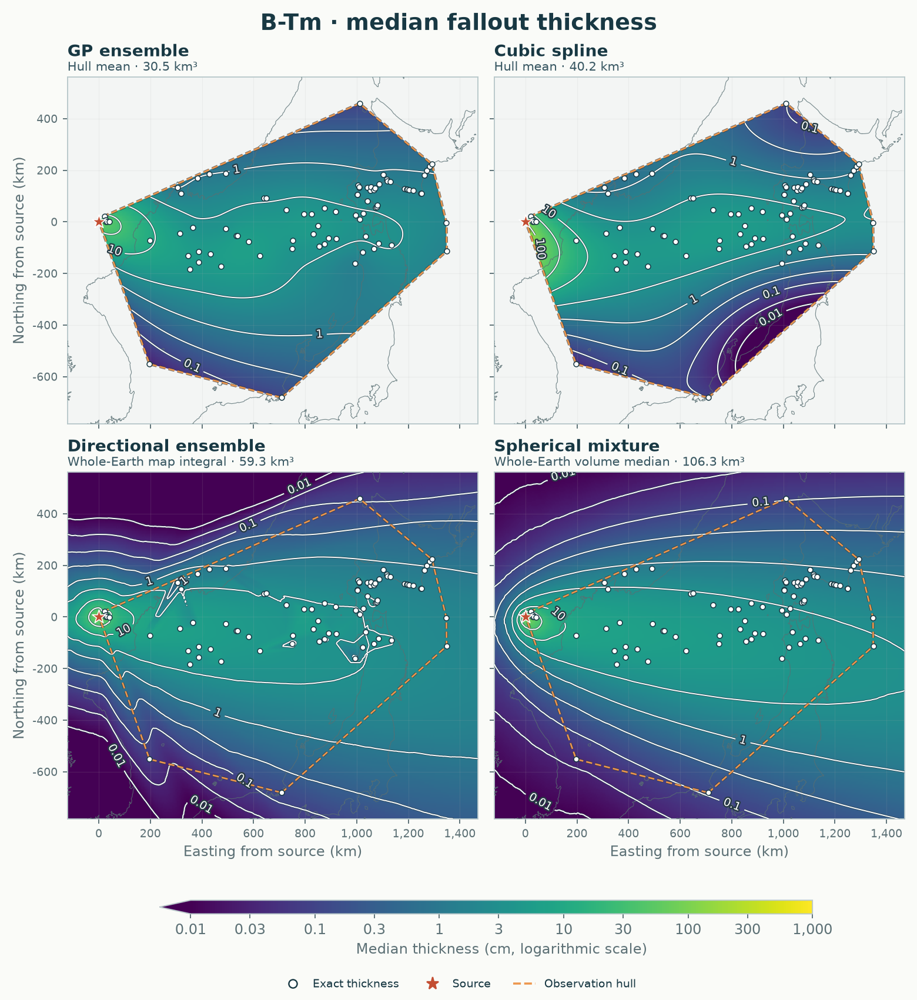
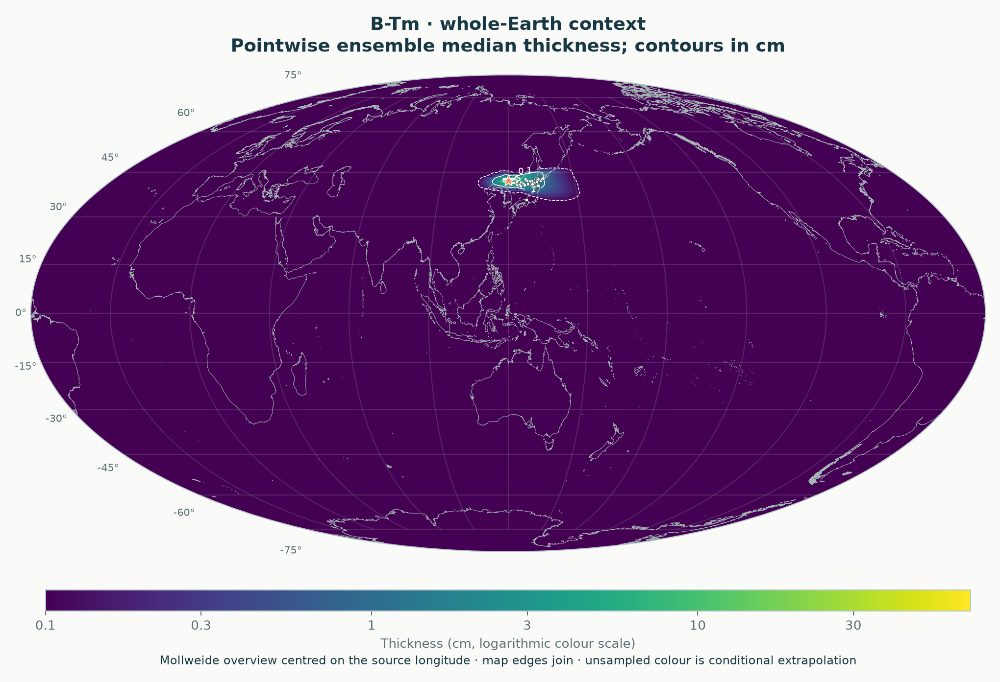

# B-Tm fallout reconstruction

The accepted dataset contains 84 exact measurements. The regional fits share an observation hull of 963,645 km². [Accepted thickness CSV](../../data/eruptions/B-Tm_tephra.csv) · [Input provenance](../../data/eruptions/README.md)

## Isopach fits

All four maps use the same frame, contour levels and thickness scale. Thickness below the first colour-bar tick shares the lowest shade. The dashed line encloses the observation hull. The regional fits stop there. The global fits also show how thickness continues into unsampled ground. Gaps inside the hull can still be poorly constrained.

## Volume and predictive performance

| Method | Bulk volume (km³) | Conditional 95% interval (km³) | Held-out score ↓ | 95% coverage |
|---|---|---:|---:|---:|
| GP ensemble | Hull mean **30.46** | 23.22–41.28 | 1.331 | 97.6% |
| Cubic spline | Hull mean **40.16** | 22.81–86.18 | 1.814 | 90.5% |
| [Directional ensemble](results/directional/README.md) | Whole-Earth median map **59.3** · volume median 71.0 | 42.2–410.0 | 1.295 | 95.2% |
| [Spherical mixture](results/spherical-mixture/README.md) | Whole-Earth volume median **106.3** | 53.2–2,159.2 | 1.162 | 92.9% |

A lower negative log predictive score means better prediction across withheld regions. Each region gets equal weight. Coverage is the share of exact held-out observations inside the 95% predictive interval.

The directional map integrates pointwise median thickness. Measured interpolation triangles account for **3.6%** of its volume. The directional volume interval comes from complete simulated deposits. The regional intervals condition on fitted settings. [Regional maps, fits and diagnostics](results/README.md)

Compare the two whole-Earth maps

| Directional ensemble | Spherical mixture |
|---|---|
|  |  |

Both maps use the vent longitude as their central meridian. Read the thickness key under each map.

## Evidence and limitations

The principal calculation treats all 84 supplied thicknesses as exact. The spherical mixture uses source-focused fans. A recovered source table identifies an upper bound at Suigetsu and unquantified cryptotephra at Kushu. The two-site sensitivity gives a spherical-mixture median of about 100 km³. One or more spherical prior refits carry a numerical warning. [Source review and two-site sensitivity](../../comparisons/source-revision/btm-input-sensitivity/README.md)

The standard local-support footprint covers 52,431 km². No complete isopach band passed the support and deletion checks. [Support map, partial volumes and rejected contours](results/support/README.md)
