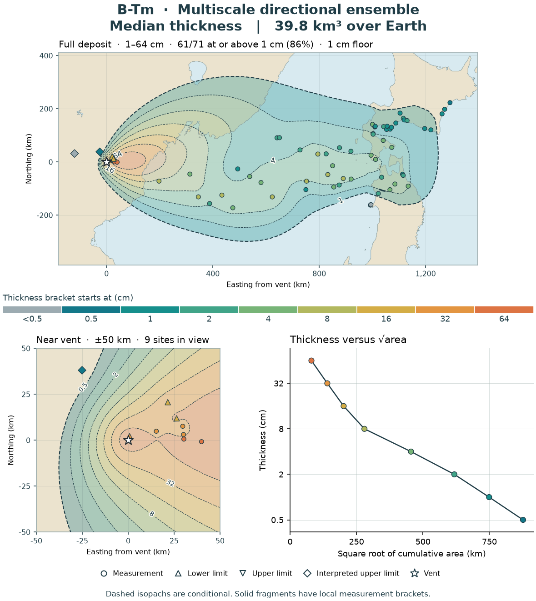
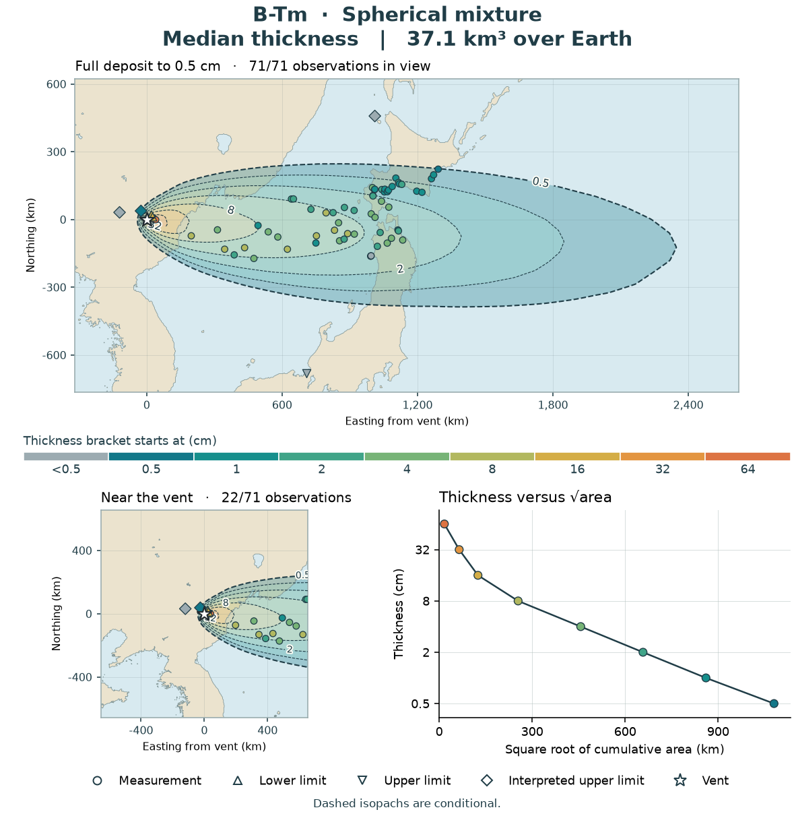

# B-Tm fallout reconstruction

The 946 CE Millennium eruption of Paektu / Changbaishan deposited fallout in two phases. The five families fit their combined airborne deposit using **64 measured thicknesses, three reported lower bounds, one reported upper bound and three interpreted upper bounds**. Diamonds locate the interpreted upper bounds. [Accepted observations](../../data/eruptions/B-Tm_cryptotephra.csv) · [Source descriptions and calculations](../../data/audits/B-Tm/README.md)

The principal uncertain-direction median map integrates to **33.5 km³**. At Lake Sihailongwan, west of the volcano, its median thickness falls from **8.02 cm to 0.0146 cm**. The conditional limits used at Sihailongwan, Quanyang and Kushu are 0.06, 0.64 and 0.45 cm. The peat and lakes require different transfer assumptions. [Before-and-after contours, weaker assumptions and the independent marine check](results/cryptotephra/README.md)

## Volumes and geographic prediction

Each volume integrates its method’s median-thickness map. The GP and spline cover the same observation hull. The other three methods cover Earth, including fallout below 0.5 cm. Conditional 95% intervals describe variation in whole-deposit volume across posterior draws.

| Method | Median-map volume (km³) | Conditional 95% interval (km³) | Held-out score ↓ | 95% coverage |
|---|---:|---:|---:|---:|
| GP ensemble | **27.6** † | 18.9–46.1 (provisional) | 1.459 | 89.1% |
| Cubic spline | **50.7** | 33–664 | 4.295 | 75.0% |
| [Directional ensemble](results/directional/README.md) | **33.5** | 23.5–77.1 | 1.243 † | 93.8% |
| [Spherical mixture](results/spherical-mixture/README.md) | **37.1** | 30.2–276 | 1.487 † | 93.8% |
| [Bayesian nested corridors](results/nested-isopachs/README.md) | **33.7** | 26.6–50.2 (provisional) | 1.544 | 92.2% |

Lower scores indicate better predictions in withheld geographic regions. Coverage counts exact withheld measurements. A dagger marks a numerical or geographic validation warning. Provisional intervals retain their fit or integration warnings.

## Full deposits and near-vent detail

The outer line is 0.5 cm. Contours and observation colours double from there. All three methods use the same near-vent window for this eruption. Each curve counts the combined area of all patches at or above a thickness.

## Inside the observation hull

The dashed boundary encloses all accepted sites. Gaps inside it can still be poorly constrained. [Regional fits and numerical checks](results/README.md)

## Evidence, coverage and history

The exact sites define a standard interpolation footprint of 96,131 km². The three bounds constrain the likelihood across the larger 796,162 km² observation hull. The complete global field also includes deposits in unsampled ground. [Footprint and support decisions](results/support/README.md) · [How an occurrence without a measured bed can constrain a fit](../../docs/methods/sites-without-measured-thickness.md)

The spline's arithmetic mean is dominated by an extremely uncertain area near Suigetsu. Geographic cross-validation and 20,000 complete-surface draws quantify the effect. [Spline analysis and other sensitivities](results/cryptotephra/README.md#regional-footprint-and-the-splines-upper-tail) · [Archived 68-site fit](../../archive/2026-11-19-b-tm-thickness-only/README.md)

Predicting the three interpreted upper limits from the other 68 rows strongly favors finite reach. At Lake Sihailongwan the withheld event probability rises from 0.18% to 97.85%. The full-data proposal retained a numerical warning. [Whole-area continuation sensitivity](results/nested-whole-area/README.md)
