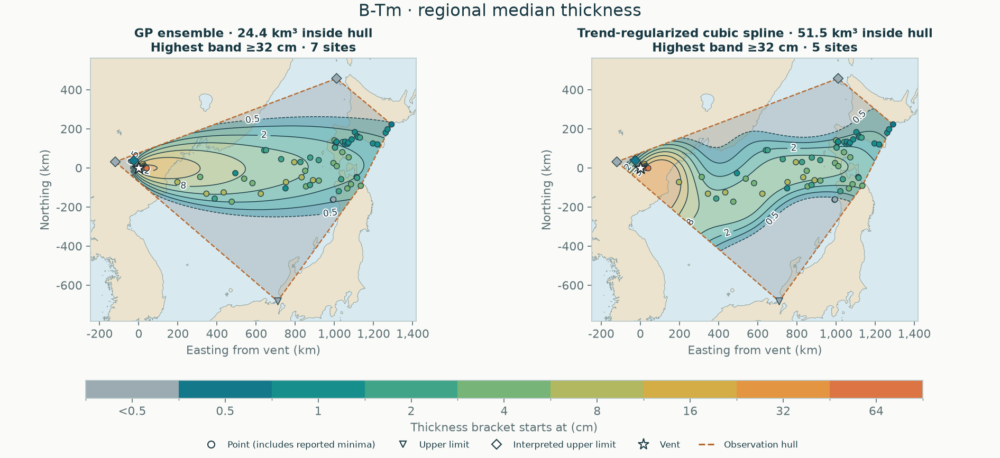

# B-Tm fallout reconstruction

The four locally published methods use the 71 accepted localities for the combined 946 CE Millennium eruption fallout. The field evidence includes 64 measured thicknesses, three reported minima and four upper limits. Each minimum enters the fit at its reported thickness, including the two beyond 25 km. Three of the upper limits are interpreted from site evidence. The spherical baseline preview below is separate from this partial release. [Source audit](../../data/audits/B-Tm/README.md) · [Fitting convention](../../docs/methods/reported-minimum-fitting.md)

| Method | Published map |
|---|---|
| Regional GP ensemble and cubic spline | [Paired median isopachs](results/minimum-fit-2026-11-25/README.md) |
| Multiscale directional ensemble | [Directional thickness](results/minimum-fit-2026-11-25/directional/README.md) |
| Mass-normalized spherical mixture | [Spherical median thickness](https://github.com/siyulai21/tephra-fallout-isopachs/blob/fb09fcf7950a44c716cbcd68e4c15dc12886da4e/results/btm-baseline-preview/principal/README.md) |
| Nested dispersal footprints | [Nested thickness](results/minimum-fit-2026-11-25/nested-isopachs/README.md) |

The spherical map uses the third baseline sampling attempt, which passed the numerical checks. The map was rendered from the completed baseline on the same numerical inputs as the sampler. The eight-prior sensitivity comparison is still being assembled. [Spherical sampling and geographic validation](https://github.com/siyulai21/tephra-fallout-isopachs/actions/runs/45669570647)

[Original field qualifiers](../../data/eruptions/B-Tm_cryptotephra.csv) · [Previous maps and source assessment](previous-minimum-treatment.md) · [Changes across eruptions](../../comparisons/reported-minima/README.md)

## Volumes and geographic prediction

Each estimate integrates the median thickness on its map. The conditional range integrates the pointwise 25th and 75th percentiles of thickness over the same area. The 50% probability refers to thickness at each location. A single probability for total volume does not follow from these endpoints.

| Method | Integration area | Median map (km³) | Q25–Q75 thickness maps (km³) | Held-out score ↓ | 95% predictive coverage |
|---|---|---:|---:|---:|---:|
| GP ensemble | observation hull | **24.4** | 19.4–30.7 | 1.485 | 89.6% |
| Cubic spline | observation hull | **51.5** | 32.3–91.2 | 4.184 | 82.1% |
| [Multiscale directional ensemble](results/minimum-fit-2026-11-25/directional/README.md) | whole Earth | **31.7** | 21.3–48.2 | 1.414 | 94.0% |
| [Bayesian nested footprints](results/minimum-fit-2026-11-25/nested-isopachs/README.md) | whole Earth | **30.8** | 26–37.1 | 1.357 † | 94.0% |

Lower scores indicate better geographic prediction. Coverage counts held-out measurements and reported minima fitted as points. A dagger marks a fit, integration or validation warning.

## Full deposits and near-vent detail

Each full map follows the thickest power-of-two contour enclosing at least 95% of the fitted locations, with a 1 cm minimum. The title gives the actual count, including when that minimum prevents 95% coverage. Global volumes include the thinner tail. The innermost line is the thickest doubling level enclosing an accepted location. The near-vent window expands from the proximal sites until eligible contours are visible. The curve sums all patches at each displayed thickness.

## Inside the observation hull

The GP and spline integrate over the dashed hull. Gaps inside it can still be poorly constrained. [Regional fits and numerical checks](results/minimum-fit-2026-11-25/README.md)
