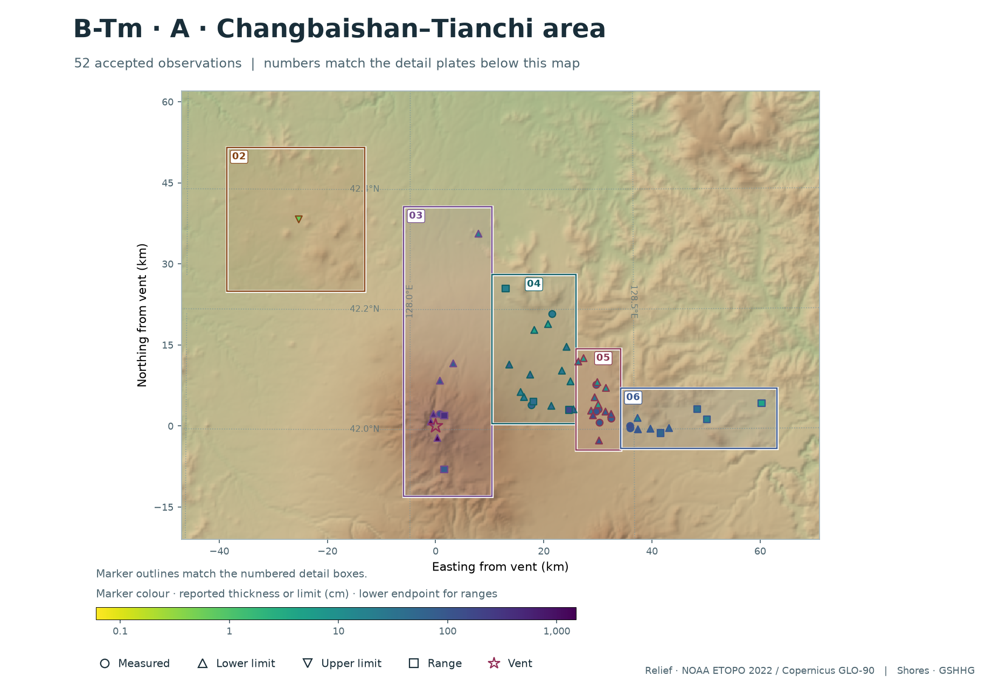

# B-Tm · principal input observations

All 150 accepted rows have a symbol at their registered coordinates on the overview and a labelled reading on one numbered detail plate. Box A on the overview marks the area shown in the near-vent detail index. Other numbered boxes lead directly to detail plates. A star marks the vent. Positions use a vent-centred equal-area grid in kilometres. Land shading shows elevation and slope. GSHHG supplies the coastline and inland water at the map’s scale. [NOAA ETOPO](https://doi.org/10.25921/fd45-gt74) · [Copernicus GLO-90](https://registry.opendata.aws/copernicus-dem/) · [GSHHG](https://doi.org/10.5281/zenodo.7007502)

[Go to the near-vent map](#near-vent-detail-index) · [Accepted input CSV](../../../data/eruptions/B-Tm_two_phase_minimum_fit.csv) · [Reported CSV](../../../data/eruptions/B-Tm_two_phase.csv) · [Audit provenance](../../../data/audits/B-Tm/two-phase/provenance.json) · [Source ledger](../../../data/audits/B-Tm/two-phase/sites.csv) · [Audit citation keys](../../../data/audits/B-Tm/two-phase/sources.json) · [Site index with coordinates and full input precision](sites.csv) · [Input hashes and panel bounds](manifest.json)

The table shows the evidence ID and source citation alongside the reported or interpreted reading. A dash marks an unavailable evidence ID. Complete citations and unrounded values are in the site index. A reported lower limit appears as ≥ on these evidence figures and as a point at that value in the fit. Upper limits and ranges retain their respective events. Marker colour represents the displayed thickness or limit, using the lower endpoint for ranges. Where rows share coordinates, a single diamond uses the first CSV row as its map key and the adjacent table lists each row.

## Near-vent detail index

**Box A · Changbaishan–Tianchi area** contains 52 accepted observations. Match a numbered box to the links below for its site locations and readings. [02](detail-02.png), [03](detail-03.png), [04](detail-04.png), [05](detail-05.png), [06](detail-06.png)

## All detail plates

| Detail plate | Input rows | Easting × northing span |
|---|---:|---:|
| [01](detail-01.png) | 1 | 26.7 × 26.7 km |
| [02](detail-02.png) · A | 1 | 25.5 × 26.7 km |
| [03](detail-03.png) · A | 9 | 16.4 × 53.7 km |
| [04](detail-04.png) · A | 16 | 15.5 × 27.6 km |
| [05](detail-05.png) · A | 16 | 8.29 × 18.7 km |
| [06](detail-06.png) · A | 10 | 28.8 × 11.1 km |
| [07](detail-07.png) | 1 | 26.7 × 26.7 km |
| [08](detail-08.png) | 21 | 420 × 480 km |
| [09](detail-09.png) | 18 | 396 × 356 km |
| [10](detail-10.png) | 16 | 130 × 261 km |
| [11](detail-11.png) | 15 | 106 × 84 km |
| [12](detail-12.png) | 1 | 26.7 × 26.7 km |
| [13](detail-13.png) | 3 | 31.5 × 55 km |
| [14](detail-14.png) | 22 | 217 × 157 km |
