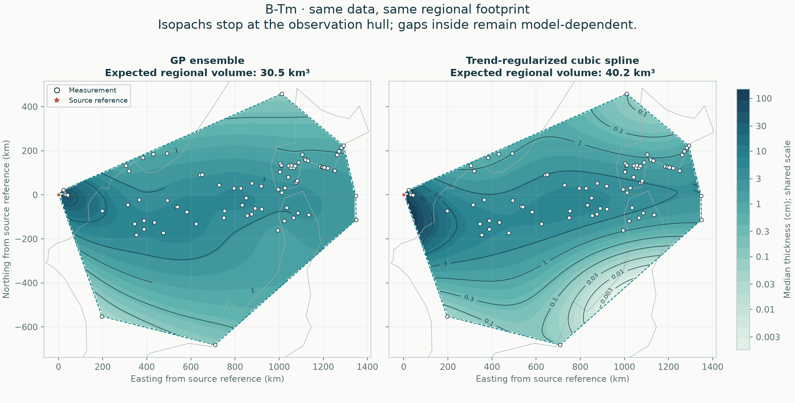
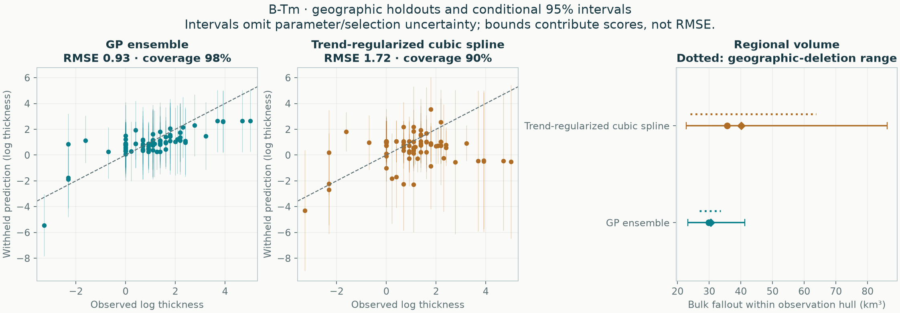

# B-Tm: empirical methods on one regional footprint

All methods use the same accepted observations, geographic holdouts and integration area. No method is designated preferred.

**84 exact measurements, 0 lower bounds, 0 upper limits.** The observation hull covers 963,645 km². The automatic validation buffer is 24.95 km.



| Quantity | GP ensemble | Trend-regularized cubic spline |
|---|---:|---:|
| Expected regional bulk fallout (km³) | 30.46 | 40.16 |
| Integral of median thickness surface (km³) | 27.12 | 32.93 |
| Conditional 95% volume interval (km³) | 23.22–41.28 | 22.81–86.18 |
| Outer equal-region negative log score ↓ | 1.331 | 1.814 |
| Outer log-thickness RMSE ↓ | 0.926 | 1.715 |
| Outer 95% observation-interval coverage | 97.6% | 90.5% |

Lower predictive score and RMSE are better. Coverage must be read with interval width and predictive score; wider intervals alone are not improvement.



## Scope

The footprint is the convex hull of measured/bounded locations, with no source point or invented observations added. It can contain large unsampled gaps and can exclude proximal deposits. These are **regional bulk fallout volumes, not total eruption volumes or dense-rock equivalents**. No global extrapolation enters this comparison.

The mean volume integrates expected thickness. The median-surface integral is a separate quantity; it is not the median volume. Volume intervals come from complete correlated surface draws, not sums of pointwise interval endpoints.

## Fitted methods

### GP ensemble

```json
{
  "candidate": {
    "tail": "stacked"
  },
  "components": [
    {
      "weight": 0.14863732999553306,
      "model": {
        "candidate": {
          "tail": "exponential",
          "length_factor": 1.5,
          "noise_ratio": 0.75
        },
        "beta": [
          2.839044355405908,
          20.304294531178392,
          18.563184707830878,
          -2.687108901429034
        ],
        "radius_scale_km": 989.3479460818735,
        "length_km": 610.629239559499,
        "amplitude_log": 0.8655528692716252,
        "noise_log": 0.6491646519537189,
        "jitter": 7.491817695043432e-10,
        "trend_on_constraint_boundary": false,
        "uncertainty": "conditional Gaussian"
      }
    },
    {
      "weight": 0.36427496972485834,
      "model": {
        "candidate": {
          "tail": "power",
          "length_factor": 0.25,
          "noise_ratio": 0.75
        },
        "beta": [
          3.1843385611166455,
          28.06273615287081,
          24.96750560783616,
          -4.0157741774027915
        ],
        "radius_scale_km": 989.3479460818735,
        "length_km": 101.77153992658316,
        "amplitude_log": 0.8313179264251255,
        "noise_log": 0.6234884448188441,
        "jitter": 6.910894947957703e-10,
        "trend_on_constraint_boundary": false,
        "uncertainty": "conditional Gaussian"
      }
    },
    {
      "weight": 0.48708770027960857,
      "model": {
        "candidate": {
          "tail": "power",
          "length_factor": 0.75,
          "noise_ratio": 0.75
        },
        "beta": [
          3.1843385611166455,
          28.06273615287081,
          24.96750560783616,
          -4.0157741774027915
        ],
        "radius_scale_km": 989.3479460818735,
        "length_km": 305.3146197797495,
        "amplitude_log": 0.8313179264251255,
        "noise_log": 0.6234884448188441,
        "jitter": 6.910894947957703e-10,
        "trend_on_constraint_boundary": false,
        "uncertainty": "conditional Gaussian"
      }
    }
  ],
  "dominant_tail": "power",
  "observation_discrepancy_variance_log": 0.024416553524290452,
  "trend_on_constraint_boundary": false,
  "uncertainty": "Predictive mixture; includes disagreement among retained candidates, conditional on each fit and estimated weights. Fitted-parameter uncertainty is not integrated."
}
```

### Trend-regularized cubic spline

```json
{
  "method": "spline",
  "candidate": {
    "tail": "power",
    "knot_intervals": 2,
    "tension": 1.0,
    "smoothing": 0.01,
    "trend_strength": 0.0,
    "noise_ratio": 0.75
  },
  "bounds_km": [
    -66.53192309995278,
    -738.353888107619,
    1416.0829900285985,
    515.432164069246
  ],
  "knot_intervals_xy": [
    2,
    2
  ],
  "n_coefficients": 25,
  "noise_log": 0.6234884448193408,
  "amplitude_log": 0.8313179264257878,
  "trend_beta": [
    3.184337972256187,
    28.06272965398631,
    24.96749990596912,
    -4.015780750531823
  ],
  "trend_radius_scale_km": 989.3479460818735,
  "trend_on_constraint_boundary": false,
  "effective_df_exact": 13.969031309908255,
  "newton_decrement": 5.037227214025059e-26,
  "newton_iterations": 0,
  "quadrature_order": 6,
  "uncertainty": "Conditional Gaussian",
  "uncertainty_omits": [
    "fitted trend",
    "noise and smoothing estimation",
    "knot/trend selection",
    "sampling and preservation bias",
    "vent location error"
  ],
  "pseudo_observations": 0
}
```

Every explored candidate is retained in the selection tables. All response-dependent choices are retuned within training folds; no hand-placed pseudo-data enter the likelihood.

## Reliability checks

- All probability intervals condition on fitted parameters and selected settings; they omit parameter/selection and preservation/sampling uncertainty.
- Four geographic outer folds evaluate the entire tuning procedure; this is development evidence, not independent external validation.
- Geographic-deletion volume ranges show refitting sensitivity and are not confidence intervals.

## Reproduce and inspect

```sh
tephra-isopachs compare B-Tm --output results/new-regional-run
```

[Complete numerical report](report.json) · [Withheld predictions](heldout_predictions.csv) · [Accepted observation semantics](accepted_observations.csv) · [Selection tables](selection/README.md)

The JSON records input/source hashes, package versions, all fold memberships, regional integration refinements, conditional-volume sampling precision and geographic-deletion sensitivity. Historical GP global calculations remain separate.

## Which parts are actually supported?

Read the [local support and complete-contour audit](support/README.md) before extrapolating these hull volumes. It screens unsampled gaps, tests closure under geographic deletion, and separates interpolation from proximal/distal assumptions.

## Whole-deposit fallout

Read the [conditional global estimate and assumption sensitivity](global/README.md). Its mass is normalized on the whole Earth; these regional partial volumes and the local contour audit retain their separate meanings.
