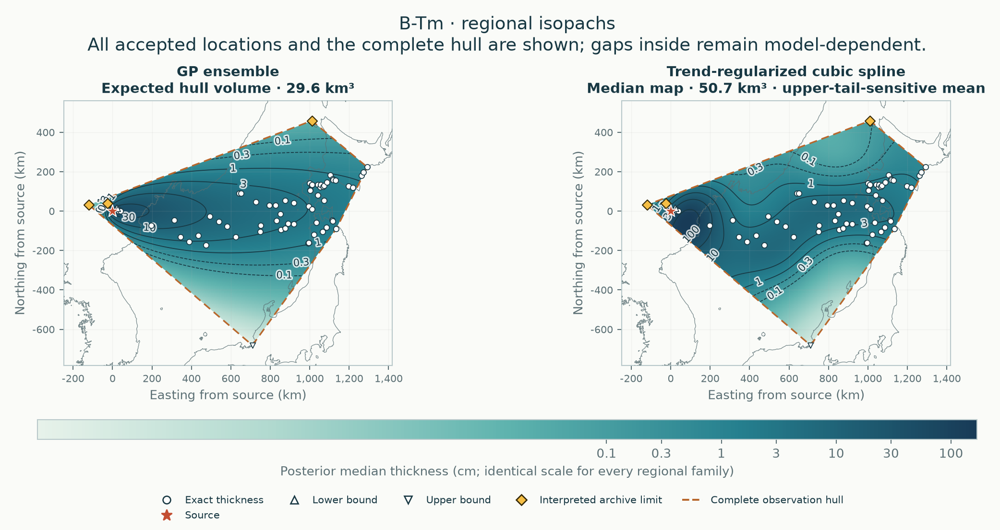
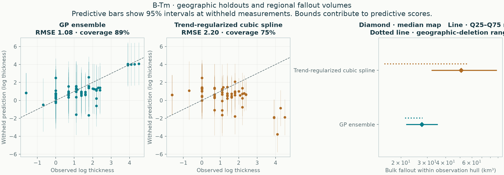

# B-Tm · regional fits inside the observation hull

[All available methods on the eruption page](../README.md)

The GP and cubic spline use the same accepted observations, geographic holdouts and observation hull.

**64 exact measurements, 3 lower bounds, 4 upper limits.** The observation hull covers 796,162 km². The automatic validation buffer is 23.22 km.



The full observation hull and every accepted location are in view. The coloured field is clipped to the exact hull; fine coastlines are context only. [Map frame and rendering provenance](map-display.json).

| Quantity | GP ensemble | Trend-regularized cubic spline |
|---|---:|---:|
| Principal median-map volume inside hull (km³) | 27.64 | 50.75 |
| Integrated Q25–Q75 thickness (km³) | 21.63–35.37 | 32.15–88.40 |
| Outer equal-region negative log score ↓ | 1.459 | 4.295 |
| Outer log-thickness RMSE ↓ | 1.085 | 2.202 |
| Outer 95% observation-interval coverage | 89.1% | 75.0% |

Lower predictive score and RMSE are better. Coverage must be read with interval width and predictive score; wider intervals alone are not improvement.



## Scope

The footprint is the convex hull of measured/bounded locations, with no source point or invented observations added. It can contain large unsampled gaps and can exclude proximal deposits. These are **regional bulk fallout volumes, not total eruption volumes or dense-rock equivalents**. No global extrapolation enters this comparison.

Volume integrates pointwise median thickness over the observation hull. The endpoints integrate the pointwise 25th and 75th percentiles of latent thickness on the same hull. [Band integrals and refinements](thickness-bands.json)

## Fitted methods


### GP ensemble

```json
{
  "candidate": {
    "tail": "stacked"
  },
  "components": [
    {
      "weight": 1.0,
      "model": {
        "candidate": {
          "tail": "exponential",
          "length_factor": 1.5,
          "noise_ratio": 1.5
        },
        "beta": [
          3.9177286079299813,
          55.40464843434249,
          52.48647992938348,
          0.8300496222510045
        ],
        "radius_scale_km": 1006.0864065815343,
        "length_km": 475.50338644035037,
        "amplitude_log": 0.7705951264423287,
        "noise_log": 1.1558926896634931,
        "jitter": 5.938168488966687e-10,
        "trend_on_constraint_boundary": false,
        "uncertainty": "conditional Laplace"
      }
    }
  ],
  "dominant_tail": "exponential",
  "observation_discrepancy_variance_log": 0.0,
  "trend_on_constraint_boundary": false,
  "uncertainty": "Predictive mixture; includes disagreement among retained candidates, conditional on each fit and estimated weights. Fitted-parameter uncertainty is not integrated."
}
```

### Trend-regularized cubic spline

```json
{
  "method": "spline",
  "candidate": {
    "tail": "exponential",
    "knot_intervals": 6,
    "tension": 0.0,
    "smoothing": 0.0001,
    "trend_strength": 0.0,
    "noise_ratio": 0.75
  },
  "bounds_km": [
    -190.76417207152855,
    -738.3045410473977,
    1362.3077833771963,
    515.5254184480947
  ],
  "knot_intervals_xy": [
    6,
    5
  ],
  "n_coefficients": 72,
  "noise_log": 0.5779463448317463,
  "amplitude_log": 0.7705951264423284,
  "trend_beta": [
    3.9177286079299805,
    55.40464843434209,
    52.48647992938308,
    0.830049622251031
  ],
  "trend_radius_scale_km": 1006.0864065815343,
  "trend_on_constraint_boundary": false,
  "effective_df_exact": 13.46491254876172,
  "newton_decrement": 1.0480591788888921e-16,
  "newton_iterations": 6,
  "quadrature_order": 6,
  "uncertainty": "Conditional Laplace",
  "uncertainty_omits": [
    "fitted trend",
    "noise and smoothing estimation",
    "knot/trend selection",
    "sampling and preservation bias",
    "vent location error"
  ],
  "pseudo_observations": 0
}
```

Every explored candidate is retained in the selection tables. All response-dependent choices are retuned within training folds; no hand-placed pseudo-data enter the likelihood.

## Reliability checks

- All probability intervals condition on fitted parameters and selected settings; they omit parameter/selection and preservation/sampling uncertainty.
- Four geographic outer folds evaluate the entire tuning procedure; this is development evidence, not independent external validation.
- Geographic-deletion volume ranges show refitting sensitivity and are not confidence intervals.
- GP ensemble regional integration did not reach the stated refinement tolerance.
- GP ensemble joint-draw quadrature needs further refinement; inspect its grid checks before using intervals.
- GP ensemble: held-out 95% observation coverage is only 89.1%; uncertainty is undercovered.
- Trend-regularized cubic spline: the analytic expected volume exceeds the 97.5th percentile of complete deposits. Rare thick fields dominate the expectation. The conditional interval remains sensitive to the upper tail.
- Trend-regularized cubic spline: held-out 95% observation coverage is only 75.0%; uncertainty is undercovered.

## Reproduce and inspect

```sh
tephra-isopachs compare B-Tm --output results/new-regional-run
```

[Complete numerical report](report.json) · [Withheld predictions](heldout_predictions.csv) · [Accepted observation semantics](accepted_observations.csv) · [Selection tables](selection/README.md)

The JSON records input/source hashes, package versions, all fold memberships, regional integration refinements, conditional-volume sampling precision and geographic-deletion sensitivity. Historical GP global calculations remain separate.

## Which parts are actually supported?

Read the [local support and complete-contour audit](support/README.md) before extrapolating these hull volumes. It screens unsampled gaps, tests closure under geographic deletion, and separates interpolation from proximal/distal assumptions.
