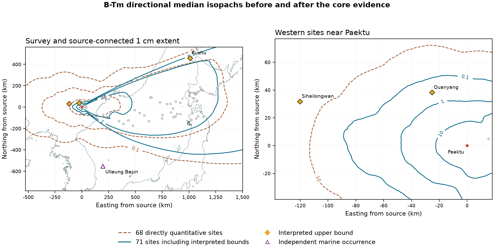
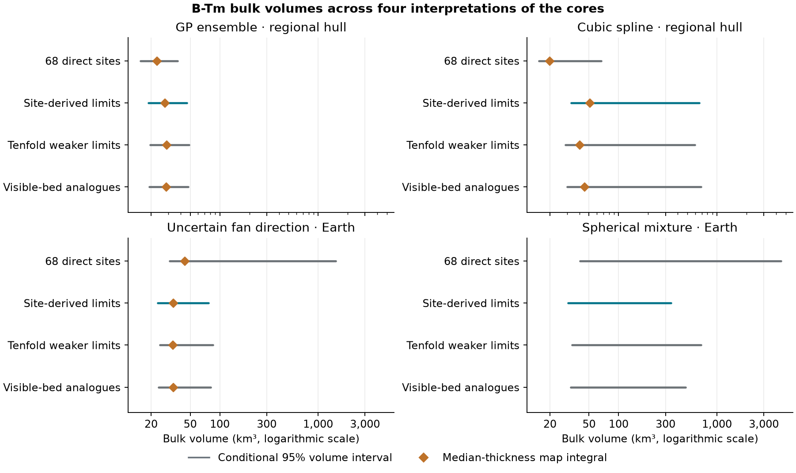
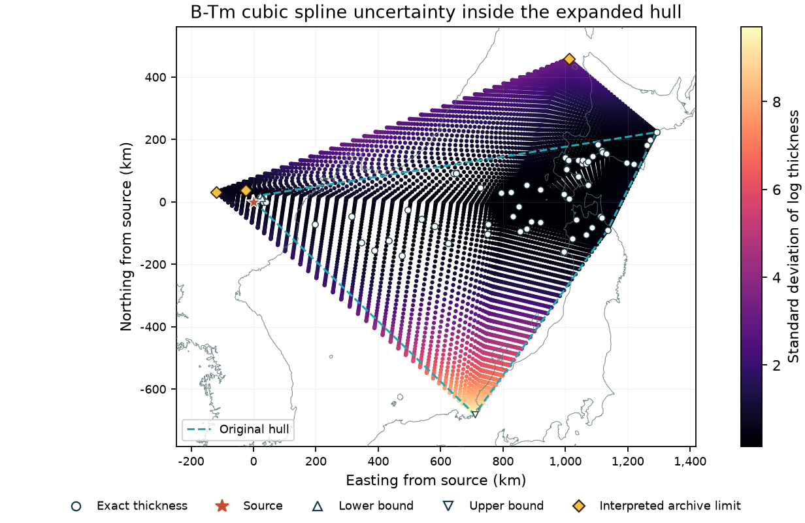

# How cryptotephra changes the B-Tm reconstruction

The principal directional median map integrates to **33.6 km³** of bulk airborne fallout, compared with **44.1 km³** on the preceding 68-site input. The conditional 95% volume interval is **23.5–77.1 km³**. The central map integrates the pointwise median thickness. The interval integrates each spatially coherent deposit separately.

The three additions are positive occurrences with unknown primary bed thickness. The principal fits use conditional upper limits of 0.06 cm at Lake Sihailongwan, 0.64 cm at Quanyang peat and 0.45 cm at Lake Kushu. The lake limits transfer a same-eruption count response from Suigetsu. The peat limit assumes full retention in a three-slice dry-mass budget, a maximum host dry density and a minimum fallout bulk density. Local variation enters the censoring likelihood. An interpreted bound gives neither an exact thickness nor a numerical lower endpoint. [Primary sources and calculations](../../../../data/audits/B-Tm/README.md) · [Accepted observations](../../../../data/eruptions/B-Tm_cryptotephra.csv)

## What changed at the three sites?

Each entry gives the previous and revised latent median thickness in cm. A regional fit ends at its own observation hull. The revised values at the three fitted sites show the effect of conditioning. [Full site intervals and alternative responses](four-method-site-predictions.csv)

| Method | Sihailongwan | Quanyang | Kushu |
|---|---:|---:|---:|
| GP ensemble | outside hull → 0.000121 | outside hull → 1.28 | outside hull → 0.0154 |
| Cubic spline | outside hull → 0.0316 | outside hull → 2.57 | outside hull → 0.0876 |
| Uncertain fan direction | 8.02 → 0.0146 | 24.60 → 0.358 | 0.454 → 0.217 |
| Spherical mixture | 15.93 → 0.00739 | 45.39 → 0.835 | 0.0564 → 0.0253 |

The spherical median at Quanyang is 0.84 cm. Its fitted probability that a repeat local observation would fall below 0.64 cm is 38.0%. The spline gives the same repeat reading only 2.5% probability, even after fitting the core. These limits enter the observation likelihood with local scatter. They can pull an isopach inward while leaving disagreement at the site. [Fitted and withheld probabilities for all three limits](heldout-archive-probabilities.csv)

To reconcile the old Sihailongwan median with the observed glass profile, the lake's effective shard response would have to be at most **0.71%** of the Suigetsu reference. At Quanyang, the old median permits at most **2.6%** retention under the stated mass and density assumptions. The profile sums and mass budget can be used to test any proposed isopach or archive response. [Response required by particular contours](response-required-by-contours.csv)

### Withhold the core's geographic region

The table gives the probability of a local observation below the stated upper limit when the entire buffered geographic fold containing that core was withheld. These predictions include local thickness scatter. The regions and training memberships match across all four families. The transfer assumptions are fixed before the folds are scored. Because the two lake bounds share a reference at Suigetsu, these folds do not independently validate the count conversion. Each probability tests the specified archive interpretation. It is a one-sided check and can reward a model that predicts extremely thin deposits.

| Site | Upper (cm) | Fold | GP | Spline | Directional | Spherical |
|---|---:|---:|---:|---:|---:|---:|
| Lake Sihailongwan | 0.06 | 0 | 100.00% | 100.00% | 20.74% | 67.50% |
| Quanyang peat | 0.64 | 0 | 100.00% | 100.00% | 24.50% | 59.09% |
| Lake Kushu | 0.45 | 3 | 94.56% | 5.38% | 68.72% | 90.80% |

With Sihailongwan and Quanyang both withheld in the western fold, the directional local median at Sihailongwan returns to **4.76 cm**. The directional model assigns the 0.06 cm upper observation 20.7% probability. The westward retreat therefore relies on the cores. The GP and spline give Sihailongwan local medians of 6.1e-16 and 2.8e-16 cm. Values that small can score well against an upper limit. The positive glass occurrence establishes arrival, while its magnitude remains conditional on archive response.

[Scores on 64 exact thicknesses and on 67 direct records excluding the Suigetsu reference](heldout-by-evidence.csv) · [Individual archive scores](heldout-archive-probabilities.csv) · [All regional holdouts](../heldout_predictions.csv) · [All directional holdouts](../directional/azimuth/heldout.csv) · [All spherical holdouts](../spherical-mixture/heldout_predictions.csv)

## Where the contours move

Distances are kilometres along a ray from Paektu to its first outward median-contour crossing. A detached lobe farther along the ray is excluded. The two fits have the same six structures and the same target-excluded calibration of structure and fan direction. The rows below show the western bearings. [All eight bearings and all fitted levels](directional-reach.csv)

| Direction | Level (cm) | Previous reach (km) | Revised reach (km) |
|---|---:|---:|---:|
| NW | 0.1 | 404 | 61 |
| NW | 1 | 217 | 39 |
| NW | 10 | 83 | 18 |
| SW | 0.1 | 406 | 56 |
| SW | 1 | 218 | 37 |
| SW | 10 | 84 | 18 |
| W | 0.1 | 760 | 86 |
| W | 1 | 371 | 47 |
| W | 10 | 113 | 23 |

### Independent marine occurrence

At Ulleung Basin core 13PT-P4_026, the 2 cm sediment slice contains 9,529 shards/g. Applying the same lake reference gives 0.0762 cm for that slice. Bioturbation, grain sorting and lateral transport make this an illustrative local equivalent. There is no verified primary-fallout bound at the core. It lies outside both regional hulls.

| Global method | Previous latent median (cm) | Revised latent median (cm) | Previous probability of ≥0.0762 cm | Revised probability |
|---|---:|---:|---:|---:|
| Uncertain fan direction | 0.0116 | 2.95e-09 | 29.11% | 2.10% |
| Spherical mixture | 0.0317 | 0.00205 | 39.16% | 10.91% |

These probabilities include site variability. A low exceedance probability signals possible narrowing at sea **if** the reference transfers to this core. The glass occurrence remains an independent check. [Marine calculations](marine-occurrence-check.csv) · [Source profile](https://doi.org/10.1029/2021JB023243)

## Bulk volume under alternative archive responses

Volumes are km³ of bulk fallout inferred from the reported thicknesses. The study applies no universal decompaction correction. Diamonds in the plot and point estimates in the table integrate median thickness. The bounds describe conditional 95% volume uncertainty. A dash marks a sensitivity with no stored median-field integral. GP and spline cover their own regional hull. The directional ensemble and spherical mixture integrate over the Earth.

| Archive assumption | GP, hull | Spline, hull | Directional, Earth | Spherical, Earth |
|---|---:|---:|---:|---:|
| Previous, 68 directly quantitative sites | 22.8 [15.7–37.1] | 19.8 [15.5–66.2] | 44.1 [31.0–1,507.8] | — [40.7–4,461.6] |
| Principal, site-derived limits | 27.6 [18.9–46.1] | 50.7 [33.0–664.4] | 33.6 [23.5–77.1] | — [30.7–341.7] |
| Tenfold weaker limits | 28.9 [19.5–48.7] | 40.0 [28.8–595.8] | 33.3 [24.5–85.2] | — [33.4–689.5] |
| Visible-bed analogues, 1 / 2 / 1 cm | 28.4 [19.3–47.6] | 44.8 [29.8–688.0] | 33.5 [23.9–81.0] | — [32.4–477.6] |

The weaker response allows upper limits of 0.60, 6.4 and 4.5 cm. The visible-bed analogue uses 1, 2 and 1 cm at the same sites. Each sensitivity refits the local censored likelihood. The preceding case omits the three inferred limits. All four retain the reported Suigetsu limit. The shared lake response is fixed within each scenario. The volume intervals condition on that choice and no probability weights are assigned to the four scenarios. [All estimands](four-method-sensitivities.csv) · [Source inputs and hashes](../../../../data/audits/B-Tm/cryptotephra-principal.json)

## Regional footprint and the spline's upper tail

Adding the cores expands the hull from 549,464 to 796,162 km². On the original footprint the GP median-map volume changes from 22.82 to 21.83 km³. Including the new ground gives 27.64 km³. The standard interpolation footprint defined by exact thickness sites covers 96,131 km². [Matched-domain calculations](regional-sensitivities.csv) · [Footprint and contour screen](../support/README.md)

The selected cubic spline has a long upper uncertainty tail. Its log-thickness standard deviation reaches 9.70 near the bounded Lake Suigetsu site. The highest-contributing 1% of hull area contributes 99.99970% of the mean. The fitted surface's median thickness at the peak-expectation quadrature node is 5e-06 cm. This instability also occurs on the original footprint. Model selection and poorly constrained local variance both matter.

The retuned spline's median-map integral is 50.75 km³. In a check with 20,000 complete draws and 3 integration orders, the finest rule gives a conditional 95% interval of 33.5–683.8 km³. Its two half-sample upper endpoints are 708 and 665 km³. The ordinary 2,000-draw run appears in the main table. The GP predicted the withheld regions better on this input. Both regional families remain visible. [Spline numerical checks](spline-tail.json) · [Six-eruption matched regional benchmark](matched-regional.csv) · [Benchmark and synthetic-trial checks](regional-benchmark-check.json)

## Numerical and geographic limits

The GP hull integral exhausted its standard refinement sequence. The final change was 0.039%. The integral still carries the repository's numerical warning. [All integration orders](../report.json)

The full-data directional structures passed sampling checks in 6 of 6 fits. Spatial quadrature passed, split-packet map passed, split-packet volume quantiles passed.

| Validation or prior family | Warning or unestimated fits |
|---|---|
| Directional geographic holdouts | 0 (sampling or phase check) |
| Directional quadrants holdouts | 2 (empty) |
| Spherical geographic holdouts | 0, 3 |
| Spherical full-data assumptions | wide_geography, five_fans, gaussian_errors |

Across the eight spherical prior fits, the outer conditional interval endpoints span 25.2–782.9 km³. This envelope measures sensitivity to the published priors. Numerical warnings are retained. [Prior-by-prior estimates](../spherical-mixture/estimates.csv) · [Diagnostics, held-out fits and normalization](../spherical-mixture/report.json)

0 of 12 family–policy combinations support a complete isopach band. Measured-bracketed fragments have a different evidential status from continuation through gaps. Both global estimates condition on the geometry of unsampled fallout.

## Reproduce the comparison

From the repository root with the project installed, write each run into a fresh directory. The complete comparison includes all geographic holdouts, fixed prior sensitivities and contour screens. [Model intake and environment](../../../../docs/NEW_ERUPTION.md)

~~~sh
python -m benchmarks.btm_cryptotephra --output results/btm-counts
python -m benchmarks.btm_cryptotephra_evidence --output results/btm-counts
tephra-isopachs compare B-Tm --output results/btm-principal
for c in one_tenth_response recognition_analogs; do
  tephra-isopachs compare "data/audits/B-Tm/cryptotephra-$c.csv" --regional-only --output "results/btm-$c"
  for family in directional spherical; do
    python -m benchmarks.btm_cryptotephra_global --case "$c" --family "$family" --work "results/btm-fits/$c/$family" --output results/btm-core-study
  done
done
python -m benchmarks.btm_cryptotephra_regional --previous archive/2026-11-19-b-tm-thickness-only/results --primary results/btm-principal --weaker results/btm-one_tenth_response --analog results/btm-recognition_analogs --output results/btm-core-study
python -m benchmarks.regional --output results/btm-matched-benchmark
python -m benchmarks.btm_cryptotephra_report --home results/btm-principal --matched-benchmark results/btm-matched-benchmark --output results/btm-core-study
python -m benchmarks.verify_btm_cryptotephra
~~~

[Case maps and summary](../../README.md) · [Previous 68-site reconstruction](../../../../archive/2026-11-19-b-tm-thickness-only/README.md) · [File identities](release.json)
