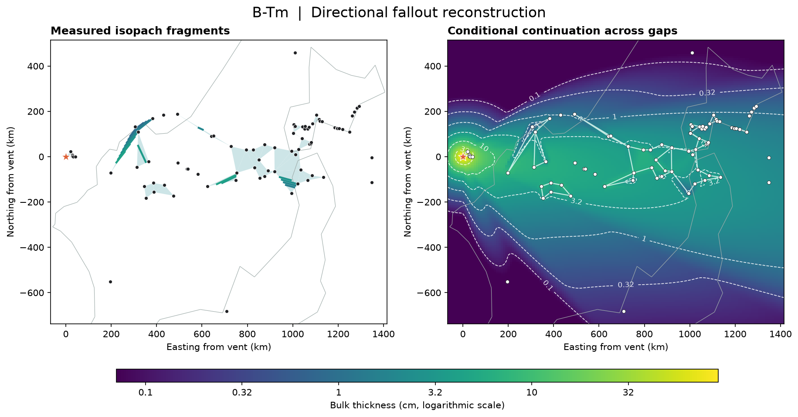
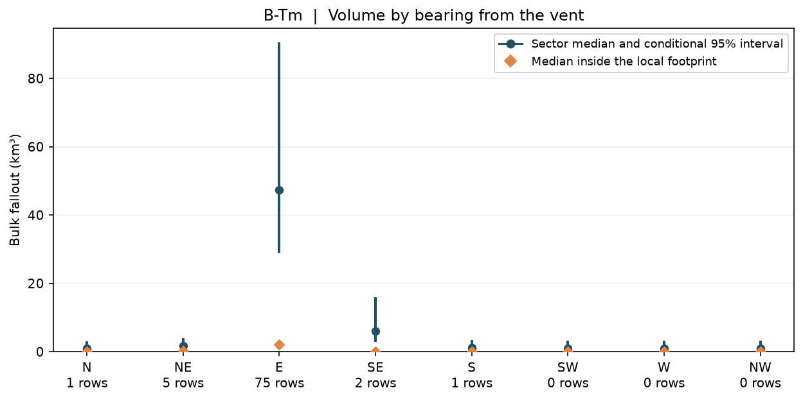

# B-Tm directional fallout estimate

**61.6 [39.7–109.0] km³ of bulk fallout** under the common two-scale continuation with an inferred distal thinning law. The brackets give the conditional 95% credible interval. A median **3.6%** of the volume lies inside retained measurement triangles. The remainder depends on extrapolation. The reference passed the sampling and integration checks.

The left map shades the interpolation footprint and shows 21 measured-bracketed line segments. The right map shows the geometric mean of posterior thickness with dashed contours. Both panels mark exact observations with circles, lower and upper bounds with up and down triangles, and the source with a star. Volume comes from integration of each complete field to the antipode.

The displayed grid reaches 124.2 cm at a source distance of 0.0 km (transition). At the supplied vent it gives 124.2 cm. These are summaries of the fitted map.

## Where the volume comes from

| Region | Median bulk km³ [95% interval] | Median fraction |
|---|---:|---:|
| Retained measurement triangles | 2.2 [1.9–2.7] | 3.6% |
| Transition around triangle edges | 4.8 [4.0–5.9] | 7.9% |
| Remaining area closer than the nearest exact site | 0.0 [0.0–0.0] | 0.0% |
| Remaining area between the nearest and farthest exact sites | 24.4 [18.1–38.1] | 41.0% |
| Remaining area beyond the farthest exact site | 28.9 [10.3–74.4] | 47.2% |

The five regions exhaust the Earth in each draw. Their separately reported medians can sum to a different value from the median total.

| Bearing | Exact rows | Bounds | Exact rows in distal half | Footprint km² | Median sector km³ [95% interval] |
|---|---:|---:|---:|---:|---:|
| N | 1 | 0 | 0 | 0 | 0.9 [0.3–2.7] |
| NE | 5 | 0 | 1 | 740 | 1.7 [0.8–3.5] |
| E | 75 | 0 | 41 | 51,015 | 47.4 [29.4–90.2] |
| SE | 2 | 0 | 0 | 676 | 6.1 [3.2–15.5] |
| S | 1 | 0 | 0 | 0 | 1.1 [0.5–2.9] |
| SW | 0 | 0 | 0 | 0 | 0.9 [0.3–2.8] |
| W | 0 | 0 | 0 | 0 | 0.9 [0.3–2.7] |
| NW | 0 | 0 | 0 | 0 | 0.9 [0.3–2.7] |

Octants span 45° centred on each compass bearing. Distal half refers to radius at or beyond the median distinct exact-site radius. The largest gap between distal bearings spans **326.4°** around **262.4°**. Measurements at the vent have no bearing. The explicit extra-fan sensitivity gives **81.8 [46.1–556.1] km³**.

## Unmeasured proximal fallout

The nearest accepted site is 2.6 km from the vent. A compact positive ash cap filling a source depression adds a median **0.00 km³** and gives **61.6 [39.7–109.0] km³**. It vanishes exactly at every accepted measurement and bound. Its amplitude comes from the fitted source-background contrast and its mass is analytic. The cap-inclusive numerical checks passed. Other unobserved proximal deposits can differ. Its matched geographic score is 1.316, with 18 held-out rows inside a training cap.

Adding the measured sites, triangle vertices and a finer near-source search to the displayed grid gives a reference thickness maximum of 126.0 cm, 2.6 km from the vent in retained measurement triangles. With the cap the highest candidate is 0.1 km from the vent. Both peak searches are finite. [Paired volume draws](source-cap.npz).

## Assumptions and validation

| Common policy | Median bulk km³ [95% interval] | Numerical checks |
|---|---:|---|
| reference | 61.6 [39.7–109.0] | pass |
| heavy tail | 143.2 [96.4–237.2] | pass |
| fixed fourth power | 74.7 [48.7–129.3] | pass |
| exponential | 57.4 [37.9–95.1] | pass |
| light tail | 61.7 [40.9–107.3] | pass |
| narrow fans | 64.5 [37.8–182.5] | pass |
| broad fans | 59.8 [46.3–89.4] | pass |
| possible missing fan | 81.8 [46.1–556.1] | pass |
| strict footprint | 68.4 [40.5–149.0] | pass |
| permissive footprint | 50.4 [36.2–77.2] | pass |
| broader background | 62.0 [39.9–107.3] | pass |
| longer transition | 61.0 [38.7–107.0] | pass |
| stronger local departures | 61.7 [39.8–112.6] | pass |

The 13 median estimates span 50.4–143.2 km³ across named assumptions. 13/13 fits passed the parameter, volume and integration checks. The intervals condition on the fitted field family, sampling locations and deposit identification. Unknown fans, preservation bias and marine redistribution can move the true total outside them.

The matched buffered geographic score is **1.316** (lower is better). Its 95% predictive intervals cover **94.0%** of exact held-out measurements. The quadrant-deletion test scored 84/84 rows with an equal-quadrant score of 3.191. Both tests rebuild the geometry from training rows.

Geographic deletion used four clusters. 4/4 fitted folds passed sampling checks. Quadrant deletion used four compass quadrants. 2/2 fitted folds passed sampling checks. Unscored folds were 2 (empty), 3 (empty).

The shared whole-contour audit found 0 policies with a qualifying band out of 3. Its record retains rejected contours, holes and geographic-deletion checks. [Complete contour audit](complete-contour-audit.json)

[Numerical report and fold identities](report.json) · [Every contour decision](isopach-fragments.csv) · [Held-out predictions](heldout.csv) · [Assumption estimates](estimates.csv) · [Joint parameter and node draws](posterior.npz) · [Sector and support mass by chain and draw](directional-mass.npz) · [All sensitivity volume draws](volume-draws.npz)
