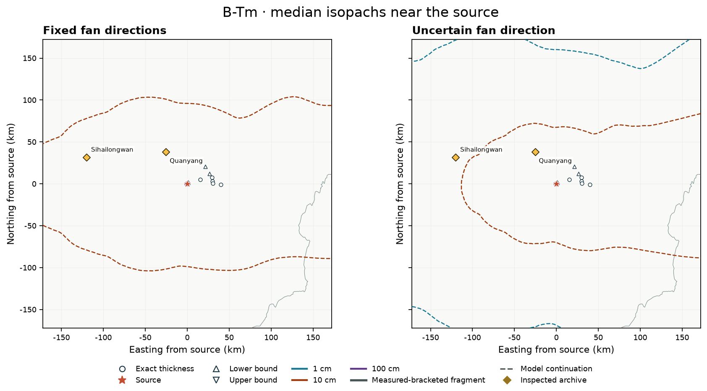
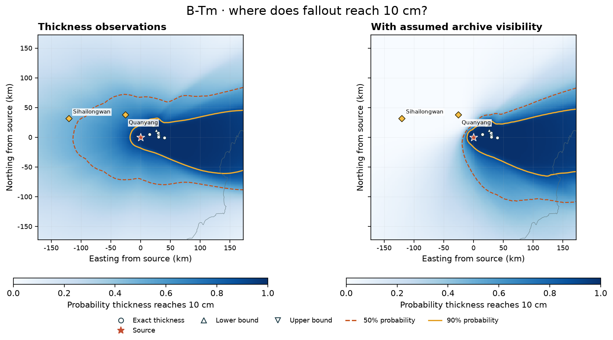

# B-Tm · directional extent

The same 68 accepted observations give a **56.2 km³** median-map integral with fixed fan directions and **44.1 km³** when an unsampled fan can turn. These two fits use identical observations and structure weights. The primary six-structure estimate on the case home uses its original calibration.

Under uncertain azimuth, integrating each complete deposit gives a volume median of **72.9 km³** and a conditional 95% range of **31.0–1,507.8 km³**. Measured interpolation triangles contribute 10.0% of the median-map volume. The rest relies on continuation.

Solid marks require a triangle whose measured sites bracket the thickness and whose posterior crossing probability reaches 90%. Dashes show the remaining median contour. White circles are thickness observations. An empty sector can contain fallout.

## Reach from the volcano

Distances are great-circle kilometres to the first outward crossing on each compass ray. The area columns give the entire 10 cm footprint in the corresponding 45° sector, including detached areas. Together they distinguish a long point on a contour from an entire broad lobe.

| Bearing | Fixed 10 cm reach (km) | Uncertain 10 cm reach (km) | Fixed ≥10 cm area (km²) | Uncertain ≥10 cm area (km²) |
|---|---:|---:|---:|---:|
| N | 96.0 | 67.5 | 3,853 | 1,925 |
| NE | 127.8 | 98.9 | 8,969 | 5,059 |
| E | 359.3 | 359.4 | 39,111 | 37,969 |
| SE | 131.4 | 107.1 | 8,698 | 7,052 |
| S | 98.8 | 70.1 | 4,206 | 2,211 |
| SW | 127.2 | 83.7 | 6,719 | 3,040 |
| W | 204.0 | 113.2 | 13,969 | 4,631 |
| NW | 126.8 | 83.4 | 6,967 | 2,891 |

The 50% and 90% probability lines answer different questions. At a location on the 90% line, nine in ten model draws reach 10 cm. These are pointwise probabilities conditional on the model. Joint confidence over an entire region requires a different calculation.

## Withheld observations

Each row averages negative log predictive scores over equally weighted folds. Lower scores predict the withheld thicknesses and limits better. The passing-only columns exclude numerical failures. A dash means no fold passed.

| Deletion | All estimable folds | Fixed | Uncertain | Passing folds | Fixed, passing | Uncertain, passing |
|---|---:|---:|---:|---:|---:|---:|
| geographic | 4 | 1.302 | 1.293 | 3 | 1.335 | 1.316 |
| quadrants | 2 | 1.426 | 1.426 | 1 | 1.234 | 1.274 |

[Predictions for every estimable held-out site](heldout.csv). The numerical record includes all planned folds, row identities, unscorable directions, fit warnings and phase-integration checks.

## Inspected archives

The thickness-only fit uses the quantitative table. Each visibility sensitivity asks what the deposit would look like if specified thicknesses at selected archives would have been recognizable as beds. The local preservation and detection scales are assumptions. The same coherent deposit supplies all site predictions.

| Visibility assumption | Sihailongwan (cm) | Quanyang (cm) | Lake Kushu (cm) | Ulleung Basin (cm) | Effective draws |
|---|---:|---:|---:|---:|---:|
| quantitative | 8.02 | 24.6 | 0.454 | 0.0116 | 11,129 |
| both 1 | 0.00229 | 0.0438 | 0.386 | 0.013 | 1,792 |
| both 10 | 0.157 | 1.14 | 0.443 | 0.0101 | 4,425 |
| lake only | 0.0804 | 1.3 | 0.546 | 0.00284 | 3,915 |
| peat only | 0.00843 | 0.0891 | 0.279 | 0.0118 | 2,083 |
| lake fine | 0.000652 | 0.016 | 0.51 | 0.00849 | 1,393 |
| visible analogs | 0.00522 | 0.111 | 0.432 | 0.0118 | 2,116 |

At Sihailongwan the thickness-only revised median is 8.02 cm, with a conditional 95% latent range of 0.000151–101 cm. Analytically averaging over every possible azimuth gives a median of 7.99 cm. Sun and colleagues counted glass shards in centimetre-thick core slices. Neither the slice thickness nor the core depth measures the original fallout bed. [Primary core study](https://doi.org/10.1016/j.gr.2015.01.013)

The visibility scenarios use the recorded assumptions below.

- **both_1** uses longgang 1 cm, quanyang 1 cm. At these core horizons, 1 cm of original local fallout suffices for recognition as a continuous layer. One slice is the sampling scale. Its status as a visibility scale is an assumption.
- **both_10** uses longgang 10 cm, quanyang 10 cm. A primary layer ten times the sampling interval suffices for a visible bed. This allows tenfold weaker net preservation or recognition than the one-slice scenario.
- **lake_only** uses longgang 1 cm. Condition on the lake alone at the one-slice scale. Predict the peat independently.
- **peat_only** uses quanyang 1 cm. Condition on the peat alone at the one-slice scale. Predict the lake independently.
- **lake_fine** uses longgang 0.1 cm, quanyang 1 cm. Effective original-fallout visibility scales of 1 mm at the varved lake and 1 cm in peat. Fine sampling and different lithology make this a sensitivity test only.
- **visible_analogs** uses longgang 1 cm, quanyang 2 cm. The original-fallout equivalent needed for a visible bed at the checked lake and peat is at most the thickness of a documented visible B-Tm bed in a comparable sedimentary setting. The Lake Ogawara OG12-2 visible layer is 1 cm. The margin of Larchenkov bog has a B-Tm ash layer up to 2 cm thick, while the central bog preserved cryptotephra. Matrix, sorting and preservation differ between archives. The model conditions on this transfer.

The mapped **visible_analogs** sensitivity gives 40.7 km³ from its median map and a conditional complete-deposit interval of 28.5–149.7 km³ (median 59.0).

## Checks and reproducibility

The shared contour audit found eligible bands under none of the screened support policies. Audit status is completed. [All contour decisions and deletion failures](complete-contour-audit.json)

The spatial integration check passed at 8,192 points per scramble. The map used up to 512 posterior draws per chain and structure. Split posterior packets disagreed about the area at 100 cm (24.3%). The joint-volume quantiles passed the split check.

All six full fits passed their sampling diagnostics.

[Numerical report, all sector volumes and sensitivities](report.json) · [Complete fields and per-field volumes](fields.npz) · [Plotted grids](map-grid.npz) · [Fragment decisions](fragment-decisions.csv) · [Bracketed coordinates](bracketed-fragments.csv) · [File hashes](artifacts.json)
