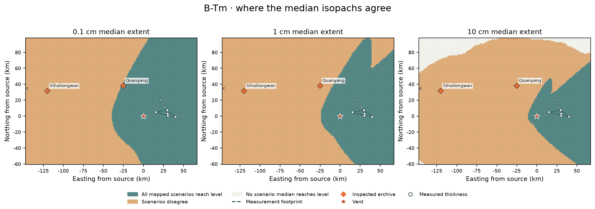
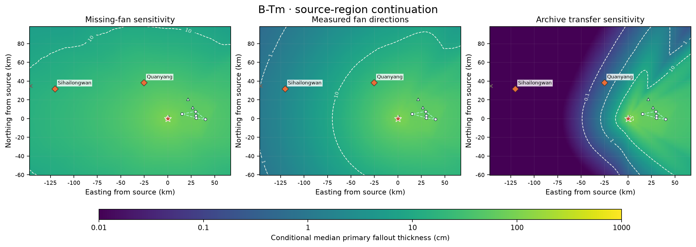
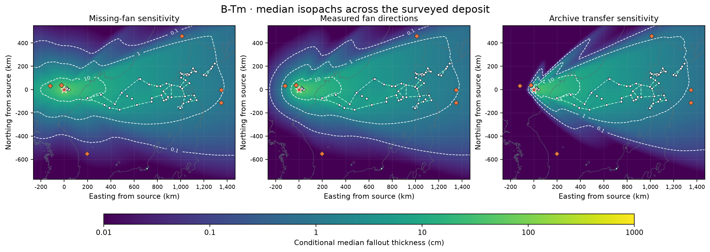
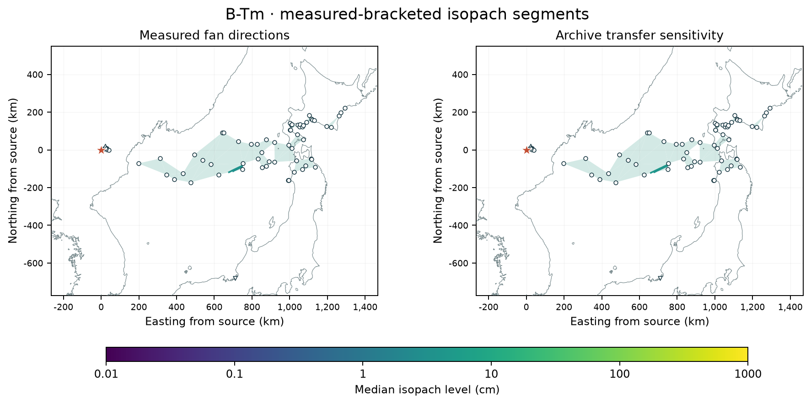
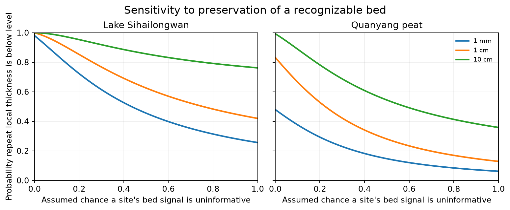
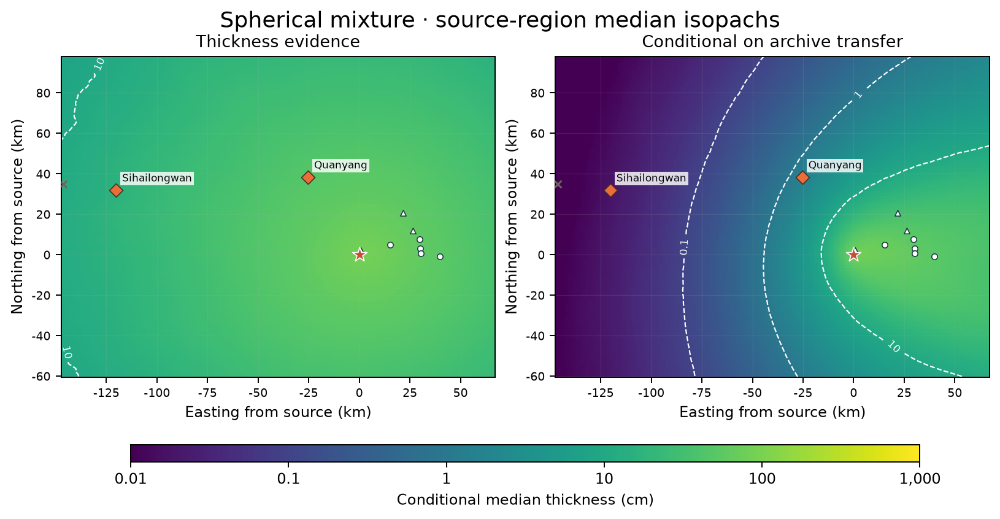

# B-Tm directional continuation

**[What the Longgang and Quanyang cores reject](field-evidence.md)** compares the original predictions, the conditional refits and the archive observations.

The median of the ensemble using measured fan directions integrates to **42.5 km³ of bulk fallout**. Angular reach varies across extrapolation assumptions. Changing reach alone preserves the field inside measured triangles. Conditioning on archive evidence can update the fitted thicknesses. A hypothetical extra fan in the largest sampling gap remains a separate structural sensitivity.

Each panel compares the same thickness level across the mapped scenarios. Ochre marks locations where changing the assumptions changes which side of an isopach the site occupies. The dashed outline encloses the measured interpolation footprint. The diamond marks an inspected archive where one is available. A scenario median below a level still permits ash at that site.

The colour scale is shared across panels. Values below 0.01 cm share the lowest colour. Diamonds mark inspected archives. The full-deposit integrals extend beyond the displayed survey area through the antipode.

Each segment lies inside an accepted interpolation triangle with measurements on both sides of the level and at least 90% conditional probability that the level crosses its nodes. Gaps and disconnected patches remain. Candidate narrow rays in the full-field panels can extend beyond the station that fixes their bearing. Only the segments here passed the local bracketing test.

| Continuation | Integral of median map (km³) | Median complete deposit (conditional 95%, km³) | SW + W + NW on median map (km³) | Numerical checks |
|---|---:|---:|---:|---|
| Measured fan directions | 42.46 | 52.3 (28.0–120.8) | 2.32 | Passed |
| One-slice effective visibility | 38.34 | 43.4 (24.4–68.3) | 0.07 | 1 member diagnostics |
| Ten-slice effective visibility | 36.18 | 44.8 (25.6–82.6) | 0.29 | Passed |
| Sub-slice visibility at the varved lake | 38.99 | 43.2 (24.4–67.1) | 0.07 | Passed |
| Comparable visible fallout beds | 35.77 | 43.5 (24.8–70.4) | 0.09 | Passed |

All eight compass sectors and their chain-resolved draws are saved per scenario. The western subtotal uses the three named 45° sectors. Bulk volumes sum through the antipode and contain extrapolated proximal, unsampled and distal fallout. The conditional intervals integrate individual deposits. Agreement among medians cannot establish an observation-supported closed band.

## Field readings and transfer assumptions

- **One-slice effective visibility.** At these core horizons, 1 cm of original local fallout suffices for recognition as a continuous layer. One slice is the sampling scale. Its status as a visibility scale is an assumption.
- **Ten-slice effective visibility.** A primary layer ten times the sampling interval suffices for a visible bed. This allows tenfold weaker net preservation or recognition than the one-slice scenario.
- **Hold Quanyang out.** Condition on the lake alone at the one-slice scale. Predict the peat independently.
- **Hold Sihailongwan out.** Condition on the peat alone at the one-slice scale. Predict the lake independently.
- **Sub-slice visibility at the varved lake.** Effective original-fallout visibility scales of 1 mm at the varved lake and 1 cm in peat. Fine sampling and different lithology make this a sensitivity test only.
- **Comparable visible fallout beds.** The original-fallout equivalent needed for a visible bed at the checked lake and peat is at most the thickness of a documented visible B-Tm bed in a comparable sedimentary setting. The Lake Ogawara OG12-2 visible layer is 1 cm. The margin of Larchenkov bog has a B-Tm ash layer up to 2 cm thick, while the central bog preserved cryptotephra. Matrix, sorting and preservation differ between archives. The model conditions on this transfer.

[Site probabilities and held-out archive checks](archive-checks.csv). The threshold at the fifth predictive percentile is the assumed effective visibility scale below which the reading would have less than 5% predictive probability. Each row identifies archives used while fitting. An uninspected or disputed horizon contributes no evidence against a contour.

**Measured fan directions** scored geographic 1.309, quadrants 1.430. Geographic sampling warnings occurred in 0. The shared screen accepted 0 complete bands across its policies. [Geographic and directional folds](quantitative/validation.json) · [Contour decisions](quantitative/complete-contour-audit.json)

**Comparable visible fallout beds** scored geographic 1.279, quadrants 2.007. Geographic sampling warnings occurred in 0. The shared screen accepted 0 complete bands across its policies. [Geographic and directional folds](visible_analogs/validation.json) · [Contour decisions](visible_analogs/complete-contour-audit.json)

## Partial preservation of the bed signal

The two archives can independently lose their ability to constrain original thickness even while preserving identifiable shards. For this sensitivity the effective visibility scales are held at the values in One-slice effective visibility. The four independently fitted posteriors condition on neither archive, either one alone, or both. Each is weighted by its predictive probability of the observed readings and the assumed chances of retaining a recognizable bed. The plot varies both loss probabilities together. The table also varies them separately. These probabilities are sensitivity parameters.

[All pairs of preservation assumptions and repeat-site probabilities](archive-reliability.csv)

## Independent spherical mixture

The same readings update the weights of complete mass-normalized spherical deposits. The likelihood includes the spherical model’s local scatter and contamination component. The whole-deposit volumes below come from the updated draws. Each retains its own physical normalization. The effective sample size and the consistency of the independent chain estimates check whether the update is numerically usable.

| Archive transfer | Complete-deposit median (conditional 95%, km³) | Weight ESS | Numerical check |
|---|---:|---:|---|
| Measured fan directions | 158.1 (40.6–4,461.4) | 12,000 | Passed |
| One-slice effective visibility | 55.9 (32.7–591.6) | 541 | Passed |
| Ten-slice effective visibility | 64.1 (34.4–926.8) | 2,490 | Passed |
| Sub-slice visibility at the varved lake | 54.4 (32.3–479.1) | 425 | Passed |
| Comparable visible fallout beds | 56.2 (33.0–618.1) | 890 | Passed |

[Spherical archive probabilities, chain checks and hull membership](spherical-archive-checks.json) · [Posterior weights by chain](spherical-archive-weights.npz)

## Reproducible results

- [Measured fan directions](quantitative/result.json) · [Median field packet](quantitative/map-fields.npz) · [Complete-field sector draws](quantitative/sector-draws.npz)
- [One-slice effective visibility](both_1/result.json) · [Median field packet](both_1/map-fields.npz) · [Complete-field sector draws](both_1/sector-draws.npz)
- [Ten-slice effective visibility](both_10/result.json) · [Median field packet](both_10/map-fields.npz) · [Complete-field sector draws](both_10/sector-draws.npz)
- [Hold Quanyang out](lake_only/result.json)
- [Hold Sihailongwan out](peat_only/result.json)
- [Sub-slice visibility at the varved lake](lake_fine/result.json) · [Median field packet](lake_fine/map-fields.npz) · [Complete-field sector draws](lake_fine/sector-draws.npz)
- [Comparable visible fallout beds](visible_analogs/result.json) · [Median field packet](visible_analogs/map-fields.npz) · [Complete-field sector draws](visible_analogs/sector-draws.npz)

[Map design](map-design.json) · [Numerical map grids](grids-log10-cm.npz)
