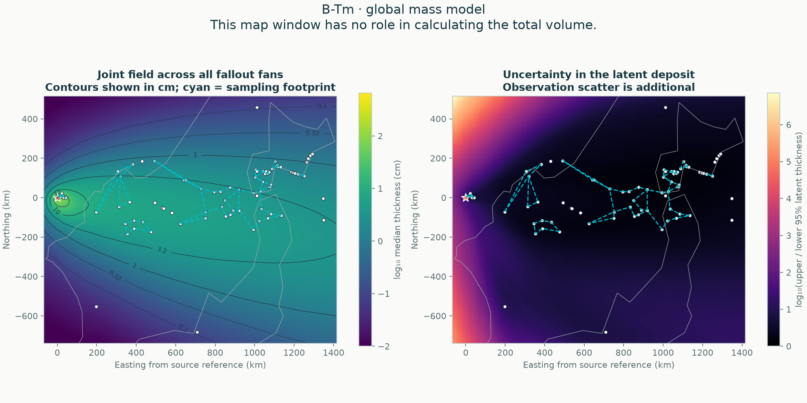
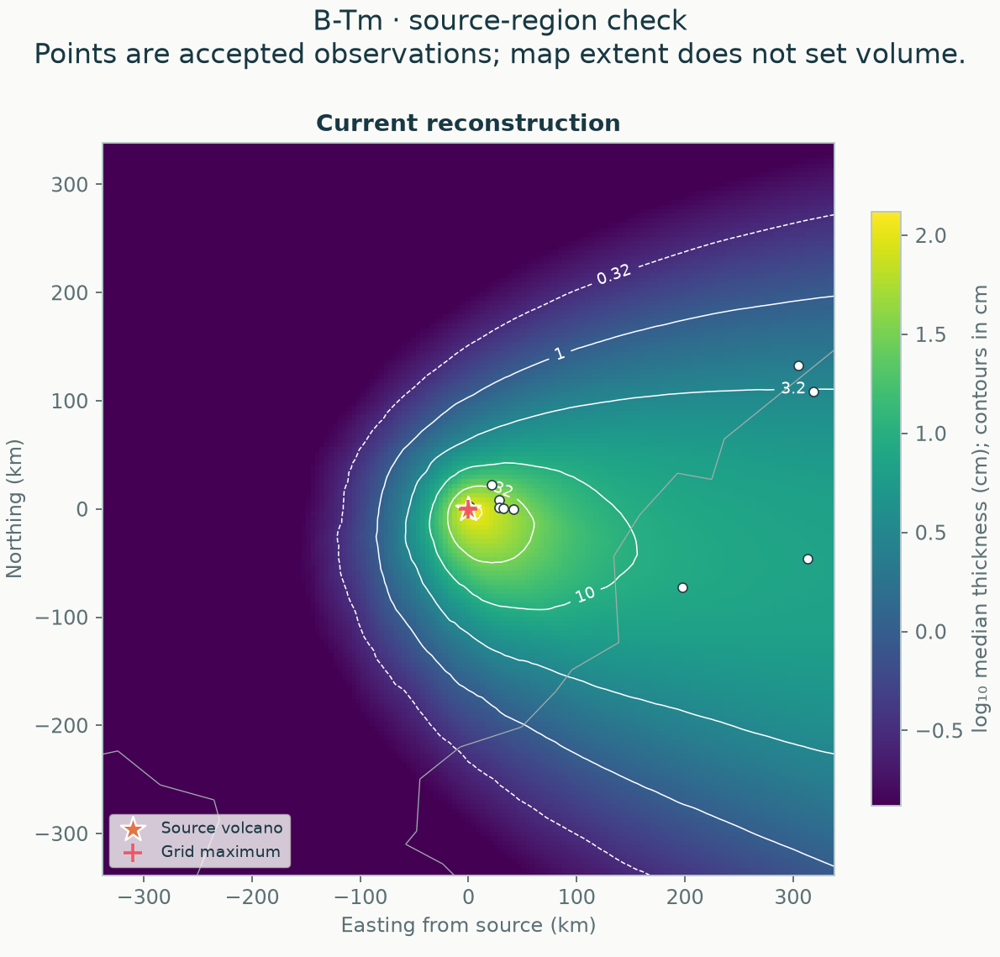
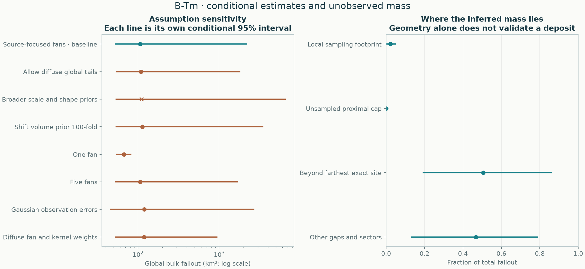

# B-Tm · global fallout estimate

[Eruption home](../../README.md) · [Regional GP/spline comparison](../README.md) · [Method and assumptions](../../../../docs/methods/probabilistic-global.md) · [All six eruptions](../../../../comparisons/global/README.md)

The baseline posterior median is **106 km³**, with a **53.2–2.16e+03 km³ conditional 95% credible interval**. This is bulk fallout across all jointly fitted fans, including co-ignimbrite ash where present in the accepted data. It excludes ignimbrite deposits and is not dense-rock equivalent. Numerical diagnostics: **passed**.

Every posterior field is positive and has total volume equal (to the reported normalization tolerance) to its fitted volume parameter on the whole Earth. No closing pseudo-observations, map rectangle, contour cutoff or arbitrary distal radius sets this total. The previous contour screen remains a diagnostic of local support; its rejection does not veto this conditional global estimate.

## Source constraint

Every fitted field has its global thickness maximum at the supplied volcano. This is an explicit shape assumption, not an invented vent-thickness observation. Thickness decreases along every source ray, so this family cannot represent a secondary radial maximum. Real deposits can violate a point-source maximum, particularly with distributed sources or secondary deposition. The maximum relative change in any posterior component's integral on quadrupling angular resolution was **4.5e-08** (tolerance 10⁻⁶). [Derivation, rejected alternatives and geological limits](../../../../docs/methods/source-anchored-fans.md).

## What the interval means

Uncertainty includes the fitted field geometry, relative strengths, total volume and observation scatter parameters. The source-focused alternative also varies its tail shape; the bounded-envelope alternative has Gaussian tails. The latent volume excludes observation noise. It remains conditional on general modelling assumptions: a finite mixture of smooth, source-related, radially decreasing components, a proper volume/scale prior and a stated observation model. Several components form overlapping fallout fans; they are mathematical components, not independently measured eruption phases.

No finite dataset alone can exclude an arbitrarily large deposit in an unsampled region. The proper prior makes inference possible; it does not create geological evidence. Unrecorded erosion, reworking, preferential sampling and source misattribution are not automatically covered by this interval. If residual scatter is unresolved areal deposition variability rather than observation/preservation error, central-field volume can differ from area-mean physical mass; that structural correction is not automatically included. Bounds retain their documented likelihood meaning.

## Sensitivity to those assumptions

| Assumption | Median km³ | Conditional 95% interval km³ | Fitted-site log-RMSE | Numerical checks |
|---|---:|---:|---:|---|
| Source-focused fans · baseline | 106 | 53.2–2.16e+03 | 0.730 | pass |
| Allow diffuse global tails | 109 | 54.3–1.78e+03 | 0.730 | pass |
| Broader scale and shape priors | 111 | 53.8–6.49e+03 | 0.726 | **not passed** |
| Shift volume prior 100-fold | 113 | 53.9–3.44e+03 | 0.731 | pass |
| One fan | 67.6 | 54.8–81.5 | 0.807 | pass |
| Five fans | 106 | 53.1–1.67e+03 | 0.729 | pass |
| Gaussian observation errors | 119 | 45.8–2.65e+03 | 0.706 | pass |
| Diffuse fan and kernel weights | 118 | 53.1–939 | 0.734 | pass |

The range across the lower and upper interval endpoints is **45.8–6.49e+03 km³**. This is an assumption-sensitivity envelope, **not** a 95% interval, a probability-weighted model average, or an exhaustive bound. Every alternative remains visible, including those that differ substantially; none was selected because its volume matched a published target.

Fitted-site log-RMSE compares the posterior predictive median with the exact measurements used for fitting; bounds contribute their likelihood events instead. These training checks can expose a restrictive alternative, but are optimistic and **not validation or a model-selection rule**. Only the baseline receives the full matched geographic holdout analysis below. Alternatives have not been given probability weights or declared equally plausible.

## Validation and numerical precision

Four buffered geographic holdouts: equal-region negative log score **1.162** (lower is better), log-thickness RMSE **0.861**, and heldout observation coverage **92.9%**. All four posterior fits passed numerical diagnostics: **True**. These predictions test transfer to withheld observations, not the unobserved whole-deposit volume.

Baseline chains: maximum rank-normalized split R-hat **1.0019**, minimum bulk/tail effective sample sizes **1529/1967**, minimum energy BFMI **0.723**, divergences **0**. Diagnostics cover label-invariant global, observed-site and unsampled-field summaries. Passing them is evidence of numerical mixing, not proof of complete mode exploration. All shorter failed attempts are retained in the report. Monte Carlo standard errors of volume log-quantiles are recorded separately; rounded interval endpoints are estimates. [Inspect the chain traces and distributions](sampling.png).

Mass partition uses 1024 whole posterior fields and 4096 positive quadrature points per component. The largest fraction change on doubling that integration rule is **0.0084**. This numerical partition never changes the separately normalized total. Its local footprint is a sampling screen, not a confidence region.

## Reproduce and inspect

Use `tephra-isopachs global data/eruptions/B-Tm_tephra.csv --geometry source-fans --output results/new-global-run`. Use `--resume` only for the same run; caches verify inputs, priors, numerical settings, source hashes, runtime versions and posterior checksums. The ordinary `compare` command runs the regional comparison followed by this global analysis.

- [Full report, priors, diagnostics, all attempts and provenance](report.json)
- [Baseline whole-field posterior samples](posterior.npz)
- [Volume samples for every assumption and chain](volume_draws.csv.gz)
- [Assumption summary](estimates.csv)
- [Geographic predictions and fold membership](heldout_predictions.csv)

Input SHA-256: `56d82584b2c45fd378d639248416159ffea9350099d1d2009576551d1729cf8d`. No accepted observations or source audits were changed for this calculation.

## Targeted observation review

The source-focused geometry comparison preserves the accepted input. A recovered published source table identifies Suigetsu as <0.1 cm and Kushu as cryptotephra without a measured visible-layer thickness, whereas the accepted input uses exact 0.1 cm values. A separate two-site interpretation gives **100 km³ (46–2,390 km³ conditional 95% interval)**; numerical checks pass. [Source crosswalk](../../../../comparisons/source-revision/input-inventory/b-tm-workbook-review/README.md) · [Sensitivity and remaining data qualifications](../../../../comparisons/source-revision/btm-input-sensitivity/README.md). The headline is therefore a controlled geometry correction, not a claim that every thickness has been independently audited.
