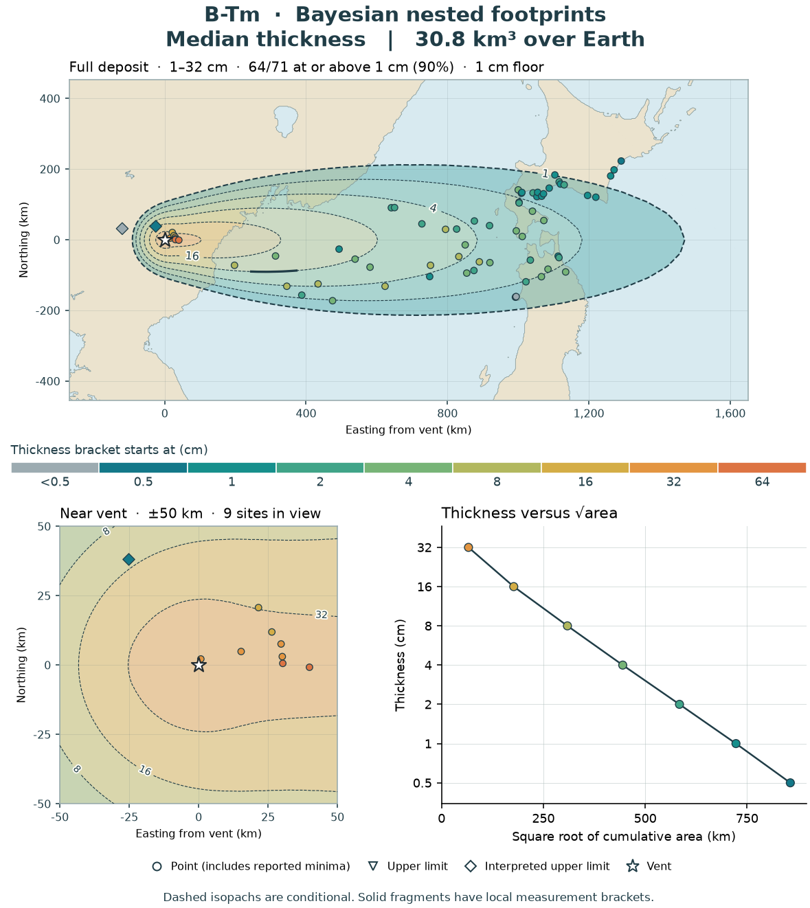

# B-Tm · Bayesian nested footprints

The principal bulk volume is **30.8 km³**, the whole-Earth integral of the median-thickness map. The conditional thickness-band range is **26–37.1 km³**. Its endpoints integrate the pointwise 25th and 75th percentiles of latent thickness over Earth.

Each circle shows a measurement. Bounded sites take the colour of their stated limit. The curve counts every patch at or above each thickness. The 1 cm footprint includes 64 of 71 modeled locations. The thickest displayed line is 32 cm and encloses 7 fitted locations. The volume includes fallout beyond the displayed contours. [Median thickness grid](median-grid.npz) · [Thickness and cumulative area](thickness-area.csv) · [Map integral, resolution and source hashes](deposit.json)

The fitted model predicts the four buffered geographic groups with an equal-group negative log score of 1.357. 3 of four independent deletion fits passed their numerical checks.

Each deposit draw expands one or more dispersal footprints. Stations enter through their thickness evidence. The direction and extent of each phase are inferred jointly with the area–thickness curve.

[Joint fit, structural sensitivities and numerical checks](footprints/report.json) · [Held-out predictions](footprints/heldout.csv.gz) · [Contour support and all rejection reasons](footprints/support.json.gz) · [Archive-site predictions](footprints/archive-probes.json) · [Volume and observations by compass sector](footprints/sector-volumes.csv)

## Geographic support and extrapolation

Across draws, the median volume share inside the first measured area rank is 0.0%. The median share outside the last positive rank is 8.2%, with a conditional 95% range of 2.4%–34.0%. A measured site can constrain one part of a perimeter while its opposite side remains unsampled.

The shared geographic screen accepts a complete contour band under 0 of 3 policies. The S, SW sectors contain no accepted off-vent sites. These bearings account for 2.6% of the median-map volume.

[Sector-by-sector evidence and volume](footprints/sector-volumes.csv) · [Volume sensitivity to the priors](footprints/report.json) · [Complete contour decisions](footprints/support.json.gz)
