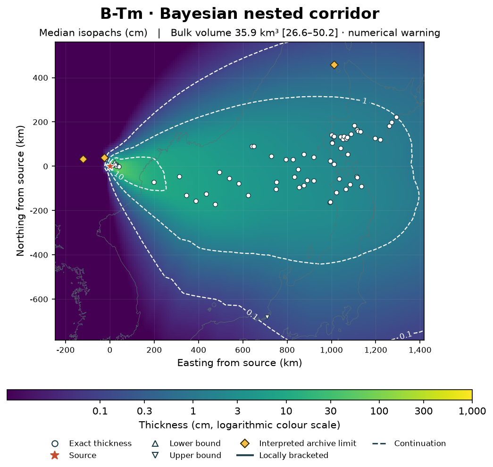
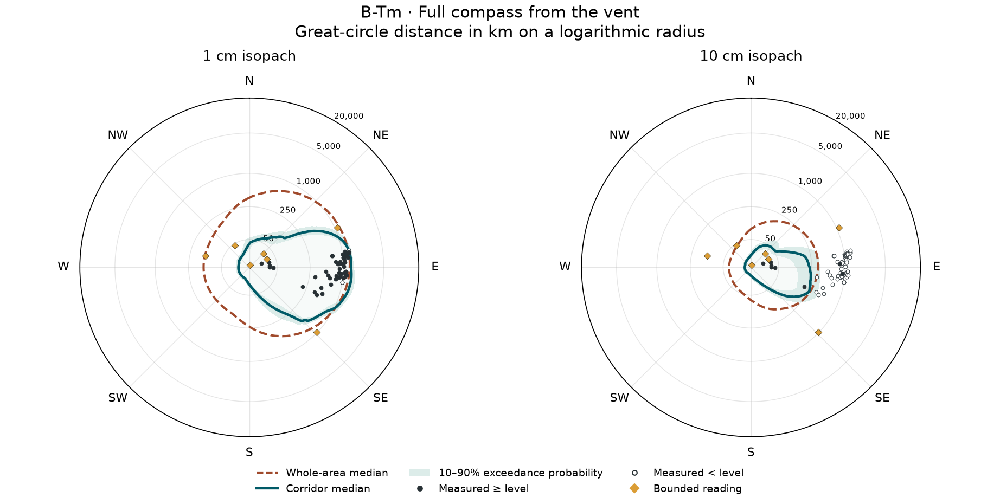

# B-Tm · Bayesian nested isopachs

The principal corridor estimate of bulk fallout is **35.9 km³** (conditional 95% interval **26.6–50.2**). The median thickness map integrates to 33.7 km³. The whole-area sensitivity gives 90.4 km³ (52.0–534.5).

Solid portions cross a retained triangle with thicknesses on either side at distinct measured sites and at least 90% posterior crossing probability. Dashed portions depend on the continuation. The triangles diagnose spatial coverage. The shared contour screen also checks thickness bracketing and deletion stability. [Whole-Earth field](world.png) · [Every local bracket](local-brackets.csv.gz) · [Complete contour checks](support.json)

The buffered geographic score is 1.544 for the corridor and 1.570 for the whole-area sensitivity. Lower scores indicate better predictions at withheld sites. The corridor’s 95% predictive intervals cover 59 of 64 exact withheld readings. 4 of 4 geographic fits passed their sampling checks. The full-data proposal and importance check retained a warning, the final volume populations passed, and the integration check passed. The shared screen accepted a complete contour band under 0 policies. [Prediction scores and row identities](report.json) · [Full fit diagnostics](full.json)

## Where the volume lies

The full-compass view includes all bearings through the antipode. Its logarithmic distance scale makes the proximal flanks visible. Areas in the table use the physical equal-area integral.

| Compass sector | Exact sites | Bounded sites | Corridor 1 cm area (km²) | Whole-area 1 cm area (km²) | Corridor volume (km³), median [95%] |
|---|---:|---:|---:|---:|---:|
| N | 0 | 1 | 625 | 55,423 | 0.065 [0.025–0.2] |
| NE | 0 | 3 | 30,789 | 331,346 | 1.9 [0.9–4.3] |
| E | 64 | 0 | 638,627 | 612,248 | 26.4 [19.9–37.2] |
| SE | 0 | 1 | 125,384 | 273,009 | 6.9 [4.0–11.1] |
| S | 0 | 0 | 454 | 36,478 | 0.08 [0.027–0.3] |
| SW | 0 | 0 | 80 | 7,729 | 0.009 [0.0043–0.036] |
| W | 0 | 1 | 71 | 6,593 | 0.0084 [0.004–0.033] |
| NW | 0 | 1 | 106 | 9,346 | 0.013 [0.0058–0.046] |

At 1 cm, the corridor median map encloses 796,136 km² and the whole-area sensitivity encloses 1,332,172 km². Of these, 698,883 and 1,234,920 km² fall outside the retained exact-site triangles. An unsampled sector can contain ash. Its allocation depends on the assumed continuation.

The prior assigns 25% to continuation across all bearings. The remaining probability spans three fan widths and three down-range extensions. The fitted probability of whole-bearing continuation is 0.0%. The widths and extensions are shared structural assumptions. A bound supplies a likelihood event. Only positive evidence supplies a potential dispersal corridor.

[Volume and sector draws](volume-budget.npz) · [Complete field draws](full.npz) · [Areas, assumptions, bounds and diagnostics](report.json)

## Structural uncertainty

[Corridor and whole-area maps on a common scale](paired-isopachs.png)

| Prior probability of broad continuation | Median bulk volume, km³ [conditional 95%] |
|---:|---:|
| 10% | 35.9 [26.6–50.2] |
| 25% | 35.9 [26.6–50.2] |
| 50% | 35.9 [26.6–50.2] |
| 75% | 35.9 [26.6–50.2] |

The prior odds vary under the same observed likelihood. The numerical report also gives the volume by individual corridor law where the saved draws resolve it.

At Lake Sihailongwan the fitted median is 2.43e-05 cm and the predictive probability of the interpreted ≤0.06 cm event is 99.99%. The archive constrains an upper limit. The actual bed thickness remains unknown.

[Whole-area sensitivity report, posterior and diagnostics](../nested-whole-area/README.md)
