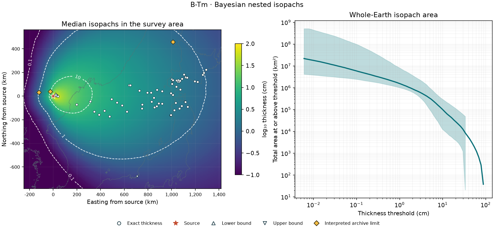

# B-Tm · Bayesian nested whole-area sensitivity

[Principal corridor estimate and median isopachs](../nested-isopachs/README.md)

**90.4 km³ of bulk fallout**, with a conditional 95% interval of **52.0–534.5 km³**. Each sample integrates one complete deposit over the Earth.

Continuing the fitted slopes freely beyond every sampled isopach rank gives 87.5 km³ [53.2–469.1]. The whole-area fit transfers the remaining-to-interior mass ratios of four independently mapped falls at the same relative thinning. Reducing or increasing the transferred odds fourfold gives medians of 78.7 and 126.5 km³. Every accepted training site has exactly the same predicted thickness in these continuations.

The refined profile learns the amount deposited beyond its own thinning break. Its median distal share is 86.5% (conditional 95% 2.5%–98.6%). The thinning break belongs to the deposit and can lie on either side of the outermost measured site.

The 71 accepted rows include 64 exact thicknesses, 3 lower bounds, 4 upper bounds and 0 two-sided intervals.

Dashed contours show model predictions. Shading in the area panel gives pointwise conditional 95% limits wherever the lower area is positive. [Whole-Earth map](world.png) · [Complete contour support decisions](support.json)

## Validation

Accepted CSV row 59 (Lake Suigetsu) sets the last sampled isopach rank in 62.2% of complete draws and 14.6% among the largest 5% by volume. Ties split the credit. This identifies where the shape assumes that measured thinning ends. It does not measure the effect of deleting a site. [Attribution to every measured or bounded site](edge-sites.csv) · [Refit with the controlling site and its local cluster withheld](edge-deletion/README.md)

The independent full-data populations gave medians from 85.2 to 96.1 km³. Their upper 95% endpoints ranged from 476.6 to 605.0 km³. The unmodified thinning profile passed and the continued global volume passed. [Population estimates and refinement history](full.json)

The matched geographic score is 1.570. 4/4 training-fold fits passed the population check. The full-fit population check passed. Direct spatial integration passed.

At withheld exact sites, 60/64 measurements fell inside their 95% predictive intervals. The median fraction of a draw’s volume inside the retained exact-site triangles is 4.9%. The median fraction beyond the farthest exact site is 21.7%. Geographic classes describe sampling coverage.

No complete contour band passed the shared support screen. The global estimate remains conditional on unsampled sectors, the unmeasured core and the distal thinning law.

## What contributes to volume

A thickness slab counts the stated slice everywhere the deposit reaches it. The highest slice can occur near or far from the source. Each draw conserves volume across all slices. Marginal medians need not add to the total median.

| Thickness slice (cm) | Median [conditional 95%], km³ |
|---|---:|
| 0–0.01 | 2.88 [0.46–50.19] |
| 0.01–0.1 | 8.26 [2.66–162.44] |
| 0.1–1 | 24.31 [13.56–219.38] |
| 1–10 | 38.46 [22.65–132.58] |
| 10–100 | 9.22 [1.86–36.71] |
| 100–1000 | 0.00 [0.00–1.90] |
| >1000 | 0.00 [0.00–0.00] |

## Prior sensitivity

| Assumption | Median [conditional 95%], km³ | Effective draws |
|---|---:|---:|
| baseline | 90.4 [52.0–534.5] | 6,144 |
| weak profile transfer | 91.1 [53.4–539.4] | 1,879 |
| broader peak prior | 90.4 [52.0–535.0] | 6,127 |
| power tail prior 80pct | 92.7 [53.4–580.7] | 3,960 |
| exponential tail prior 80pct | 89.1 [51.2–506.8] | 5,302 |
| detached prior 50pct | 96.4 [52.8–607.5] | 4,383 |
| more distal ash prior | 91.1 [50.5–615.7] | 5,212 |
| less distal ash prior | 89.6 [53.3–479.5] | 4,219 |
| distal prior without Santa Maria 1902 | 90.0 [53.9–429.9] | 3,533 |
| distal prior without Quizapu 1932 | 90.6 [52.0–565.7] | 6,022 |
| distal prior without Novarupta 1912 | 90.7 [51.9–572.0] | 6,011 |
| distal prior without Hudson 1991 | 91.0 [51.6–584.7] | 5,890 |

## Compatibility with fitted bounds

Of 7 documented thickness bounds, 2 had a posterior-predictive probability below 5% under the fitted model. Each bound entered the likelihood once. This check includes field scatter and known measurement error.

| Site or source row | Bound (cm) | Median field (cm) | Probability of observed bound |
|---|---|---:|---:|
| Lake Sihailongwan | ≤ 0.06 | 1.12 | 0.77% |
| Quanyang peat | ≤ 0.64 | 9.08 | 0.98% |

The numerical report gives the latent and observation probabilities at every fitted bound. A poorly predicted bound identifies a limitation of the fitted thinning geometry or error model.

## Additional distal thinning

Beyond the largest equivalent isopach radius of any training site in a draw, a smooth extra thinning term tests progressive loss of transported ash. The three fixed scenarios reach an additional e-fold of attenuation after one, two or four more sampled radii. All three integrate to the antipode. The same rule is applied to the training sites in each geographic fold.

| Additional range | Median [conditional 95%], km³ | Geographic score ↓ |
|---|---:|---:|
| 1 × sampled radius | 80.7 [51.0–316.5] | 1.568 |
| 2 × sampled radius | 85.0 [51.7–356.0] | 1.569 |
| 4 × sampled radius | 88.0 [52.0–403.6] | 1.570 |

The accepted sites give each scenario the same fitted likelihood. The difference in global volume measures sensitivity to the unobserved continuation. [Quadrature and withheld-site checks](distal-taper.json)

The intervals condition on the recorded sampling locations and the specified shape family. Preservation, reworking and the far-field transfer of analogue slopes can introduce additional uncertainty.

[Numerical report and archive probes](report.json) · [Withheld thickness predictions](heldout.csv) · [Geographic training IDs](geographic.json) · [Full posterior](full.npz) · [Per-draw thickness budgets](volume-budget.npz)

[Matched test of the volume assigned to unsupported bearings](bearing-study/README.md)
