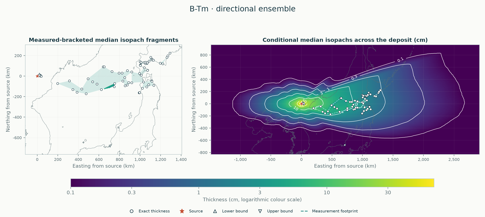

# B-Tm sensitivity to source interpretation

The principal median-map integral is **54.0 km³**, with a conditional whole-deposit interval of **31.8–1,211.9 km³**. All six principal structures pass the full-data sampling and integral checks. One of four geographic holdouts and one of two estimable source-sector holdouts retain numerical warnings. Two sectors contain no observations. The directional contour audit finds no completely supported band under any of its three policies. The accompanying regional estimates over the 549,464 km² observation hull are 24.3 km³ for the GP and 28.5 km³ for the spline. The independent spherical sensitivity calculations are still running. [Audited input](../../../../data/eruptions/B-Tm_reviewed.csv) · [Source decisions](../../../../data/audits/B-Tm/README.md)

Each row uses the same six directional structures and the same ensemble weights. The central estimate integrates the pointwise median thickness over Earth. The interval uses entire simulated deposits with their spatial dependence intact. It covers bulk airfall from both phases in km³.

| Reading | Sites and bounds | Median-map integral | Volume median | Conditional 95% interval | Full-data fits passing | Map integration |
|---|---:|---:|---:|---:|---:|---|
| [Principal selection](principal/report.json) | 68 | 54.0 | 73.5 | 31.8–1,211.9 | 6/6 | Pass |
| [Twelve low endpoints](range_low/result.json) | 80 | 50.8 | 67.2 | 33.2–991.1 | 6/6 | Pass |
| [Twelve high endpoints](range_high/result.json) | 80 | 59.2 | 79.1 | 38.8–1,016.5 | 6/6 | Pass |
| [Both disputed proximal stacks](correlations/result.json) | 68 | 46.8 | 64.4 | 29.7–1,222.1 | 6/6 | Pass |
| [Samjiyon as 700 cm of combined fall](samjiyon_scalar/result.json) | 69 | 63.9 | 84.8 | 37.4–1,070.3 | 6/6 | Pass |
| [Samjiyon as ≥700 cm of combined fall](samjiyon_component/result.json) | 69 | 66.6 | 87.2 | 39.1–1,054.7 | 5/6 | Pass |
| [Samjiyon as ≤700 cm of combined fall](samjiyon_complete_stack/result.json) | 69 | 53.6 | 73.3 | 31.5–1,149.9 | 6/6 | Pass |
| [Samjiyon as 160 cm from Hoang (1987)](samjiyon_160/result.json) | 69 | 57.3 | 77.3 | 34.5–1,132.7 | 6/6 | Pass |

The endpoint cases restore the same twelve positive site ranges. Moving every site to the same end of its own range tests a coordinated change in reporting. The proximal case assigns 150 cm to the summit and 26 cm to Dongfanghong. The four Samjiyon cases each add one site at the alternate workbook position. The lower limit assumes that all 7 m is primary Millennium fall and additional fall could be missing. The upper limit assumes a complete, representative stack that includes all local Millennium fall and may include other material. The 160 cm scenario uses the earlier botanical field account from the Samjiyon area. [Field evidence and stratigraphic assumptions](../../../../data/audits/B-Tm/samjiyon.md)

## Why the directional interval is wide

The principal fit gives every structure a weight learned from the other eruptions. Three structures allow a separate fallout fan in a poorly observed direction. Those structures assign more probability to large totals.

| Principal structure | Weight | Whole-deposit median (km³) | Conditional 95% interval (km³) |
|---|---:|---:|---:|
| narrow fans | 15.7% | 50.5 | 26.8–126.7 |
| reference | 16.6% | 55.5 | 33.7–134.7 |
| broad fans | 11.9% | 60.1 | 44.8–120.0 |
| narrow missing fan | 14.9% | 83.0 | 32.1–726.1 |
| possible missing fan | 22.9% | 100.8 | 40.4–1,548.8 |
| broad missing fan | 18.0% | 142.2 | 54.4–3,836.4 |

In the saved principal volume draws, the ensemble assigns 5.8% above 500 km³. Structures permitting a missing fan account for 100.0% of that weighted tail. The 500 km³ threshold describes where large simulated volumes come from and has no role in fitting or accepting data. [Principal whole-deposit draws](principal/coherent-mass.npz)

## Predictions at Samjiyon before inclusion

The principal ensemble was fitted without the 7 m record. The field describes the smooth deposit at each position. A new local observation also includes the model’s estimated residual variation. All values below are centimetres. The town and pond locate named features and illustrate how predictions change nearby.

| Position | Field median (conditional 95%) | New local observation, median (conditional 95%) | Probability of a local observation above 1 m | Above 7 m |
|---|---:|---:|---:|---:|
| Workbook position | 51.6 (17.1–108.5) | 50.4 (7.3–311.6) | 22.9% | 0.26% |
| Samjiyŏn-ŭp, GeoNames 2041442 | 48.1 (14.5–101.8) | 46.7 (6.5–291.2) | 20.6% | 0.21% |
| Samji-yŏn pond, GeoNames 2041444 | 52.2 (22.5–104.9) | 51.4 (8.3–308.7) | 23.1% | 0.25% |

The table uses all 32,000 retained final-chain draws, with each structure receiving its calibrated weight. Repeating the workbook calculation with the smaller map packet gives 0.25% probability of a new local observation over 7 m. [Full local prediction draws](samjiyon-local-draws.npz)

At the workbook location, 160 cm is inside the 95% local prediction interval of 7.3–311.6 cm. The reported 700 cm is above that interval. These comparisons condition on the location transfer and the eruption model.

A low probability measures tension with this fitted model. It cannot identify the outcrop, prove reworking or date the bed. The 2002 field party’s observation of more than 1 m applies to multiple localities in the area. [Replayable numerical predictions](samjiyon-prediction.json)

- **Samjiyon as ≥700 cm of combined fall** retains numerical warnings for broad fans.

The principal fit includes geographic and source-sector holdouts. The seven source scenarios are full-data refits with the target eruption excluded from ensemble calibration. Each numerical record lists the attempts, diagnostics and map refinements. The intervals condition on the corresponding data interpretation and fan model. Combining their endpoints would give a sensitivity envelope with no common coverage probability.

[Scenario table](source-scenarios.csv) · [Principal directional fit](principal/report.json) · [Source ledger and physical interpretation](../../../../data/audits/B-Tm/README.md) · [Outermost measured sites by direction](octant-extremes.csv)

[Low-endpoint draws](range_low/volume-draws.npz) · [High-endpoint draws](range_high/volume-draws.npz) · [Alternative-proximal draws](correlations/volume-draws.npz) · [Samjiyon scalar draws](samjiyon_scalar/volume-draws.npz) · [Lower-bound draws](samjiyon_component/volume-draws.npz) · [Upper-bound draws](samjiyon_complete_stack/volume-draws.npz) · [160 cm account draws](samjiyon_160/volume-draws.npz) · [Evidence snapshot hashes](release.json)

## Regional numerical check

The Kinashibetsu correction exposed a loss of precision in a strongly penalized spline refit. On the affected geographic fold, subtracting nearly equal penalty terms made the computed objective increase even at a stationary Newton proposal. The fitter now accepts such a proposal only if its independently recalculated Hessian and gradient meet the existing strict convergence threshold. The input values, likelihood, model families and validation folds retain their usual definitions. The check was rerun on all six eruptions. The other five exactly reproduced their published regional volumes and geographic scores. Each family completed 38 of 40 synthetic trials. The same two heavily censored training sets remained unestimable for both methods. [Matched regional results](matched-regional.csv) · [Paired comparison with previous results](spline-replay.csv) · [Synthetic trials, including failures](matched-synthetic.csv) · [Benchmark settings](regional-benchmark-design.json)
