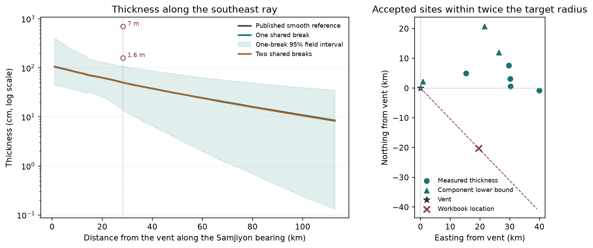

# Does segmented thinning explain the Samjiyon discrepancy?

The principal fit and every comparison here use the same 68 audited B-Tm observations. All four disputed Samjiyon thickness interpretations and the other DPRK locality summaries are withheld. The experiment predicts at the workbook position before considering either the 1.6 m or the 7 m account. [Input](../../../../../data/eruptions/B-Tm_reviewed.csv) · [Field evidence](../../../../../data/audits/B-Tm/samjiyon.md)

## What the published curve allows

In the directional model, a short-range component and a longer, bearing-dependent component contribute to thickness. Their relative contributions change with distance. Even when both kernels are exponential, their sum can change semi-log slope smoothly. The usual kernels also allow the distal slope to flatten. The standard model has no explicit change point. Inside supported triangles its field can depart from this background through the measured nodes. [Model equations](../../../../../docs/methods/directional-continuation.md)

The workbook position is 28.2 km from the vent at 136.1°. It lies in the interpolation transition zone. Local nodes contribute 0.62% of the log-field weight and the radial background contributes 99.38%. There are 8 accepted sites within 56.4 km of the vent. Their bearings span 20–91°. The nearest, Pan trench 1, lies 23.5 km from the workbook location. [Nearby sections, measurements and bounds](nearby-sites.csv)

The classical segmented-exponential relation uses log thickness and the square root of enclosed isopach area. A source-to-site radial transect is a different quantity. This deposit has no accepted complete directional isopach band from which to identify an observed area-space breakpoint. The comparison here tests the consequence a radial slope change would have at the disputed site. [Pyle (1989)](https://doi.org/10.1007/BF01086757) · [Fierstein and Nathenson (1992)](https://pubs.usgs.gov/publication/70017275) · [Bonadonna et al. (1998)](https://doi.org/10.1016/S0377-0273(98)00007-9)

## Predictions and geographic validation

| Radial model | Local median, cm | Conditional 95% local interval, cm | Probability above 700 cm | Equal-fold negative log score | Proximal negative log score | Folds with sampling warnings |
|---|---:|---:|---:|---:|---:|---|
| Published smooth reference | 48.5 | 6.5–315.1 | 0.28% | 1.425 | 0.985 | None |
| One shared break | 48.2 | 6.3–314.9 | 0.28% | 1.425 | 1.036 | None |
| Two shared breaks | 48.1 | 6.3–311.5 | 0.27% | 1.441 | 1.082 | None |
| Exponential kernels | 51.5 | 7.5–327.2 | 0.31% | 1.408 | 0.957 | None |
| Exponential kernels, one break | 51.3 | 7.4–320.6 | 0.28% | 1.423 | 0.996 | None |
| One break, wider slope prior | 47.8 | 6.3–310.4 | 0.27% | — | — | Full fit only |

All six full-data fits passed the sampling screen. Across the explicit-break alternatives, the probability of a new local observation above 7 m is 0.27%–0.28%. The one-break radius has median 60.6 km and conditional 95% interval 2.9–1,124 km. Its slope multiplier has median 1.24 and interval 0.44–3.58. The observations allow both steeper and gentler post-break thinning. These shared radial changes leave the 7 m account well into the predictive tail at the workbook position. A localized southern lobe or changes in phase geometry are outside this test. Local accumulation, an uncertain outcrop position or a different stratigraphic unit also remain possible.

The one-break model’s change in negative log score relative to the published smooth reference was +0.018, +0.007, -0.030, +0.005 in geographic folds 0–3. A negative change favours the new curve. All eight proximal observations lie in one held-out region. Four regional scores and a single proximal group give limited evidence for choosing a thinning law. The principal six-structure ensemble has its own calibrated weights and separate estimate. [All held-out scores](heldout.csv) · [Full and map-packet predictions from the principal ensemble](../samjiyon-prediction.json)



## Experimental design

The comparison preserves the reference fan width, training-derived directions, two deposition scales, mesh, Gaussian local effects and censored observation likelihood. Distance along each ray uses the source-centred authalic chord from the published geometry. A continuous change in effective radial distance gives each segment a positive slope. For one breakpoint at distance b, the effective distance is min(r,b) + q max(r−b,0). Thus q=1 reproduces the original radial curve. The slope can steepen or flatten. With exponential kernels each component is exponential within each segment. Both break distances are shared across bearings in the two-break model. These are tests of one directional structure, with all other assumptions held fixed. No experimental volume is substituted for the published ensemble.

Ordered breaks have a uniform prior on log radius between the nearest and farthest positive training-site radii. These endpoints are recomputed in each holdout. Independent increments to log slope have zero-mean normal priors with standard deviation log(2), or log(4) in the wider full-data sensitivity. Posterior break positions and slope changes are integrated over. Four chains and the reference retry thresholds are used throughout. Local prediction intervals include residual site scatter. A field interval in the figure describes only smooth thickness at that location. [Posterior diagnostics, break ranges and training IDs](fits.json) · [Local posterior draws](local-draws.npz) · [Transect values](rays.csv)

From the repository root, repeat the experiment in a fresh directory.

```sh
for v in smooth one_break two_breaks exponential broken_exponential wide_prior; do
  python -m benchmarks.btm_thinning --work results/btm-break-check --variant "$v"
done
python -m benchmarks.btm_thinning_report --work results/btm-break-check --output results/btm-break-report --reference eruptions/b-tm/results/source-audit/principal/single-reference.json
```
