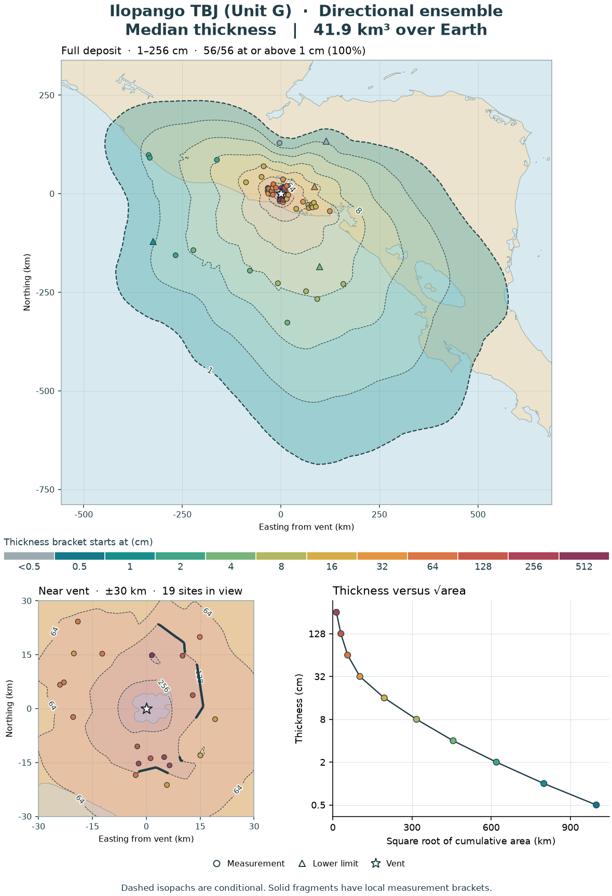
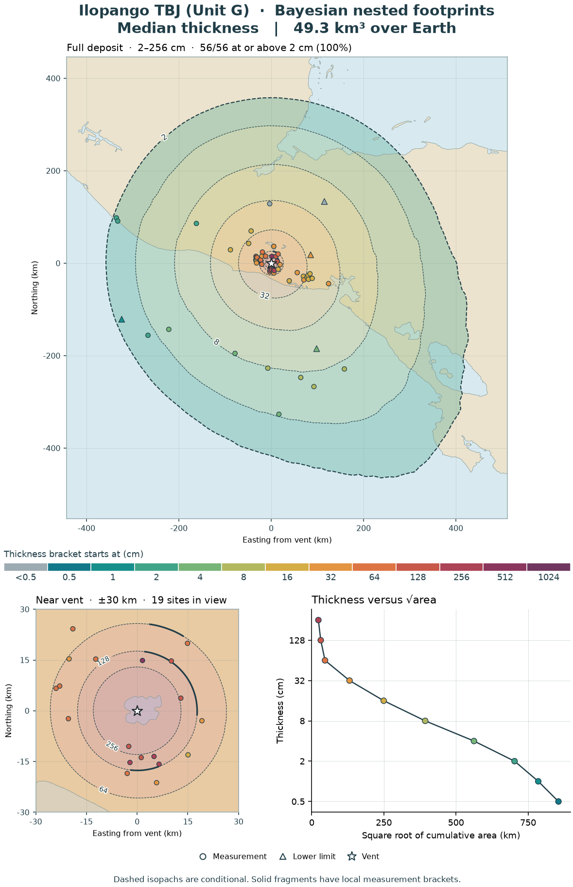
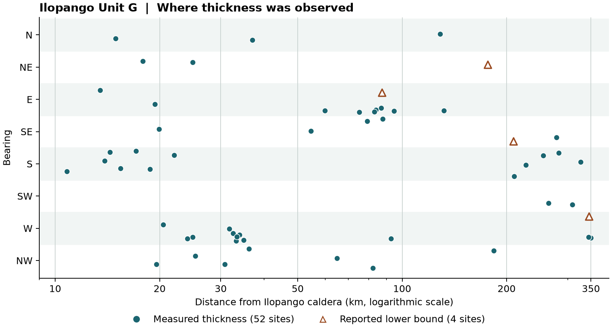

# Ilopango Tierra Blanca Joven, Unit G

The widespread upper co-ignimbrite ash has **52 measured thicknesses and four reported lower bounds**. The fitted sites extend from 11 to 349 km from Ilopango caldera in El Salvador. All five models use the same accepted observations. [Thickness data](../../data/eruptions/Ilopango_TBJ_Unit_G.csv) · [Original sources](../../data/sources/ilopango-tbj/README.md) · [Source decisions and geographic coverage](../../data/audits/Ilopango-TBJ/README.md)

The revised nested map integrates to 49.3 km³. Its 39.0–226 km³ interval and all four geographic refits retain population-sampling warnings. [Independent attempts and full diagnostics](results/nested-isopachs/footprints/report.json)

## Volumes and geographic prediction

Each estimate integrates the median thickness on its map. The conditional range integrates the pointwise 25th and 75th percentiles of thickness over the same area. The 50% probability refers to thickness at each location. A single probability for total volume does not follow from these endpoints.

| Method | Median map (km³) | Q25–Q75 thickness maps (km³) | Held-out score ↓ | 95% predictive coverage |
|---|---:|---:|---:|---:|
| GP ensemble | **23.3** | 18.4–29.7 | 1.343 | 98.1% |
| Cubic spline | **25.7** | 21.3–31 | 1.462 | 92.3% |
| [Directional ensemble](results/directional/README.md) | **41.9** | 25.4–77.4 | 1.493 | 94.2% |
| [Spherical mixture](results/spherical-mixture/README.md) | **133** | 76.8–234 † | 1.284 | 94.2% |
| [Bayesian nested footprints](results/nested-isopachs/README.md) | **49.3** | 36.7–73.9 † | 1.227 † | 84.6% |

Lower scores indicate better geographic prediction. Coverage counts exact withheld measurements. A dagger marks a fit, integration or validation warning.

## Full deposits and near-vent detail

Each full map follows the thickest power-of-two contour enclosing at least 95% of the fitted locations, with a 1 cm minimum. The title gives the actual count, including when that minimum prevents 95% coverage. Global volumes include the thinner tail. The innermost line is the thickest doubling level enclosing an accepted location. The near-vent window expands from the proximal sites until eligible contours are visible. The curve sums all patches at each displayed thickness.

## Inside the observation hull

The GP and spline integrate over the dashed hull. Gaps inside it can still be poorly constrained. [Regional fits and numerical checks](results/README.md)

The current global fits use the same audited rows. [What changed in the maps, volumes and validation](../../comparisons/global-extent/README.md) · [Continuation rules](../../docs/methods/finite-spread.md)

## Reading the global uncertainty

In the [preceding reconstruction](../../archive/2026-11-22-global-extent/README.md), across two halves of the spherical draws, the median changed by 0.12% and the upper interval endpoint by 17.3%. The latter exceeded the 10% numerical tolerance. The parent sampler and spatial integration passed. One directional quadrant fit also retained a sampling warning. [Spherical numerical checks](results/spherical-mixture/README.md) · [Directional holdouts](results/directional/README.md)

## What the observations constrain

Every 45° compass sector contains at least two measured thicknesses. In the northeast, both measurements lie within 25 km, with a published lower bound at Lake Yojoa 176 km away. In the southwest, both measurements come from marine cores 264–309 km away. The largest gap between measured bearings grows from 37° overall to 107° at distances of at least 50 km. The extent of the ash between these sites depends on the fitted thinning and continuation assumptions. [Distances by bearing](../../data/audits/Ilopango-TBJ/coverage.csv)

Smith et al. also identified TBJ glass in the TUNU2013 ice core about 7,755 km from Ilopango. It documents long-distance transport. The core supplies no separate thickness or bound for Unit G. [Ice-core evidence and fitting decision](../../data/audits/Ilopango-TBJ/README.md#greenland-ice-core-occurrence)

The two regional models integrate the same 166,961 km² hull. The standard measured-site support screen covers 15,973 km². The median maps give partial volumes of 1.44 km³ for the GP and 1.46 km³ for the spline. The standard screen accepted no complete isopach band for any of the five models. A full deposit still requires assumptions about the proximal region, gaps and distal continuation. [Support geometry, partial volumes and contour decisions](results/support/README.md)

The workbook distinguishes the final ash layer from earlier falls and from pyroclastic density-current deposits. In the offshore cores, chemistry supports a TBJ correlation more securely than attribution to an individual phase. The 550 cm Unit G value at Istagua and the two adjacent 3 cm distal cores in the west remain in the input. Tazumal's conflicting 20 cm and 40–50 cm reports remain in the audit. [Source decisions](../../data/audits/Ilopango-TBJ/README.md)

Smith et al. estimated **85–188 km³ of bulk co-ignimbrite fallout** with a physical dispersal model. That estimate provides a comparison based on overlapping thickness measurements. All five empirical fits used the site data directly. [Published dispersal estimate](https://pmc.ncbi.nlm.nih.gov/articles/PMC7584997/)

## Reproduce the calculation

The accepted input identifies the source cell or printed core record for every thickness. The case uses the registered regional models, uncertain fan direction, and the default displaced spherical mixture with measured-bearing continuation. Their geographic holdouts, prior sensitivities, integration checks and conditional intervals are included with each report. [Intake and run command](../../docs/NEW_ERUPTION.md) · [Input checksum and replay](../../data/audits/Ilopango-TBJ/provenance.json) · [Directional verification receipt](results/source-audit/release.json)

Both geographic and compass holdouts favor the broader fit. The full-data proposal retained a numerical warning. [Whole-area continuation sensitivity](results/nested-whole-area/README.md)
