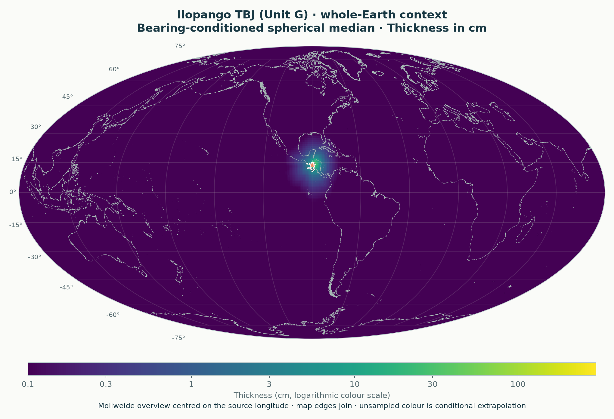
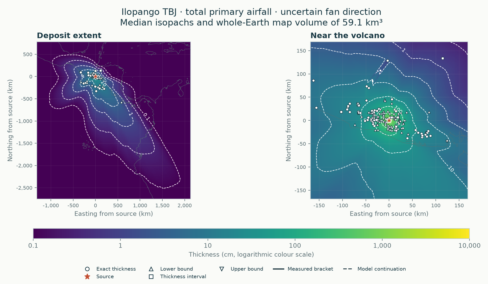
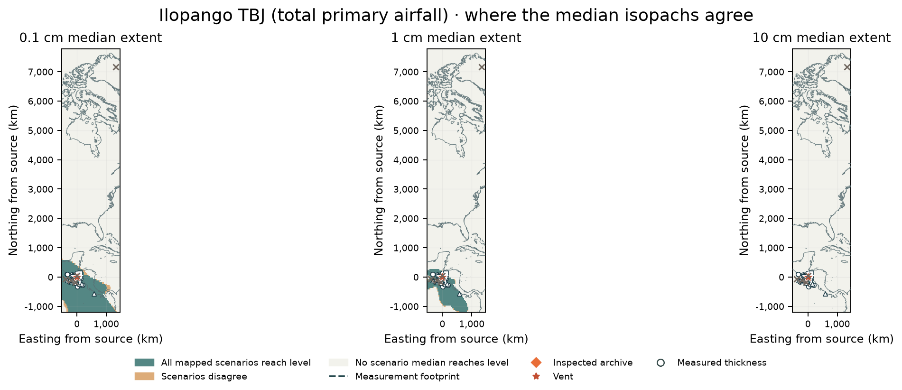

# Ilopango Tierra Blanca Joven, Unit G

The widespread upper co-ignimbrite ash has **52 measured thicknesses and four reported lower bounds**. The fitted sites extend from 11 to 349 km from Ilopango caldera in El Salvador. All four models use the same accepted observations. [Thickness data](../../data/eruptions/Ilopango_TBJ_Unit_G.csv) · [Original sources](../../data/sources/ilopango-tbj/README.md) · [Source decisions and geographic coverage](../../data/audits/Ilopango-TBJ/README.md)

## Five matched thickness-only fits

All four maps use the same frame, contour levels and thickness scale. Thickness below the first colour-bar tick shares the lowest shade. The dashed line encloses the observation hull. The regional fits stop there. The global fits also show how thickness continues into unsampled ground. On the directional map, solid white segments connect thicknesses bracketed by measured sites in a supported triangle. White dashes on the global maps show conditional isopachs. Gaps inside the hull can still be poorly constrained.

## Volume and predictive performance

| Method | Bulk volume (km³) | Conditional 95% interval (km³) | Held-out score ↓ | 95% coverage |
|---|---|---:|---:|---:|
| GP ensemble | Hull mean **24.99** | 17.93–33.81 | 1.343 | 98.1% |
| Cubic spline | Hull mean **26.75** | 22.61–31.55 | 1.462 | 92.3% |
| [Directional ensemble · uncertain fan direction](results/directional/README.md) | Whole-Earth median map **40.8** · volume median 59.4 | 30.1–384.8 | 1.528 | 92.3% |
| [Spherical mixture](results/spherical-mixture/README.md) | Whole-Earth volume median **190.9** | 62.9–3,300.8 **(provisional)** | 1.225 | 94.2% |
| [Bayesian nested isopachs](results/nested-isopachs/README.md) | Whole-Earth volume median **50.5** | 37.5–181.8 **(provisional)** | 1.159 † | 94.2% |

[Nested median isopachs and the area–thickness curve](results/nested-isopachs/isopachs.png) · [Nested whole-Earth map](results/nested-isopachs/world.png) · [Nested sensitivity in poorly sampled bearings](results/nested-isopachs/bearing-study/README.md) · [Uncertain gap amount](results/directional/sensitivity-study/README.md) · [Soft source displacement](results/spherical-mixture/sensitivity-study/README.md)

The nested estimate puts a median 3.4% of the fallout volume inside the retained exact-site triangles and 11.3% beyond the farthest exact measurement. 1/4 geographic refits passed the independent-population check.

A lower negative log predictive score means better prediction across withheld regions. Each region gets equal weight. Coverage is the share of exact held-out observations inside the 95% predictive interval.

The directional map integrates pointwise median thickness. Measured interpolation triangles account for **3.9%** of its volume. The directional volume interval comes from complete simulated deposits. The spherical mixture reports the median integrated volume across broad and uncertain fan continuations. The regional intervals condition on fitted settings. [Regional maps, fits and diagnostics](results/README.md)

Compare the two whole-Earth maps

| Uncertain fan direction | Spherical mixture |
|---|---|
|  |  |

Both maps use the vent longitude as their central meridian. Read the thickness key under each map.

With the same observations and structure weights, fixing the fan directions gives a median-map volume of **46.7 km³**.

View the directional deposit extent and source area

## Directional assumptions

The principal fit above uses quantitative thicknesses and bounds. The measured-fan model extends fallout along sampled bearings.

| Fan direction | Evidence assumption | Median-map volume (km³) | Complete-deposit median (km³) | Conditional 95% interval (km³) |
|---|---|---:|---:|---:|
| Measured fan directions | Thicknesses and bounds | 49.6 | 69.1 | 32.3–433.2 |

View agreement between the directional sensitivities

[Measured-fan maps, held-out tests and site evidence](results/directional/bearing/README.md)

## Reading the global uncertainty

Across two halves of the spherical draws, the median changed by 0.12% and the upper interval endpoint by 17.3%. The latter exceeded the 10% numerical tolerance. The parent sampler and spatial integration passed. The medians under the eight prior fits range from 64.7 to 350.4 km³. One directional quadrant fit also retained a sampling warning. [Spherical numerical checks](results/spherical-mixture/README.md) · [Directional holdouts](results/directional/README.md)

## What the observations constrain

Every 45° compass sector contains at least two measured thicknesses. In the northeast, both measurements lie within 25 km, with a published lower bound at Lake Yojoa 176 km away. In the southwest, both measurements come from marine cores 264–309 km away. The largest gap between measured bearings grows from 37° overall to 107° at distances of at least 50 km. The extent of the ash between these sites depends on the fitted thinning and continuation assumptions. [Distances by bearing](../../data/audits/Ilopango-TBJ/coverage.csv)

Smith et al. also identified TBJ glass in the TUNU2013 ice core about 7,755 km from Ilopango. It documents long-distance transport. The core supplies no separate thickness or bound for Unit G. [Ice-core evidence and fitting decision](../../data/audits/Ilopango-TBJ/README.md#greenland-ice-core-occurrence)

The two regional models integrate the same 166,961 km² hull. The standard measured-site support screen covers 15,973 km². It gives expected partial volumes of 1.54 km³ for the GP and 1.52 km³ for the spline. The standard screen accepted no complete isopach band for any of the four models. A full deposit still requires assumptions about the proximal region, gaps and distal continuation. [Support geometry, partial volumes and contour decisions](results/support/README.md)

The workbook distinguishes the final ash layer from earlier falls and from pyroclastic density-current deposits. In the offshore cores, chemistry supports a TBJ correlation more securely than attribution to an individual phase. The 550 cm Unit G value at Istagua and the two adjacent 3 cm distal cores in the west remain in the input. Tazumal's conflicting 20 cm and 40–50 cm reports remain in the audit. [Source decisions](../../data/audits/Ilopango-TBJ/README.md)

Smith et al. estimated **85–188 km³ of bulk co-ignimbrite fallout** with a physical dispersal model. That estimate provides a comparison based on overlapping thickness measurements. All four empirical fits used the site data directly. [Published dispersal estimate](https://pmc.ncbi.nlm.nih.gov/articles/PMC7584997/)

## Reproduce the calculation

The accepted input identifies the source cell or printed core record for every thickness. The case uses the registered regional models, uncertain fan direction, and the default displaced spherical mixture with measured-bearing continuation. Their geographic holdouts, prior sensitivities, integration checks and conditional intervals are included with each report. [Intake and run command](../../docs/NEW_ERUPTION.md) · [Input checksum and replay](../../data/audits/Ilopango-TBJ/provenance.json) · [Directional verification receipt](results/source-audit/release.json)
