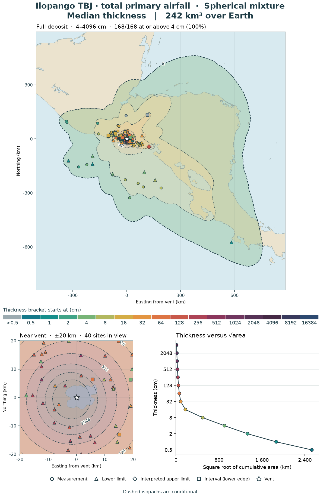
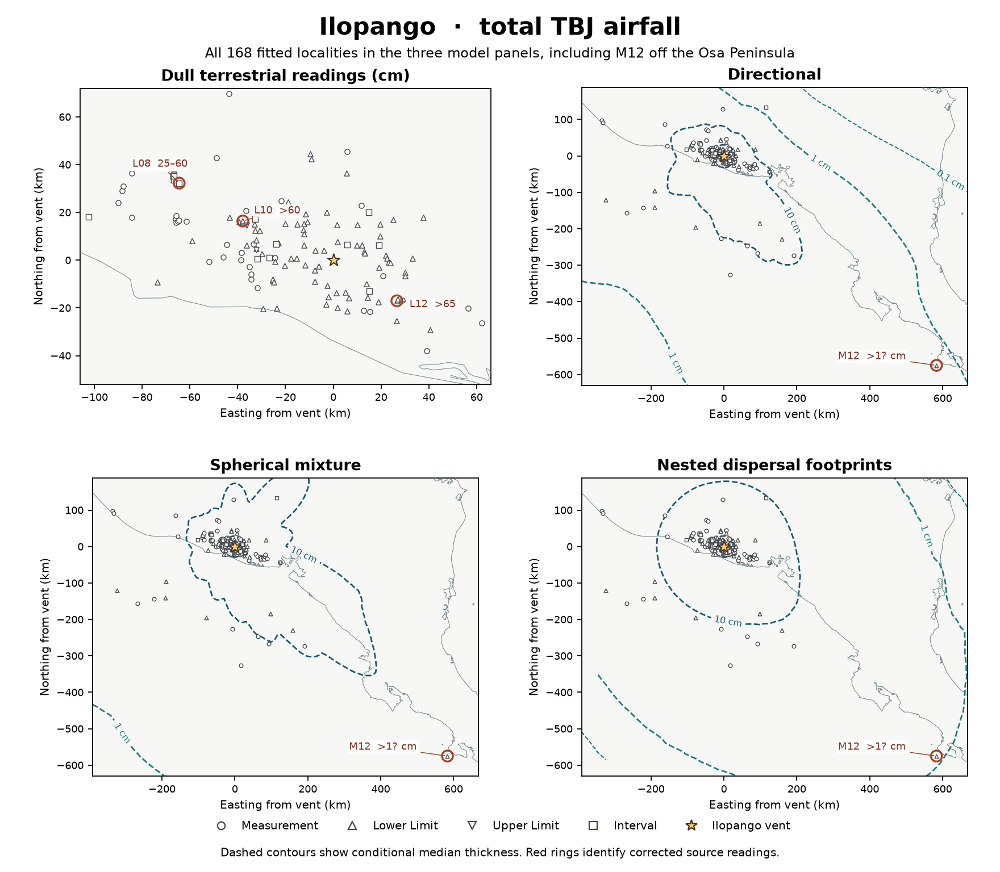

# Ilopango · total Tierra Blanca Joven airfall

The current reconstruction combines primary fallout across eruption phases at **168 localities** in Central America and adjacent waters. The three global fits share 65 point thicknesses, 14 two-sided ranges, 84 lower limits and five upper limits. The regional GP and spline were last published for Unit G alone. [Accepted observations](../../data/eruptions/Ilopango_TBJ_total_airfall.csv) · [Field logs and audit decisions](../../data/audits/Ilopango-TBJ/field-logs/README.md) · [Download the current estimates](results/principal-volumes.csv)

## Volumes and geographic prediction

Each estimate integrates the median thickness on its map. The conditional range integrates the pointwise 25th and 75th percentiles of thickness over the same area. The 50% probability refers to thickness at each location. A single probability for total volume does not follow from these endpoints.

| Method | Integration area | Median map (km³) | Q25–Q75 thickness maps (km³) | Held-out score ↓ | 95% predictive coverage |
|---|---|---:|---:|---:|---:|
| [Directional ensemble](results/directional/README.md) | whole Earth | **60.6** | 33.5–124 | 1.336 | 90.8% |
| [Spherical mixture](results/spherical-mixture/README.md) | whole Earth | **242** | 96.5–769 | 1.204 | 98.5% |
| [Bayesian nested footprints](results/nested-isopachs/README.md) | whole Earth | **62.8** | 40.5–97.4 | 1.115 | 93.8% |

Lower scores indicate better geographic prediction. Coverage counts exact withheld measurements. A dagger marks a fit, integration or validation warning.

## Full deposits and near-vent detail

Each full map follows the thickest power-of-two contour enclosing at least 95% of the fitted locations, with a 1 cm minimum. The title gives the actual count, including when that minimum prevents 95% coverage. Global volumes include the thinner tail. The innermost line is the thickest doubling level enclosing an accepted location. The near-vent window expands from the proximal sites until eligible contours are visible. The curve sums all patches at each displayed thickness.

## What the field sites constrain

The four buffered geographic holdouts passed for each family. No complete contour band passed the shared geographic support screen. Two of the eight spherical prior settings retained numerical warnings. [Geographic predictions at all 168 localities](results/geographic-site-validation.csv) · [Prior checks and source sensitivities](results/README.md)

The overview below includes the four Dull et al. core readings and the Osa Peninsula site about 819 km away. The ash correlation at Osa is uncertain. The published sensitivity fits show what changes when that reading or the historical T2 contributions are omitted. [Local evidence and omission fits](results/README.md#distal-and-historical-evidence)

Unit G is the widespread upper co-ignimbrite ash. Its two earlier editions cover a different deposit target. [Unit G inputs, maps and validation](../../archive/2026-11-24-case-editions/README.md#ilopango)
