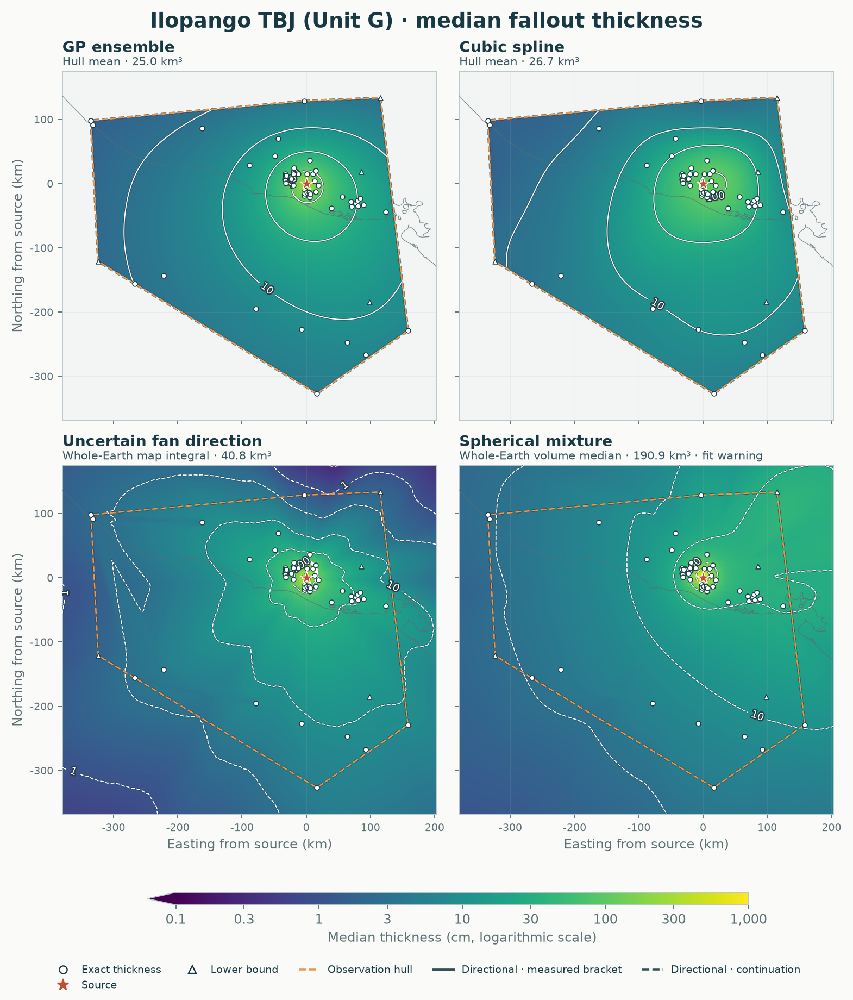
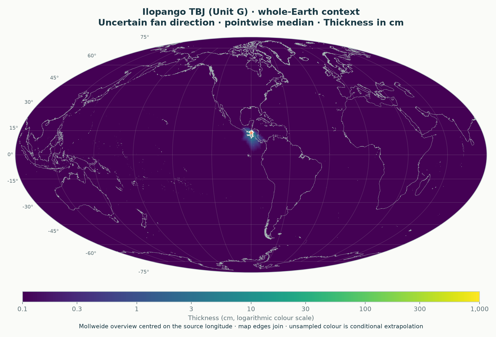
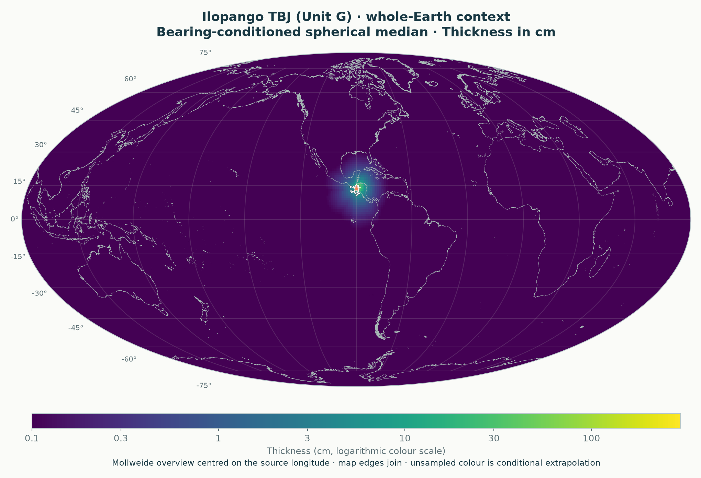
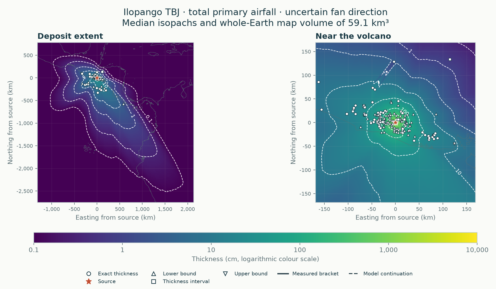
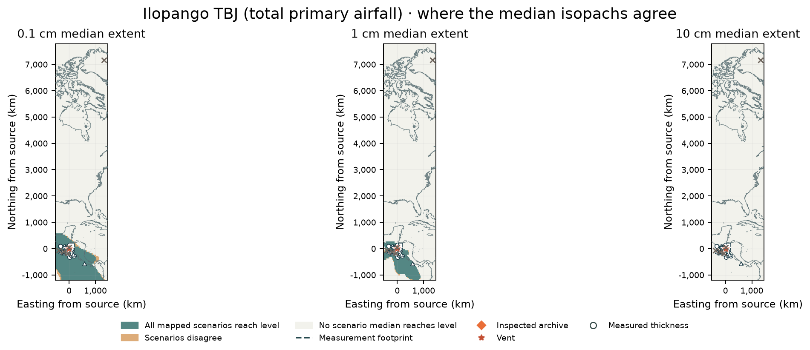
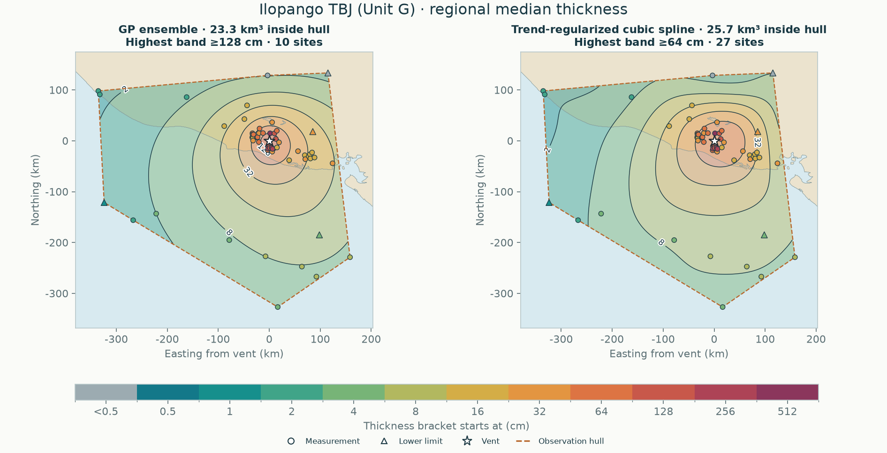
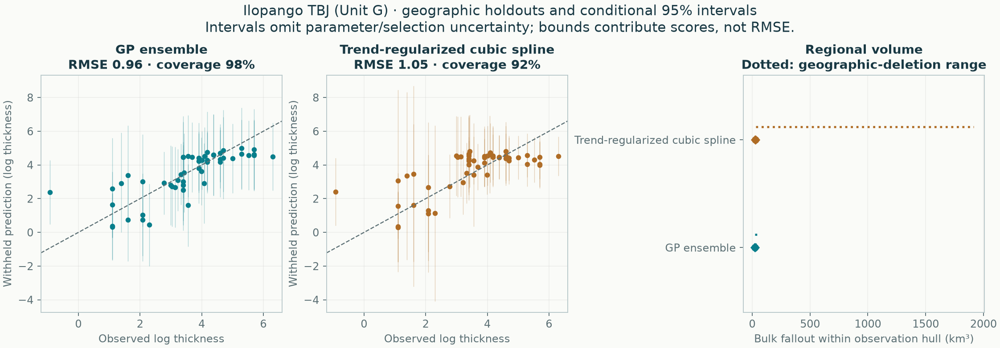

# Ilopango TBJ (Unit G) fallout reconstruction

## Four matched thickness-only fits



All four maps use the same frame, contour levels and thickness scale. Thickness below the first colour-bar tick shares the lowest shade. The dashed line encloses the observation hull. The regional fits stop there. The global fits also show how thickness continues into unsampled ground. On the directional map, solid white segments connect thicknesses bracketed by measured sites in a supported triangle. White dashes on the global maps show conditional isopachs. Gaps inside the hull can still be poorly constrained.

## Volume and predictive performance

| Method | Bulk volume (km³) | Conditional 95% interval (km³) | Held-out score ↓ | 95% coverage |
|---|---|---:|---:|---:|
| GP ensemble | Hull mean **24.99** | 17.93–33.81 | 1.343 | 98.1% |
| Cubic spline | Hull mean **26.75** | 22.61–31.55 | 1.462 | 92.3% |
| [Directional ensemble · uncertain fan direction](directional/README.md) | Whole-Earth median map **40.8** · volume median 59.4 | 30.1–384.8 | 1.528 | 92.3% |
| [Spherical mixture](spherical-mixture/README.md) | Whole-Earth volume median **190.9** | 62.9–3,300.8 **(provisional)** | 1.225 | 94.2% |

A lower negative log predictive score means better prediction across withheld regions. Each region gets equal weight. Coverage is the share of exact held-out observations inside the 95% predictive interval.

The directional map integrates pointwise median thickness. Measured interpolation triangles account for **3.9%** of its volume. The directional volume interval comes from complete simulated deposits. The spherical mixture reports the median integrated volume across broad and uncertain fan continuations. The regional intervals condition on fitted settings.

<details>
<summary>Compare the two whole-Earth maps</summary>

| Uncertain fan direction | Spherical mixture |
|---|---|
|  |  |

Both maps use the vent longitude as their central meridian. Read the thickness key under each map.

</details>

With the same observations and structure weights, fixing the fan directions gives a median-map volume of **46.7 km³**.

<details>
<summary>View the directional deposit extent and source area</summary>



</details>

## Directional assumptions

The principal fit above uses quantitative thicknesses and bounds. The measured-fan model extends fallout along sampled bearings.

| Fan direction | Evidence assumption | Median-map volume (km³) | Complete-deposit median (km³) | Conditional 95% interval (km³) |
|---|---|---:|---:|---:|
| Measured fan directions | Thicknesses and bounds | 49.6 | 69.1 | 32.3–433.2 |

<details>
<summary>View agreement between the directional sensitivities</summary>



</details>

[Measured-fan maps, held-out tests and site evidence](directional/bearing/README.md)

[Volume and geographic prediction plot](overview.png)

## Regional fit details

All methods use the same accepted observations, geographic holdouts and integration area. No method is designated preferred.

**52 exact measurements, 4 lower bounds, 0 upper limits.** The observation hull covers 166,961 km². The automatic validation buffer is 8.11 km.



The full observation hull and every accepted location are in view. The coloured field is clipped to the exact hull; fine coastlines are context only. [Map frame and rendering provenance](map-display.json).

| Quantity | GP ensemble | Trend-regularized cubic spline |
|---|---:|---:|
| Expected regional bulk fallout (km³) | 24.99 | 26.75 |
| Integral of median thickness surface (km³) | 23.31 | 25.67 |
| Conditional 95% volume interval (km³) | 17.93–33.81 | 22.61–31.55 |
| Outer equal-region negative log score ↓ | 1.343 | 1.462 |
| Outer log-thickness RMSE ↓ | 0.964 | 1.053 |
| Outer 95% observation-interval coverage | 98.1% | 92.3% |

Lower predictive score and RMSE are better. Coverage must be read with interval width and predictive score; wider intervals alone are not improvement.



## Scope

The footprint is the convex hull of measured/bounded locations, with no source point or invented observations added. It can contain large unsampled gaps and can exclude proximal deposits. These are **regional bulk fallout volumes, not total eruption volumes or dense-rock equivalents**. No global extrapolation enters this comparison.

The mean volume integrates expected thickness. The median-surface integral is a separate quantity; it is not the median volume. Volume intervals come from complete correlated surface draws, not sums of pointwise interval endpoints.

## Fitted methods

### GP ensemble

```json
{
  "candidate": {
    "tail": "stacked"
  },
  "components": [
    {
      "weight": 1.0,
      "model": {
        "candidate": {
          "tail": "power",
          "length_factor": 1.5,
          "noise_ratio": 1.5
        },
        "beta": [
          5.877882565797928,
          2.3646239542705834,
          0.014532660036742534,
          -0.36433322738101886
        ],
        "radius_scale_km": 36.57850657147445,
        "length_km": 159.7258596900914,
        "amplitude_log": 0.6824933387478334,
        "noise_log": 1.02374000812175,
        "jitter": 4.657971574351648e-10,
        "trend_on_constraint_boundary": true,
        "uncertainty": "conditional Laplace"
      }
    }
  ],
  "dominant_tail": "power",
  "observation_discrepancy_variance_log": 0.0,
  "trend_on_constraint_boundary": true,
  "uncertainty": "Predictive mixture; includes disagreement among retained candidates, conditional on each fit and estimated weights. Fitted-parameter uncertainty is not integrated."
}
```

### Trend-regularized cubic spline

```json
{
  "method": "spline",
  "candidate": {
    "tail": "power",
    "knot_intervals": 4,
    "tension": 1.0,
    "smoothing": 1e-08,
    "trend_strength": 100.0,
    "noise_ratio": 1.5
  },
  "bounds_km": [
    -359.99334443125537,
    -349.72718466324744,
    183.1725013964103,
    156.57345952248915
  ],
  "knot_intervals_xy": [
    4,
    4
  ],
  "n_coefficients": 49,
  "noise_log": 0.9827594136709957,
  "amplitude_log": 0.6551729424473305,
  "trend_beta": [
    5.63400524303206,
    2.1459918386242784,
    0.024895812665345022,
    -0.4568280516334591
  ],
  "trend_radius_scale_km": 36.57850657147445,
  "trend_on_constraint_boundary": false,
  "effective_df_exact": 3.335974118041806,
  "newton_decrement": 1.325114647418844e-18,
  "newton_iterations": 2,
  "quadrature_order": 6,
  "uncertainty": "Conditional Laplace",
  "uncertainty_omits": [
    "fitted trend",
    "noise and smoothing estimation",
    "knot/trend selection",
    "sampling and preservation bias",
    "vent location error"
  ],
  "pseudo_observations": 0
}
```

Every explored candidate is retained in the selection tables. All response-dependent choices are retuned within training folds; no hand-placed pseudo-data enter the likelihood.

## Reliability checks

- All probability intervals condition on fitted parameters and selected settings; they omit parameter/selection and preservation/sampling uncertainty.
- Four geographic outer folds evaluate the entire tuning procedure; this is development evidence, not independent external validation.
- Geographic-deletion volume ranges show refitting sensitivity and are not confidence intervals.
- Spline selection reaches an explored search boundary: smoothing. This is a bounded-grid result, not proof of a continuous optimum.

## Reproduce and inspect

```sh
tephra-isopachs compare 'Ilopango TBJ (Unit G)' --output results/new-regional-run
```

[Complete numerical report](report.json) · [Withheld predictions](heldout_predictions.csv) · [Accepted observation semantics](accepted_observations.csv) · [Selection tables](selection/README.md)

The JSON records input/source hashes, package versions, all fold memberships, regional integration refinements, conditional-volume sampling precision and geographic-deletion sensitivity. Historical GP global calculations remain separate.

## Which parts are actually supported?

Read the [local support and complete-contour audit](support/README.md) before extrapolating these hull volumes. It screens unsampled gaps, tests closure under geographic deletion, and separates interpolation from proximal/distal assumptions.
