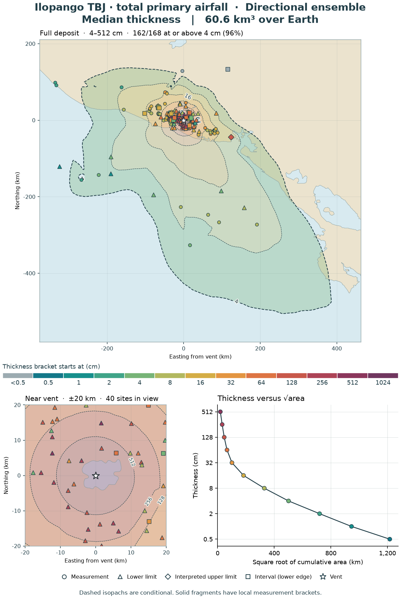
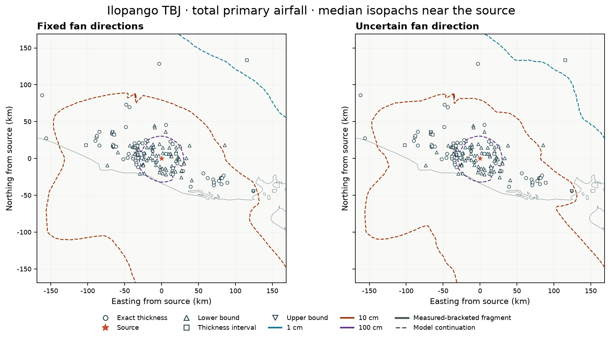
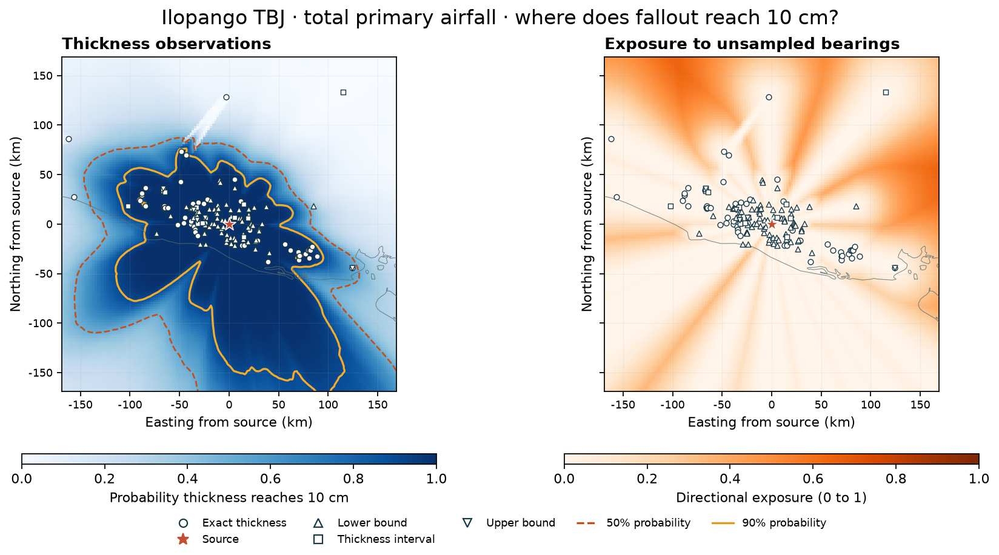

# Ilopango TBJ · total primary airfall · Directional ensemble

The principal bulk volume is **60.6 km³**, the whole-Earth integral of the median-thickness map. The conditional thickness-band range is **33.5–124 km³**. Its endpoints integrate the pointwise 25th and 75th percentiles of latent thickness over Earth.

Each circle shows a measurement. Bounded sites take the colour of their stated limit. The curve counts every patch at or above each thickness. The 4 cm footprint includes 162 of 168 modeled locations. The thickest displayed line is 512 cm and encloses 7 fitted locations. The volume includes fallout beyond the displayed contours. [Median thickness grid](median-grid.npz) · [Thickness and cumulative area](thickness-area.csv) · [Map integral, resolution and source hashes](deposit.json)

The principal map uses the geographic continuation evaluated on all registered eruptions. [Geographic holdouts, structural alternatives and numerical checks](extent/report.json) · [Complete contour decisions](extent/support.json.gz) · [Predictions at withheld observations](extent/heldout.csv.gz)

## Earlier continuation and its diagnostics

The following figures and statistics describe the fitted parent and its broader continuation. The principal estimate and its interval appear above.

## Reach from the volcano

Distances are great-circle kilometres to the first outward crossing on each compass ray. The area columns give the entire 10 cm footprint in the corresponding 45° sector, including detached areas. Together they distinguish a long point on a contour from an entire broad lobe.

| Bearing | Fixed 10 cm reach (km) | Uncertain 10 cm reach (km) | Fixed ≥10 cm area (km²) | Uncertain ≥10 cm area (km²) |
|---|---:|---:|---:|---:|
| N | 79.3 | 79.4 | 2,507 | 2,382 |
| NE | 74.1 | 74.3 | 2,201 | 2,086 |
| E | 86.3 | 82.1 | 4,028 | 3,836 |
| SE | 279.3 | 279.3 | 28,195 | 27,156 |
| S | 225.0 | 224.8 | 18,907 | 18,721 |
| SW | 154.0 | 146.1 | 9,820 | 9,530 |
| W | 131.2 | 126.8 | 8,425 | 8,065 |
| NW | 118.7 | 111.1 | 5,864 | 5,420 |

The 50% and 90% probability lines answer different questions. At a location on the 90% line, nine in ten model draws reach 10 cm. These are pointwise probabilities conditional on the model. Joint confidence over an entire region requires a different calculation.

## Withheld observations

Each row averages negative log predictive scores over equally weighted folds. Lower scores predict the withheld thicknesses and limits better. The passing-only columns exclude numerical failures. Coverage counts exact withheld thicknesses inside the uncertain-direction 95% predictive interval. A dash marks an unavailable score or coverage.

| Deletion | All estimable folds | Fixed | Uncertain | Passing folds | Fixed, passing | Uncertain, passing | Exact-site 95% coverage |
|---|---:|---:|---:|---:|---:|---:|---:|
| Geographic regions | 4 | 1.241 | 1.349 | 4 | 1.241 | 1.349 | 60/65 (92.3%) |
| Source quadrants | 4 | 1.123 | 1.220 | 4 | 1.123 | 1.220 | 65/65 (100.0%) |

[Predictions for every estimable held-out site](azimuth/heldout.csv). The numerical record includes all planned folds, row identities, unscorable directions, fit warnings and phase-integration checks.

## Inspected archives

The principal fit includes the interpreted upper limits below. Each core enters once. Other sites provide an occurrence check. The interval describes the modeled latent thickness at each site.

| Site | Interpreted upper limit (cm) | Median thickness (cm) | Conditional 95% interval (cm) |
|---|---:|---:|---:|
| TUNU2013 | Occurrence only | 2.7e-09 | 8.17e-86–0.00451 |
| DSDP 67-499-1R-CC | Occurrence only | 7.17 | 2.85–17.1 |
| V15-26 | Occurrence only | 7.44 | 0.818–22.9 |
| RC12-31 | Occurrence only | 1.53 | 0.0975–8.32 |
| Los Flores (Las Flores) CH-2t | Occurrence only | 55.5 | 27.4–86.4 |

## Checks and reproducibility

The shared contour audit found eligible bands under none of the screened support policies. Audit status is completed. [All contour decisions and deletion failures](azimuth/complete-contour-audit.json)

The spatial integration check passed at 4,096 points per scramble. The map used up to 64 posterior draws per chain and structure. Resolved contour areas passed the split-packet check. The joint-volume quantiles passed the split check.

All six full fits passed their sampling diagnostics.

[Numerical report, all sector volumes and sensitivities](azimuth/report.json) · [Complete fields and per-field volumes](azimuth/fields.npz) · [Principal map grids](azimuth/median-grids.npz) · [Near-source comparison grids](azimuth/map-grid.npz) · [Fragment decisions](azimuth/fragment-decisions.csv) · [Bracketed coordinates](azimuth/bracketed-fragments.csv) · [File hashes](azimuth/artifacts.json)

## Related directional studies

- [Earlier fixed-direction ensemble and its separate calibration](ensemble/README.md)
- [Single-structure and proximal-cap sensitivities](single-structure/README.md)
- [Measured-fan continuation and inspected-site evidence](bearing/README.md)
