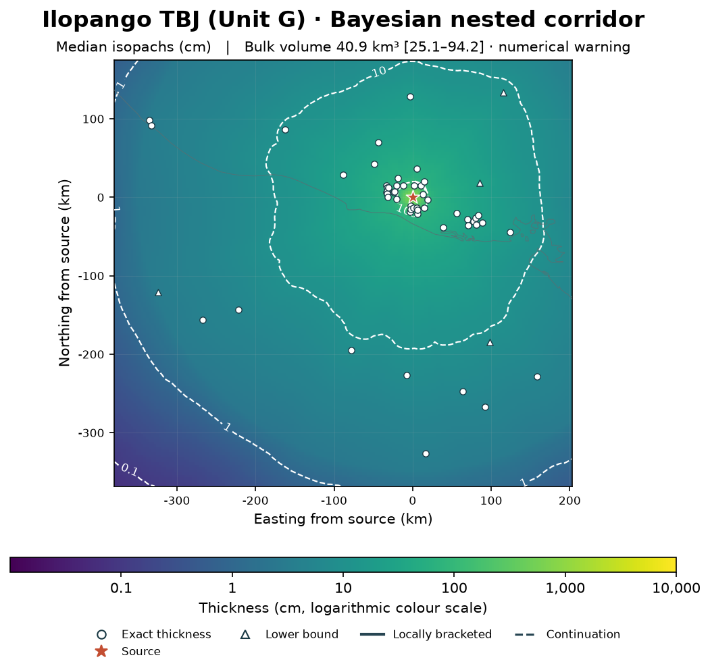
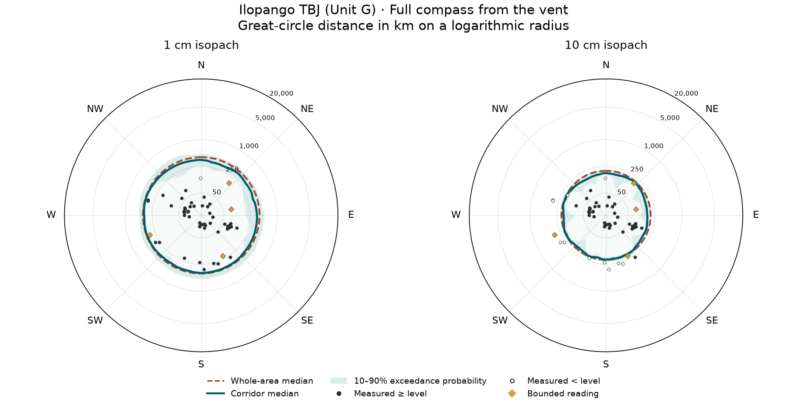

# Ilopango TBJ (Unit G) · Bayesian nested isopachs

The principal corridor estimate of bulk fallout is **40.9 km³** (conditional 95% interval **25.1–94.2**). The median thickness map integrates to 39.1 km³. The whole-area sensitivity gives 50.5 km³ (37.5–181.8).

Solid portions cross a retained triangle with thicknesses on either side at distinct measured sites and at least 90% posterior crossing probability. Dashed portions depend on the continuation. The triangles diagnose spatial coverage. The shared contour screen also checks thickness bracketing and deletion stability. [Whole-Earth field](world.png) · [Every local bracket](local-brackets.csv.gz) · [Complete contour checks](support.json)

The buffered geographic score is 1.274 for the corridor and 1.159 for the whole-area sensitivity. Lower scores indicate better predictions at withheld sites. The corridor’s 95% predictive intervals cover 49 of 52 exact withheld readings. 1 of 4 geographic fits passed their sampling checks. The full-data proposal and importance check retained a warning, the final volume populations passed, and the integration check passed. The shared screen accepted a complete contour band under 0 policies. [Prediction scores and row identities](report.json) · [Full fit diagnostics](full.json)

## Where the volume lies

The full-compass view includes all bearings through the antipode. Its logarithmic distance scale makes the proximal flanks visible. Areas in the table use the physical equal-area integral.

| Compass sector | Exact sites | Bounded sites | Corridor 1 cm area (km²) | Whole-area 1 cm area (km²) | Corridor volume (km³), median [95%] |
|---|---:|---:|---:|---:|---:|
| N | 3 | 0 | 43,953 | 65,640 | 4.4 [2.1–12.4] |
| NE | 2 | 1 | 45,138 | 65,728 | 4.6 [2.5–12.2] |
| E | 9 | 1 | 44,327 | 65,829 | 4.5 [2.2–13.6] |
| SE | 5 | 1 | 56,550 | 65,828 | 5.4 [3.5–13.0] |
| S | 12 | 0 | 59,081 | 65,717 | 5.7 [4.3–11.5] |
| SW | 2 | 0 | 57,776 | 65,036 | 5.4 [3.2–10.3] |
| W | 12 | 1 | 60,289 | 64,541 | 5.5 [3.3–10.1] |
| NW | 7 | 0 | 54,117 | 65,529 | 5.1 [2.7–10.8] |

At 1 cm, the corridor median map encloses 421,230 km² and the whole-area sensitivity encloses 523,848 km². Of these, 405,577 and 508,195 km² fall outside the retained exact-site triangles. An unsampled sector can contain ash. Its allocation depends on the assumed continuation.

The prior assigns 25% to continuation across all bearings. The remaining probability spans three fan widths and three down-range extensions. The fitted probability of whole-bearing continuation is 25.0%. The widths and extensions are shared structural assumptions. A bound supplies a likelihood event. Only positive evidence supplies a potential dispersal corridor.

[Volume and sector draws](volume-budget.npz) · [Complete field draws](full.npz) · [Areas, assumptions, bounds and diagnostics](report.json)

## Structural uncertainty

[Corridor and whole-area maps on a common scale](paired-isopachs.png)

| Prior probability of broad continuation | Median bulk volume, km³ [conditional 95%] |
|---:|---:|
| 10% | 39.0 [24.8–69.8] |
| 25% | 40.9 [25.1–94.2] |
| 50% | 44.4 [25.9–125.6] |
| 75% | 47.6 [27.6–147.1] |

The prior odds vary under the same observed likelihood. The numerical report also gives the volume by individual corridor law where the saved draws resolve it.

[Whole-area sensitivity report, posterior and diagnostics](../nested-whole-area/README.md)
