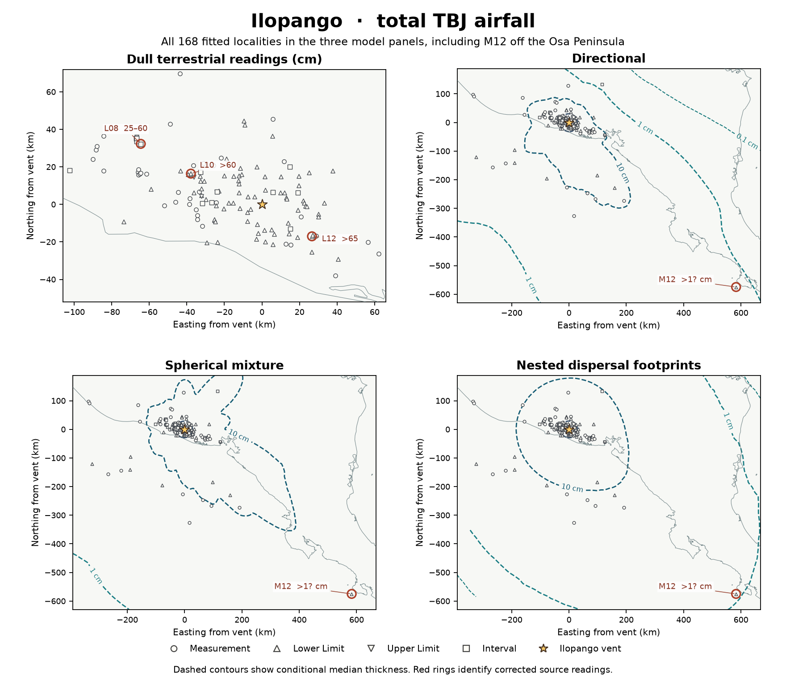

# Ilopango Tierra Blanca Joven, total primary airfall

All three methods use **168 localities**. The principal input contains 65 measurements, 14 two-sided ranges, 84 lower bounds and five upper bounds. It combines primary airborne deposits across eruption phases. The previous Unit G maps retain their phase-specific interpretation. [Field audit](../../../../data/audits/Ilopango-TBJ/field-logs/README.md) · [Accepted data](../../../../data/eruptions/Ilopango_TBJ_total_airfall.csv) · [Unit G results and history](../../README.md)

| Method | Median map (km³) | Q25–Q75 maps (km³) | Complete deposits, conditional 95% (km³) | Geographic score ↓ | 95% coverage, exact sites | Geographic fits passed |
|---|---:|---:|---:|---:|---:|---:|
| [Directional](directional/README.md) | 60.6 | 33.5–123.6 | 39.0–477.4 | 1.336 | 90.8% | 4/4 |
| [Spherical mixture](spherical-mixture/README.md) | 242.1 | 96.5–768.8 | 86.0–18,643 | 1.204 | 98.5% | 4/4 |
| [Nested dispersal footprints](nested-isopachs/README.md) | 62.8 | 40.5–97.4 | 40.2–316.5 | 1.115 | 93.8% | 4/4 |

Each map volume integrates its median thickness over Earth. The Q25–Q75 columns integrate the pointwise thickness quartiles. The complete-deposit interval comes from whole-field draws under each family’s assumptions. The score averages the four buffered geographic holdouts equally and uses each reported event, including both endpoints of an interval. Coverage describes the 65 measured values. [Numerical comparison](model-comparison.csv) · [All 504 held-out site predictions](geographic-site-validation.csv)

The overview includes the Osa Peninsula point in every model panel. The individual family maps show the repository’s standard contour extent, local enlargement and thickness–area curve. [Directional map](directional/deposit.png) · [Spherical map](spherical-mixture/deposit.png) · [Nested map](nested-isopachs/deposit.png) · [Map grids and source identities](all-sites-map.json)

## Distal and historical evidence

Dull L08 contributes one 25–60 cm interval, L10 a >60 cm lower bound, and L12 a >65 cm lower bound. M12 contributes >1? cm about 819 km from Ilopango. The core attribution remains queried. The table below compares the median thickness on the full map to the probability of exceeding 1 cm when the entire geographic group containing M12 was withheld. [Source dots and readings](../../../../data/audits/Ilopango-TBJ/field-logs/dull-four-readings.png)

| Model | Median map at M12 | P(>1 cm) with geographic group withheld |
|---|---:|---:|
| Directional | 1.63 cm | 5.5% |
| Spherical mixture | 5.73 cm | 40.9% |
| Nested dispersal footprints | 1.37 cm | 9.8% |

An independent nested fit omitting only M12 gives 0.016 cm median latent thickness there, compared with 1.50 cm in the principal posterior. The median across complete-deposit volume draws changes from 75.8 to 58.0 km³, with a conditional 95% interval of 38.0–233.2 km³ after omission. A second independent fit omits the historical T2 contribution while preserving other logged fall and independent workbook evidence. Three sites then lose their only numerical constraint. The reduced 165-site fit gives a complete-draw median of 77.4 km³ and a conditional 95% interval of 38.9–441.0 km³. Both refits passed their final sampling checks. At Laguna Seca, the nested principal predicts about 23 cm at the field locality against the 45–50 cm range derived from the two investigations. [Source-by-source refit results](source-sensitivity/comparison.csv) · [Osa omission posterior](source-sensitivity/without-osa/full.json) · [T2 omission and refinement](source-sensitivity/without-historical-T2/refinement/full.json)

## Geographic support and numerical checks

| Method | Complete-draw checks | Median-map integral | Q25–Q75 integrals | Standard complete contour band |
|---|---|---|---|---|
| Directional | Passed | Passed | Passed | None |
| Spherical mixture | Passed | Passed | Passed | None |
| Nested dispersal footprints | Passed | Passed | Passed | None |

The support screen tests local observations around complete contours, including where evidence is absent. A whole-Earth integral includes assumptions beyond those observations. The complete decisions and rejected segments are available for each method. [Directional screen](directional/extent/support.json.gz) · [Spherical screen](spherical-mixture/extent/support.json.gz) · [Nested screen](nested-isopachs/footprints/support.json.gz)

The spherical model uses eight fixed prior settings. The smallest lower endpoint is 38.0 km³ and the largest upper endpoint is 69,680 km³ across these separate conditional intervals. Six of eight settings passed both their required sampling and continuation checks. The diffuse-tail setting retained a warning for the parent field’s bearing, and the one-fan setting retained a warning for instability in volume quantiles between draw subsets. The nested fitter emitted floating-point warnings while evaluating very small interval probabilities for some trial particles. The published held-out probabilities and posterior integrals were checked separately. [Eight spherical intervals and checks](spherical-priors.csv) · [Full spherical prior diagnostics](spherical-mixture/extent/prior-sensitivity.json) · [Nested fits and integration](nested-isopachs/footprints/report.json) · [Directional folds and continuation](directional/extent/report.json)

## Reproduction

Run `python -m benchmarks.ilopango_total_airfall` for the input, `python -m benchmarks.ilopango_total_checks` for the three published maps, geographic predictions and source refits, and `python -m benchmarks.ilopango_total_map --verify` for the all-locality overview. The input SHA-256 is `fafffcdf423f6b258aebb9b2a953d8206f14a12db57acc5c342b9326b142f867`. [Sampling evidence](sampling/README.md) · [Original PDFs and hashes](../../../../data/audits/Ilopango-TBJ/field-logs/primary-scans.csv) · [Published evidence inventory](../../../../benchmarks/published-evidence.sha256)
