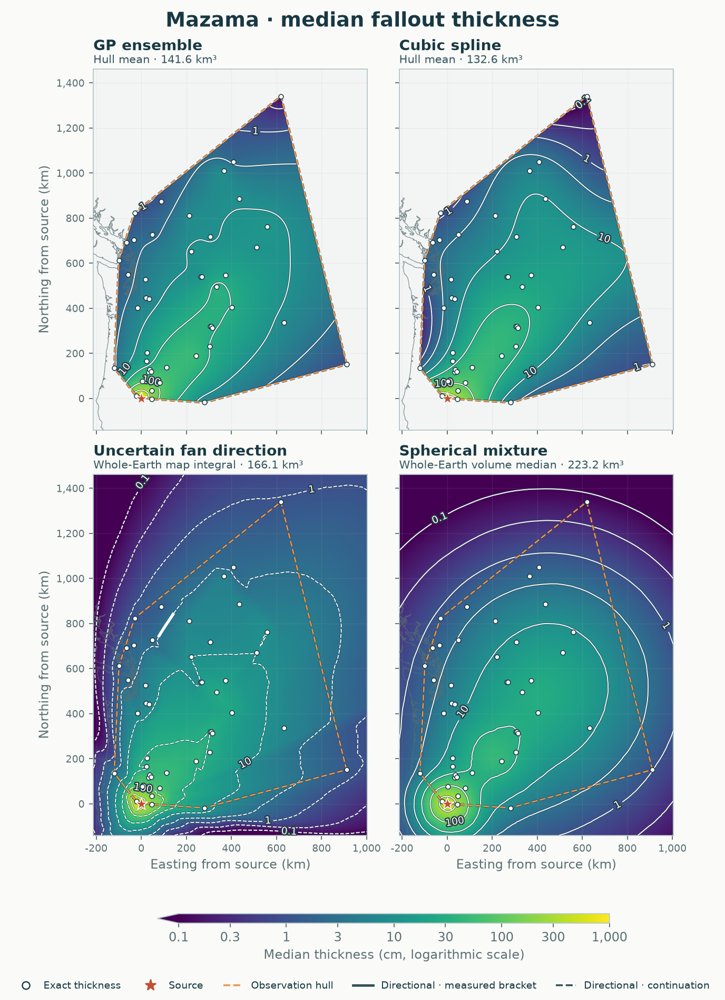
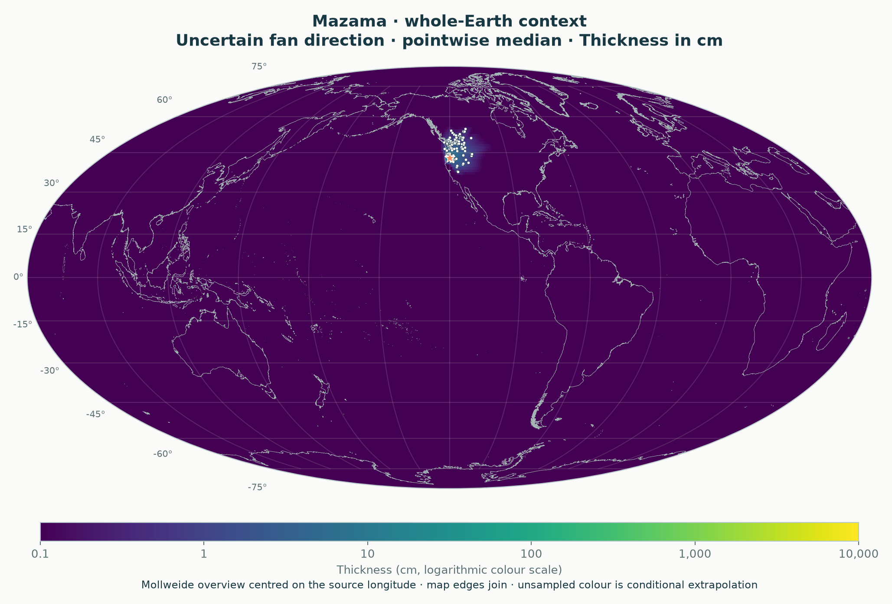
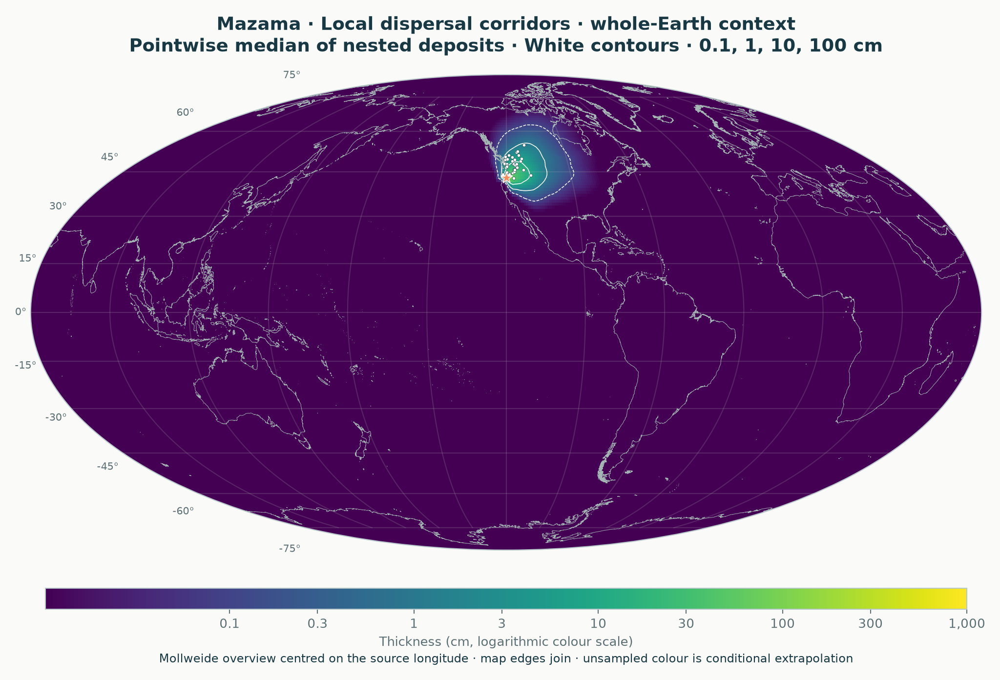
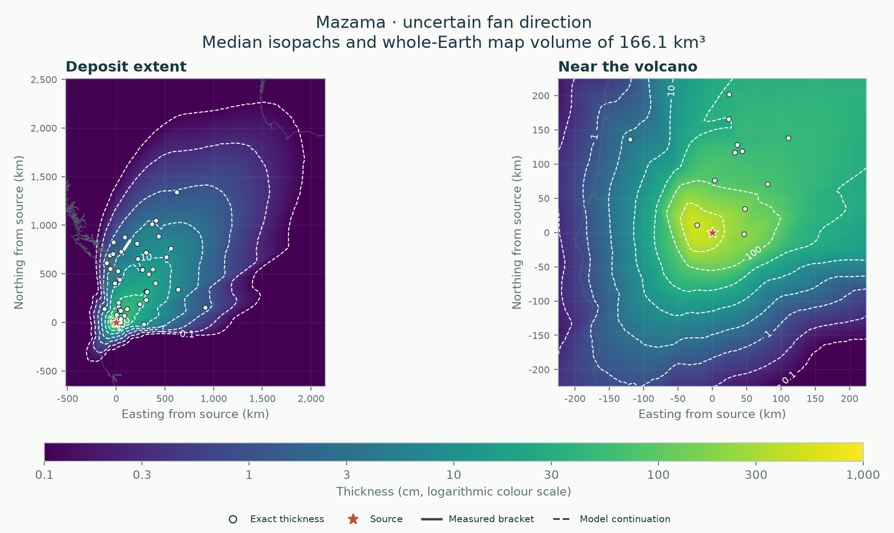

# Mazama fallout reconstruction

**Principal Bayesian nested estimate.** The corridor model gives 271.4 km³ of bulk fallout (conditional 95% interval 129.2–938.0), compared with 411.2 km³ under the whole-area continuation. The southwestern sector has no measured sites or bounds. Its median 1 cm footprint changes from 28,185 to 5,771 km². Buffered thickness predictions improve, and withholding whole quadrants slightly favors the broader fit. [Corridor map, volume and checks](results/nested-isopachs/README.md) · [Full-compass isopachs](results/nested-isopachs/compass.png)

The accepted dataset contains 45 exact measurements. The regional fits share an observation hull of 930,447 km². [Accepted thickness CSV](../../data/eruptions/Mazama_tephra.csv) · [Input provenance](../../data/eruptions/README.md)

## Isopach fits

On the nested map, solid contour segments have a local thickness bracket and at least 90% posterior crossing probability. Dashes show conditional continuation. [Corridor estimate, support and uncertainties](results/nested-isopachs/README.md)

All four maps use the same frame, contour levels and thickness scale. Thickness below the first colour-bar tick shares the lowest shade. The dashed line encloses the observation hull. The regional fits stop there. The global fits also show how thickness continues into unsampled ground. On the directional map, solid white segments connect thicknesses bracketed by measured sites in a supported triangle. White dashes on the global maps show conditional isopachs. Gaps inside the hull can still be poorly constrained.

## Volume and predictive performance

| Method | Bulk volume (km³) | Conditional 95% interval (km³) | Held-out score ↓ | 95% coverage |
|---|---|---:|---:|---:|
| GP ensemble | Hull mean **141.64** | 109.26–179.21 | 1.272 | 95.6% |
| Cubic spline | Hull mean **132.61** | 120.25–151.97 | 1.971 | 82.2% |
| [Directional ensemble · uncertain fan direction](results/directional/README.md) | Whole-Earth median map **166.1** · volume median 213.5 | 138.6–1,265.1 | 1.408 | 95.6% |
| [Spherical mixture](results/spherical-mixture/README.md) | Whole-Earth volume median **212.9** | 140.1–2,614.3 | 1.561 † | 88.9% |
| [Bayesian nested · corridor](results/nested-isopachs/README.md) | Whole-Earth volume median **271.4** | 129.2–938.0 | 1.365 | 95.6% |

The nested corridor assigns a median 7.8% of bulk volume to the retained exact-site triangles and 6.4% beyond the farthest exact site. Its median map integrates to 244.6 km³. 4/4 buffered fits passed their numerical checks. [Whole-area sensitivity](results/nested-whole-area/README.md) · [Paired median isopachs](results/nested-isopachs/paired-isopachs.png) · [Five-family volume and geographic prediction plot](results/overview.png)

A lower negative log predictive score means better prediction across withheld regions. Each region gets equal weight. Coverage is the share of exact held-out observations inside the 95% predictive interval. † A geographic fit had a numerical warning or incomplete scoring.

The directional map integrates pointwise median thickness. Measured interpolation triangles account for **15.7%** of its volume. The directional volume interval comes from complete posterior deposit draws. The spherical mixture reports the median integrated volume across broad and uncertain fan continuations. The regional intervals condition on fitted settings. [Regional maps, fits and diagnostics](results/README.md)

Compare the three whole-Earth maps

| Uncertain fan direction | Spherical mixture | Nested corridor |
|---|---|---|
|  |  |  |

Each map is centred on the vent longitude and has its own thickness key.

With the same observations and structure weights, fixing the fan directions gives a median-map volume of **177.0 km³**.

View the directional deposit extent and source area

## Evidence and limitations

The calculation uses the supplied acceptance flags. An independent row-by-row source review is still outstanding. Some spherical-mixture prior refits carry numerical warnings, and the broad upper interval reflects unsampled fallout.

The standard local-support footprint covers 172,792 km². No complete isopach band passed the support and deletion checks. [Support map, partial volumes and rejected contours](results/support/README.md)
