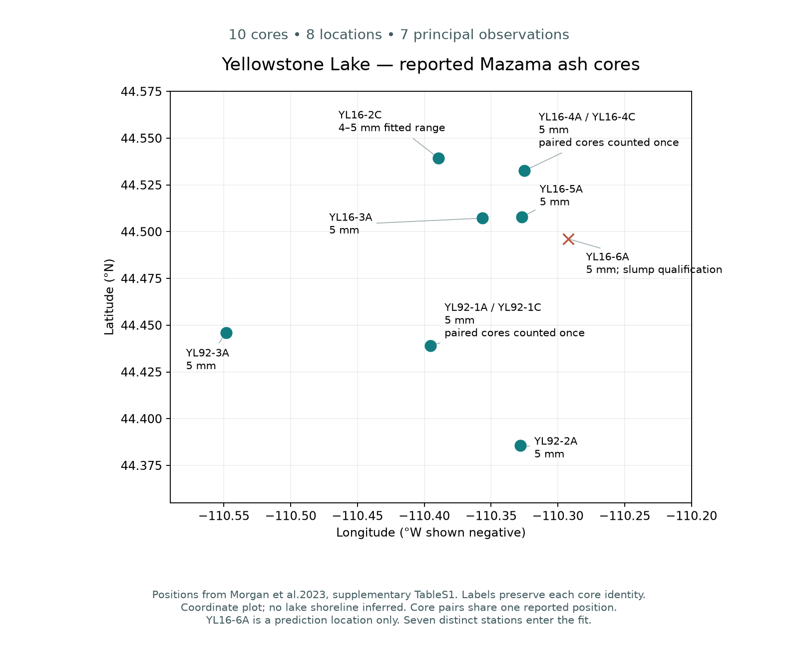

# Mazama climactic fallout

**The principal nested estimate uses 300 localities and gives 291 km³ of bulk fallout, with a conditional 95% interval of 221–833 km³.** The input has 46 point thicknesses, 29 two-sided intervals, 129 lower limits and 96 upper limits. All four nested geographic fits passed. The five-family table farther down uses the same 271 localities for every method. On that preceding revision the revised nested estimate is 510 km³ (238–1,503). [Principal nested map and checks](results/primary-ranges/nested-isopachs/README.md) · [Four geographic models on the current data](../../comparisons/nested-isopachs/geography/mazama.png)

 [Current principal CSV](../../data/eruptions/Mazama_primary_ranges.csv) · [Primary classifications and ranges](../../data/audits/Mazama/principal-ranges/README.md) · [Input used by the published figures](../../data/eruptions/Mazama_reviewed.csv)

[Distal sources and their effect on the estimates](results/source-audit/distal-facies-results.md) · [Thick distal deposits and original field evidence](../../data/audits/Mazama/distal-review/FIELD_EVIDENCE.md) · [Archived numerical editions](../../archive/2026-11-24-mazama-distal-facies/README.md)

On the model maps, circles mark measured beds, triangles mark minima and diamonds mark conditional ceilings. The symbol colour at Johnson Lake encodes its 156 cm enclosing package. The background contours show the model’s inferred thickness there.

**The matched five-family comparison uses 271 observations.** The common input has 31 measurements, 137 lower bounds and 103 upper bounds. The source ledger reconciles 293 original catalogue entries and 574 additional records, cross-references and controls. The original field evidence remains incomplete at sites identified in the audit.

[Accepted input](../../data/eruptions/Mazama_reviewed.csv) · [Audit assessment](../../data/audits/Mazama/README.md) · [Every locality](../../data/audits/Mazama/LOCALITIES.md) · [Young field sections](../../data/audits/Mazama/YOUNG_AND_FIELD_SECTIONS.md) · [Lake cores and Mount Baker field sections](../../data/audits/Mazama/LAKE_AND_FIELD_RECORDS.md) · [Dated sections](../../data/audits/Mazama/DATED_SECTIONS.md) · [Great Basin and Carp Lake](../../data/audits/Mazama/GREAT_BASIN.md) · [Thicknessless-site derivations](../../data/audits/Mazama/THICKNESSLESS_SITES.md) · [Yellowstone cores](../../data/audits/Mazama/YELLOWSTONE.md) · [Source sensitivities](results/source-audit/README.md)

The target is primary airborne bulk fallout from the climactic eruption, including co-ignimbrite ash. Identified precursor beds, flow deposits and reworked totals are excluded. Preserved primary components and range minima enter once as lower bounds, conditional on their identity and preservation. Green and Tepee Lake positions are corrected; the 850 cm Muir Creek facies-ambiguous value is quarantined. The two Williams Fen horizons remain unresolved. The 46 cm value is excluded and restored only in a historical sensitivity. See the [distal facies and airfall review](../../data/audits/Mazama/distal-review/README.md).

These global volumes are conditional estimates. Sparse bearings and unsampled regions remain uncertain even where a whole-Earth integral converges. Each family keeps its own interval, prior sensitivity and numerical status. [Shared support decisions](results/support/README.md) and each global extent report preserve rejected contours and unsupported gaps.

## Volumes and geographic prediction

Each volume integrates its method’s median-thickness map. The GP and spline cover the same observation hull. The other three methods cover Earth, including fallout below 0.5 cm. Conditional 95% intervals describe variation in whole-deposit volume across posterior draws.

| Method | Median-map volume (km³) | Conditional 95% interval (km³) | Held-out score ↓ | 95% coverage |
|---|---:|---:|---:|---:|
| GP ensemble | **282** | 199–593 | 0.719 | 77.4% |
| Cubic spline | **1,107** | 756–3.68e+04 | 1.738 | 77.4% |
| [Directional ensemble](results/directional/README.md) | **214** | 154–642 (provisional) | 0.530 † | 96.8% |
| [Spherical mixture](results/spherical-mixture/README.md) | **241** | 154–1.58e+03 | 0.532 | 74.2% |
| [Bayesian nested footprints](results/nested-isopachs/README.md) | **510** | 238–1.5e+03 | 0.327 † | 93.5% |

Lower scores indicate better predictions in withheld geographic regions. Coverage counts exact withheld measurements. A dagger marks a numerical or geographic validation warning. Provisional intervals retain their fit or integration warnings.

## Full deposits and near-vent detail

The outer line is 0.5 cm. Contours and observation colours double from there. All three methods use the same near-vent window for this eruption. Each curve counts the combined area of all patches at or above a thickness.

## Inside the observation hull

The dashed boundary encloses all accepted sites. Gaps inside it can still be poorly constrained. [Regional fits and numerical checks](results/README.md)

## Evidence, reproduction and history

Ten Yellowstone Lake cores contain 4–5 mm of Mazama ash at eight positions. Seven positions enter the principal fit. Two core pairs share positions, and YL16-6A lies at a slump toe. The enlarged map resolves the cores that overlap at the continental scale. [Core identities and bed measurements](../../data/audits/Mazama/YELLOWSTONE.md)

The fit also includes 8 cm at Overland Lake, 4 cm at Soldier Lake, 1 cm in Great Salt Lake core GSL00-4A-2H-2, and the approximately 4 cm airfall bed in the Lyman Lake composite. [Primary core reports](../../data/audits/Mazama/FOLLOWUP_SEARCH.md) · [Lyman position and stratigraphy](../../data/audits/Mazama/LATE_SOURCE_REVIEW.md)

The nested-model edge test refits the deposit after withholding the most influential outer site and again after withholding its geographic cluster. [Withheld rows, volumes and numerical checks](results/nested-whole-area/edge-deletion/README.md)

Run `tephra-isopachs compare Mazama --output results/new-mazama-run` for the registered comparison. The source-refit commands and publication verification are recorded with the [release](results/source-audit/README.md). Earlier published results and superseded audit trials retain their inputs and hashes in [dated archives](../../archive/2026-11-23-mazama-source-audit/README.md).
