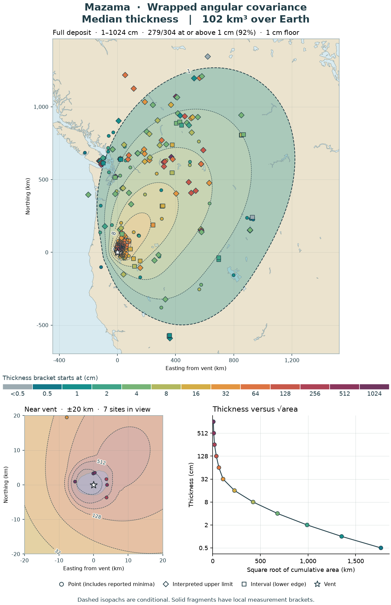
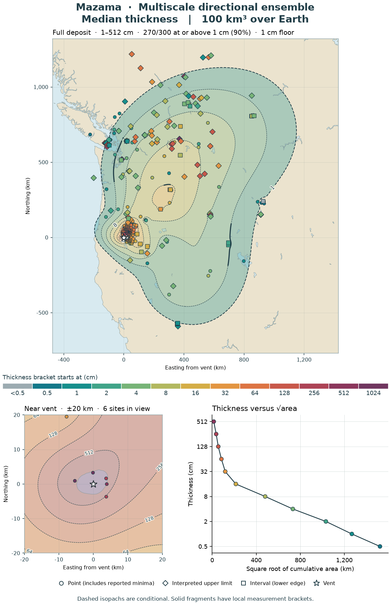
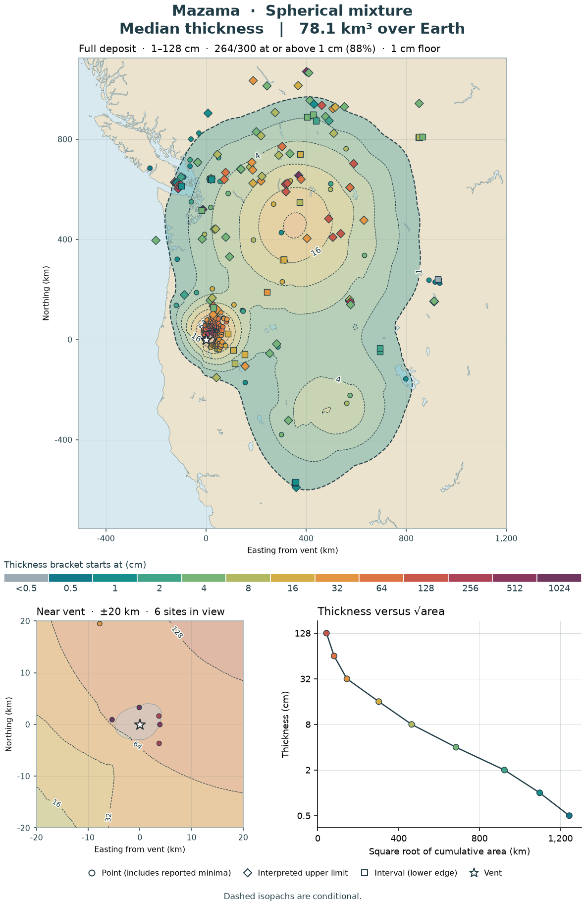
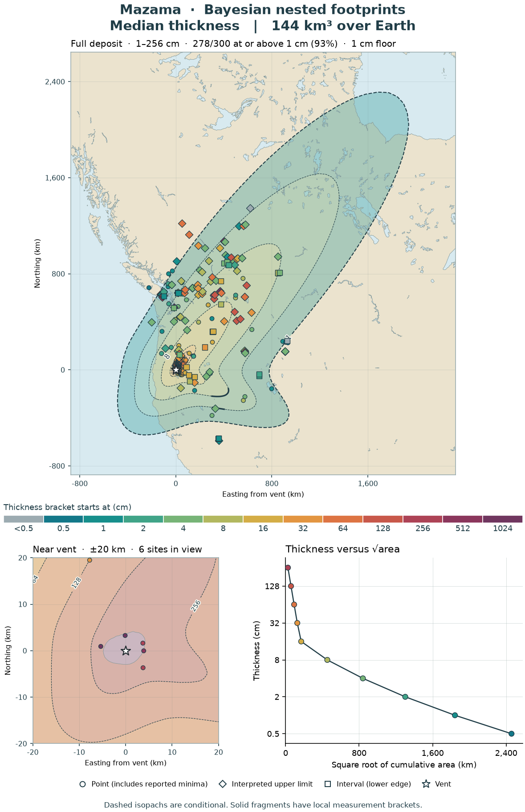

# Mazama

[Principal input maps and numbered detail plates](observations/README.md)

The principal dataset contains **304 fallout localities**, including the **5 mm** bed at Bolan Lake. Young’s corrected section positions add **358 cm** at 95, **75 cm** at 134 and **2,000+ cm** at 150. Sections 97 and 116 retain their own readings at the reviewed positions. The source table has 47 measurements, 132 geological lower limits, 96 upper limits and 29 ranges. [Marked sections and field tables](../../data/audits/Mazama/young-marker-review/README.md) · [Bolan Lake audit](../../data/audits/Mazama/principal-ranges/README.md#bolan-lake-addition) · [Reported table](../../data/eruptions/Mazama_young_centroids.csv) · [Fitting table](../../data/eruptions/Mazama_young_centroids_minimum_fit.csv)

[Wrapped angular covariance at three scales](results/young-centroids-2026-11-26/wrapped-angular-covariance/three-scales.png) · [Geological review and matched validation](../../comparisons/wrapped-angular-covariance/evidence.md)

## Volumes and geographic prediction

Each estimate integrates the median thickness on its map. The conditional range integrates the pointwise 25th and 75th percentiles of thickness over the same area. The 50% probability refers to thickness at each location. A single probability for total volume does not follow from these endpoints.

| Method | Integration area | Median map (km³) | Q25–Q75 thickness maps (km³) | Held-out score ↓ | 95% predictive coverage |
|---|---|---:|---:|---:|---:|
| [Wrapped angular covariance](results/young-centroids-2026-11-26/wrapped-angular-covariance/README.md) | whole Earth | **102** | 75.8–144 | 1.212 | 93.1% |

Lower scores indicate better geographic prediction. Coverage counts held-out measurements and reported minima fitted as points. A dagger marks a fit, integration or validation warning.

## Full deposits and near-vent detail

Each full map follows the thickest power-of-two contour enclosing at least 95% of the fitted locations, with a 1 cm minimum. The title gives the actual count, including when that minimum prevents 95% coverage. Global volumes include the thinner tail. The innermost line is the thickest doubling level enclosing an accepted location. The near-vent window expands from the proximal sites until eligible contours are visible. The curve sums all patches at each displayed thickness.

## Published reconstructions of the 300-locality edition

The maps, volumes and validation below were fitted to the preceding 300-locality edition, whose fitting table has SHA-256 `1cd60d207a3ddbb7393775683664a92be06fada73479dabaa55351e0ec3f9bb1`. [Immutable case revision](https://github.com/siyulai21/tephra-fallout-isopachs/tree/0869f7d7b3cb505944f6f104aea42ac068868938/eruptions/mazama)

The five reconstructions use the same 300 accepted fallout localities. Field reports give 46 measured thicknesses, 129 lower limits, 96 upper limits and 29 two-sided ranges. Each lower limit enters the fit as a point at its reported value, including the 121 beyond 25 km. Upper limits and ranges retain their respective one-sided and two-sided probabilities. [Source audit for the 300-locality edition](../../data/audits/Mazama/principal-ranges/README.md#preceding-300-locality-edition) · [Reported table](../../data/eruptions/Mazama_primary_ranges.csv) · [Fitting table](../../data/eruptions/Mazama_primary_ranges_minimum_fit.csv)

The site table pairs each source classification with its fitting value, geographic fold, mapped thickness and held-out score. It includes the predictive median or cumulative probability at the site value where the method saves it. A fitted minimum can underestimate total fallout at an incomplete section. [Reported and fitted sites](results/minimum-fit-2026-11-25/reported-and-fitted-sites.csv) · [Changes by method and coverage by source type](results/minimum-fit-2026-11-25/minimum-fit-comparison.csv) · [Fitting convention](../../docs/methods/reported-minimum-fitting.md)

## Volumes and geographic prediction

Each estimate integrates the median thickness on its map. The conditional range integrates the pointwise 25th and 75th percentiles of thickness over the same area. The 50% probability refers to thickness at each location. A single probability for total volume does not follow from these endpoints.

| Method | Integration area | Median map (km³) | Q25–Q75 thickness maps (km³) | Held-out score ↓ | 95% predictive coverage |
|---|---|---:|---:|---:|---:|
| GP ensemble | observation hull | **60.3** | 34.9–105 | 1.410 | 94.3% |
| Cubic spline | observation hull | **98.7** | 52.6–263 | 1.776 | 92.0% |
| [Multiscale directional ensemble](results/minimum-fit-2026-11-25/directional/README.md) | whole Earth | **100** | 73.3–140 | 1.380 | 85.1% |
| [Spherical mixture](results/minimum-fit-2026-11-25/spherical-mixture/README.md) | whole Earth | **78.1** | 66–92.3 | 1.361 † | 90.3% |
| [Bayesian nested footprints](results/minimum-fit-2026-11-25/nested-isopachs/README.md) | whole Earth | **144** | 124–172 | 1.380 | 85.1% |

Lower scores indicate better geographic prediction. Coverage counts held-out measurements and reported minima fitted as points. A dagger marks a fit, integration or validation warning.

## Full deposits and near-vent detail

Each full map follows the thickest power-of-two contour enclosing at least 95% of the fitted locations, with a 1 cm minimum. The title gives the actual count, including when that minimum prevents 95% coverage. Global volumes include the thinner tail. The innermost line is the thickest doubling level enclosing an accepted location. The near-vent window expands from the proximal sites until eligible contours are visible. The curve sums all patches at each displayed thickness.

## Inside the observation hull

The GP and spline integrate over the dashed hull. Gaps inside it can still be poorly constrained. [Regional fits and numerical checks](results/minimum-fit-2026-11-25/README.md)

## Nested geometry and field agreement

The small circular summit contour gives way to a turning proximal structure, with a northeastern main lobe and a smaller southeastern shoulder already evident in the 256–128 cm geometry. The intermediate and full maps preserve this concavity and gradual change of spacing instead of replacing it with a smooth oval. The northeastern thin reach shortens, but the southwestern conditional extension grows farther into the Pacific. The observed southern branch remains connected to the main field. There are no crossing successive levels or detached rings in the displayed median contours.

Southeastern Y1990-A082 and B2024-UKR improve, as does the two-sided FLV93-C7 interval. The very thick proximal Y1990-A118 is underestimated more strongly, and the northwestern P1999-BEAVER-OR upper bound and B2020-052 measurement worsen. The new geography therefore does not resolve every upwind conflict. Measured log RMSE improves slightly from 0.739 to 0.737, median absolute log error from 0.416 to 0.355, and bounded negative log probability from 0.779 to 0.756. Median upper-limit violations fall from 11 to 10 while interval violations rise from 21 to 24. Geographic score worsens from 1.182 to 1.380 despite passing numerical checks on all four folds; this is a predictive tradeoff, not a convergence warning.

[Three-scale comparison, site identities and contour diagnostics](../../comparisons/nested-isopachs/adaptive-growth/visual-review.md#mazama)

## Evidence and checks

[Matched predictions by locality](results/minimum-fit-2026-11-25/geographic-site-validation.csv) · [Numerical checks and file identities](results/minimum-fit-2026-11-25/release.json) · [Spherical fits and computing revisions](results/minimum-fit-2026-11-25/spherical-mixture/workflow-provenance.json) · [Regional support](results/minimum-fit-2026-11-25/support/README.md) · [Whole-area sensitivity](results/minimum-fit-2026-11-25/nested-whole-area/README.md)

[Previous maps and geological assessment](previous-minimum-treatment.md) · [Change at all distances across eruptions](../../comparisons/reported-minima/README.md)
