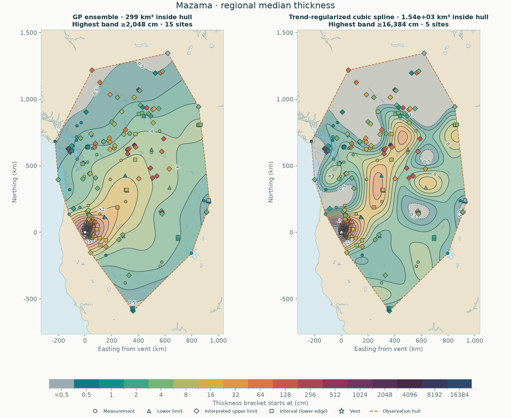

# Mazama source audit and model results

The deposit-nature review covers 836 records. The revised 243-location fit uses 31 point measurements, 137 primary minima and 75 conditional upper limits. The Yellowstone evidence retains each reported 1992 and 2016 core. [Distal evidence and comparison](../../data/audits/Mazama/distal-review/README.md) · [All localities](../../data/audits/Mazama/revised-locality-ledger.csv) · [Fitting input](../../data/eruptions/Mazama_reviewed.csv) · [Yellowstone core map](../../data/audits/Mazama/yellowstone-cores.png)

The five earlier 244-position fits remain available at their fixed revision. The revised fit and its thirteen source-choice tests have a separate calculation identity. [Five-family 244-position results](https://github.com/siyulai21/tephra-fallout-isopachs/blob/8130479529dfe2ac4b85c72ad363cd2be279ef50/eruptions/mazama/audit-run/README.md) · [Recalculation request](../../data/audits/Mazama/recompute-request.json)

## Archived pre-audit results

The figures and values below are the earlier published case.

## Archived model comparison on 45 measurements

The accepted dataset contains 45 exact measurements. The regional fits share an observation hull of 930,447 km². [Accepted thickness CSV](../../data/eruptions/Mazama_tephra.csv) · [Input provenance](../../data/eruptions/README.md)

## Volumes and geographic prediction

Each volume integrates its method’s median-thickness map. The GP and spline cover the same observation hull. The other three methods cover Earth, including fallout below 0.5 cm. Conditional 95% intervals describe variation in whole-deposit volume across posterior draws.

| Method | Median-map volume (km³) | Conditional 95% interval (km³) | Held-out score ↓ | 95% coverage |
|---|---:|---:|---:|---:|
| GP ensemble | **130** | 109–179 | 1.272 | 95.6% |
| Cubic spline | **129** | 120–152 | 1.971 | 82.2% |
| [Directional ensemble](results/directional/README.md) | **166** | 138–1.19e+03 (provisional) | 1.366 | 95.6% |
| [Spherical mixture](results/spherical-mixture/README.md) | **171** | 135–914 | 1.559 † | 84.4% |
| [Bayesian nested corridors](results/nested-isopachs/README.md) | **219** | 116–960 | 1.369 | 95.6% |

Lower scores indicate better predictions in withheld geographic regions. Coverage counts exact withheld measurements. A dagger marks a numerical or geographic validation warning. Provisional intervals retain their fit or integration warnings.

## Full deposits and near-vent detail

The outer line is 0.5 cm. Contours and observation colours double from there. All three methods use the same near-vent window for this eruption. Each curve counts the combined area of all patches at or above a thickness.

## Inside the observation hull

The dashed boundary encloses all accepted sites. Gaps inside it can still be poorly constrained. [Regional fits and numerical checks](results/README.md)

The current global fits use the same audited rows. [What changed in the maps, volumes and validation](../../comparisons/global-extent/README.md) · [Continuation rules](../../docs/methods/finite-spread.md)

## Evidence and limitations

The calculation uses the supplied acceptance flags. An independent row-by-row source review is still outstanding. Some spherical-mixture prior refits carry numerical warnings, and the broad upper interval reflects unsampled fallout.

The standard local-support footprint covers 172,792 km². No complete isopach band passed the support and deletion checks. [Support map, partial volumes and rejected contours](results/support/README.md)

In the [preceding reconstruction](../../archive/2026-11-22-global-extent/README.md), the southwestern sector has no measured sites or bounds. Its median 1 cm footprint changes from 28,185 to 5,771 km². Buffered thickness predictions improve, and withholding whole quadrants slightly favors the broader fit. [Whole-area continuation sensitivity](results/nested-whole-area/README.md)
