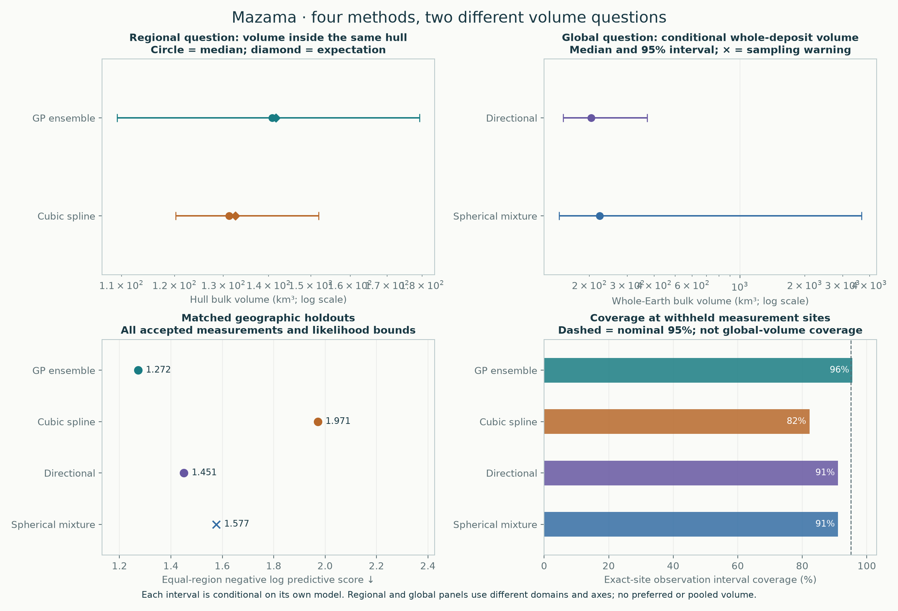

# Mazama: data, global and regional results

[Read the visual comparison](results/overview.png) · [Map and uncertainty guide](../../docs/OUTPUTS.md)

[Regional fit](results/README.md) · [Local support](results/support/README.md) · [Directional estimate](results/directional/README.md) · [Spherical mixture](results/spherical-mixture/README.md)

[All eruptions](../README.md) · [Active methods](../../methods/README.md) · [Add or revise data](../../docs/NEW_ERUPTION.md)

## Global fallout from measured isopach fragments

The common directional model gives **203.3 km³** of whole-deposit bulk fallout with a conditional 95% credible interval of **150.6–370.2 km³**. Within retained measurement triangles it gives **27.3 km³**, a median 13.5% of the total. The remaining volume depends on the continuation. [Measured isopach fragments, alternative fans and validation](results/directional/README.md) · [Matched six-eruption comparison and independent replications](../../comparisons/directional/README.md).

## Spherical-mixture estimate

The joint global posterior has median **223 km³** and a **145–3,669 km³ conditional 95% credible interval** for bulk fallout. All accepted fans are fitted together. This whole-Earth estimate uses no closing pseudo-data or arbitrary calculation region. [Read the global report, assumptions and sensitivity refits](results/spherical-mixture/README.md). The wide upper tail reflects deposits that remain poorly constrained by observations.

**Local support audit:** no complete isopach band passes the support and deletion checks. The standard local footprint covers 172,792 km². Read the [local partial volumes and rejected-contour checks](results/support/README.md) before interpreting the broader hull results below. The separate [conditional global analysis](results/spherical-mixture/README.md) now estimates the whole deposit under explicit assumptions; this contour-screen decision is unchanged.

## Regional reconstruction

**GP ensemble and automatic cubic spline are reported as peers.** Both use the same accepted data, geographic holdouts and observation hull.

[Read the full comparison](results/README.md) · [Compare all six eruptions](../../comparisons/regional/README.md) · [Method definitions](../../methods/README.md)

45 exact measurements and 0 lower bounds; regional area 930,447 km².

| Quantity | GP ensemble | Cubic spline |
|---|---:|---:|
| Expected regional bulk fallout (km³) | 141.64 | 132.61 |
| Outer equal-region negative log score ↓ | 1.272 | 1.971 |

These volumes cover only the observation hull. It can include unsampled gaps and exclude proximal deposits; it is not total eruption volume or dense-rock equivalent. Conditional intervals omit fitted-parameter and selection uncertainty. Read withheld coverage and geographic-deletion sensitivity in the full report.

## Evidence and calculation

| Follow the calculation | File |
|---|---|
| Accepted input | [Thickness observations](../../data/eruptions/Mazama_tephra.csv) |
| Source decisions | [Audit or supplied-flag status](../../data/eruptions/README.md) |
| Whole-deposit mass and uncertainty | [Global posterior report](results/spherical-mixture/README.md) |
| Local maps and partial volumes | [Regional report](results/README.md) |
| Fits, validation and provenance | [Complete numerical record](results/report.json) |
| Row-by-row outer predictions | [Held-out predictions](results/heldout_predictions.csv) |
| Automatic tuning | [Candidate tables](results/selection/README.md) |

The 2026-11-04 regional rerun reproduced accepted inputs, fitted settings, held-out predictions and matched-hull volumes exactly. The new global companion is published separately. [Rerun verification](../../comparisons/spherical-mixture/verification.json).

## Related evidence and history

[Validation and targeted studies](../../comparisons/README.md) · [Earlier calculations in Git history](../../docs/HISTORY.md)
