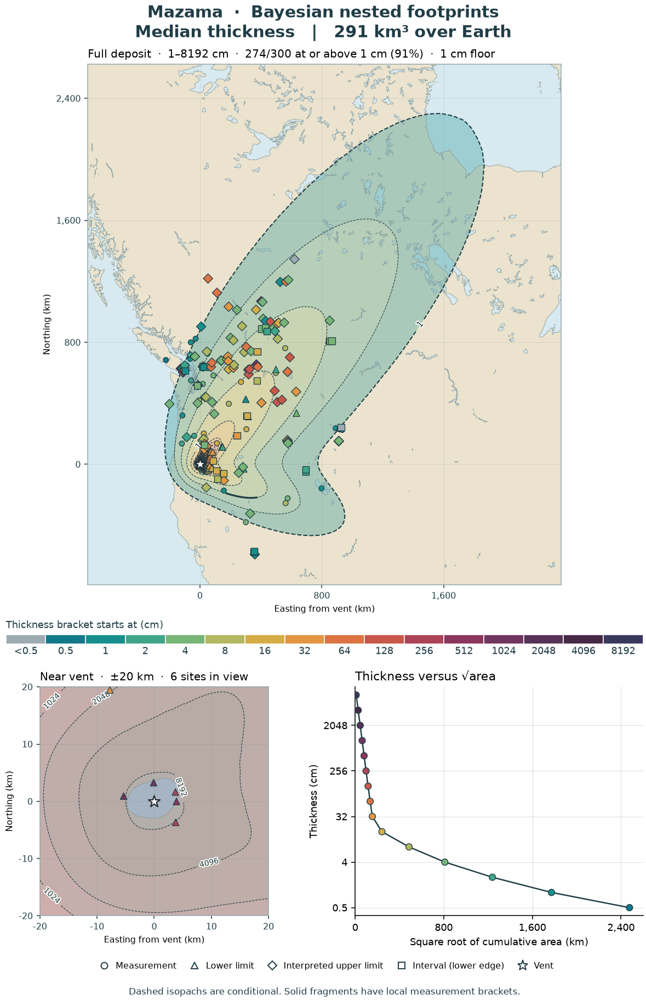
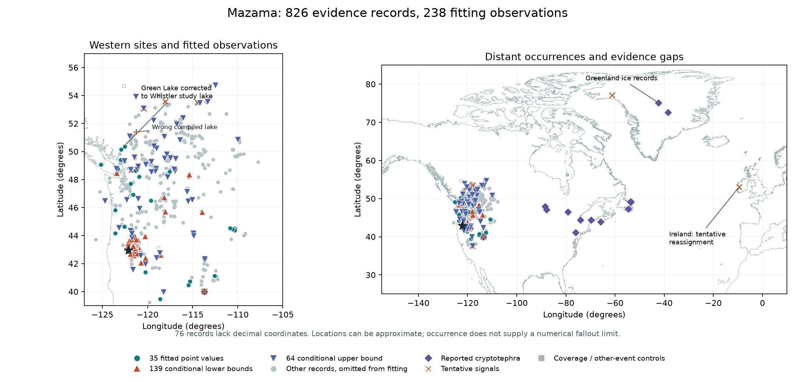

# Mazama climactic fallout

The current audit accepts **300 localities** for primary airborne fallout from the climactic eruption, including co-ignimbrite ash. It records 46 point measurements, 29 two-sided intervals, 129 lower limits and 96 upper limits. The Bayesian nested footprints fit uses all 300. The GP ensemble, spline, directional ensemble and spherical mixture have published fits on the preceding 271-locality input.

[Current input](../../data/eruptions/Mazama_primary_ranges.csv) · [Field classifications and measured ranges](../../data/audits/Mazama/principal-ranges/README.md) · [Historical five-method comparison on 271 localities](results/README.md)

## Volumes and geographic prediction

Each estimate integrates the median thickness on its map. The conditional range integrates the pointwise 25th and 75th percentiles of thickness over the same area. The 50% probability refers to thickness at each location. A single probability for total volume does not follow from these endpoints.

| Method | Median map (km³) | Q25–Q75 thickness maps (km³) | Held-out score ↓ | 95% predictive coverage |
|---|---:|---:|---:|---:|
| [Bayesian nested footprints](results/primary-ranges/nested-isopachs/README.md) | **291** | 228–400 | 0.697 | 95.7% |

Lower scores indicate better geographic prediction. Coverage counts exact withheld measurements. A dagger marks a fit, integration or validation warning.

## Full deposits and near-vent detail

Each full map follows the thickest power-of-two contour enclosing at least 95% of the fitted locations, with a 1 cm minimum. The title gives the actual count, including when that minimum prevents 95% coverage. Global volumes include the thinner tail. The innermost line is the thickest doubling level enclosing an accepted location. The near-vent window expands from the proximal sites until eligible contours are visible. The curve sums all patches at each displayed thickness.

## Field evidence and validation

All four geographic holdouts passed their numerical checks. The shared support screen qualifies no complete contour band. Unsampled bearings and assumptions about deposit continuation still affect the whole-Earth volume. [Sector volumes and extrapolation](results/primary-ranges/nested-isopachs/README.md#geographic-support-and-extrapolation) · [Matched footprint experiments](../../comparisons/nested-isopachs/geography/README.md)

The audit distinguishes primary beds, enclosing packages and reworked deposits. Two Yellowstone core pairs share positions. YL16-6A lies at a slump toe. [Locality ledger](../../data/audits/Mazama/LOCALITIES.md) · [Original distal field evidence](../../data/audits/Mazama/distal-review/FIELD_EVIDENCE.md) · [Yellowstone cores](../../data/audits/Mazama/YELLOWSTONE.md) · [Earlier source sensitivities](results/source-audit/README.md)
