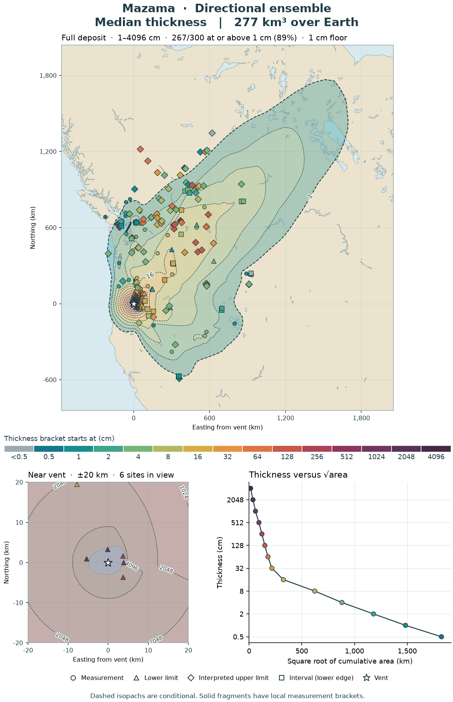
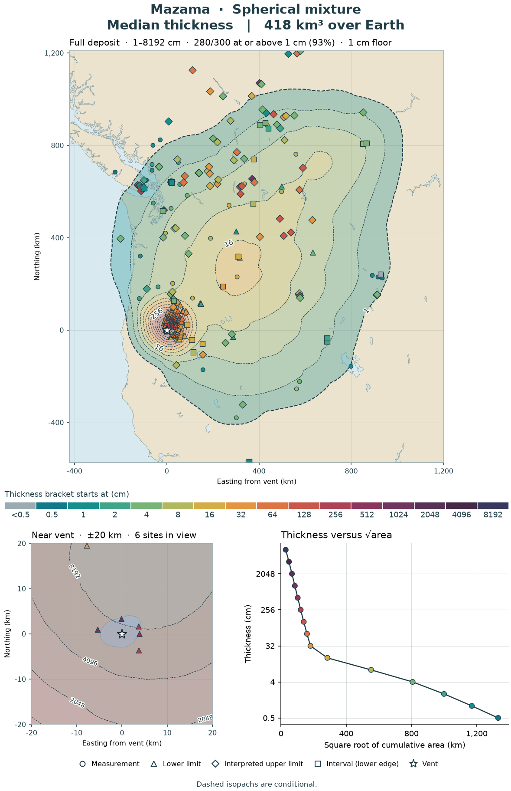
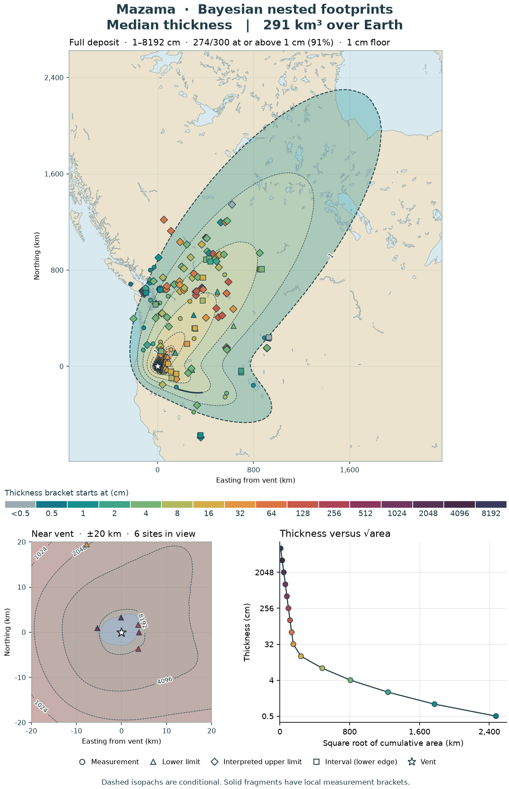

# Mazama climactic fallout

All five methods use **300 audited localities** for primary airborne fallout from the climactic eruption, including co-ignimbrite ash. The input contains 46 point measurements, 29 two-sided thickness ranges, 129 lower limits and 96 upper limits. Each geographic holdout uses the same test sites and buffered training sites across methods. [Model input](../../data/eruptions/Mazama_primary_ranges.csv) · [Field classifications and measured ranges](../../data/audits/Mazama/principal-ranges/README.md) · [Numerical results](results/principal-volumes.csv)

## Volumes and geographic prediction

Each estimate integrates the median thickness on its map. The conditional range integrates the pointwise 25th and 75th percentiles of thickness over the same area. The 50% probability refers to thickness at each location. A single probability for total volume does not follow from these endpoints.

| Method | Integration area | Median map (km³) | Q25–Q75 thickness maps (km³) | Held-out score ↓ | 95% predictive coverage |
|---|---|---:|---:|---:|---:|
| GP ensemble | observation hull | **299** | 179–473 | 1.399 | 71.7% |
| Cubic spline | observation hull | **1,537** | 729–3,527 | 1.231 | 89.1% |
| [Directional ensemble](results/directional/README.md) | whole Earth | **277** | 188–430 † | 0.739 † | 89.1% |
| [Spherical mixture](results/spherical-mixture/README.md) | whole Earth | **418** | 248–795 † | 1.027 | 76.1% |
| [Bayesian nested footprints](results/nested-isopachs/README.md) | whole Earth | **291** | 228–400 | 0.697 | 95.7% |

Lower scores indicate better geographic prediction. Coverage counts exact withheld measurements. A dagger marks a fit, integration or validation warning.

## Full deposits and near-vent detail

Each full map follows the thickest power-of-two contour enclosing at least 95% of the fitted locations, with a 1 cm minimum. The title gives the actual count, including when that minimum prevents 95% coverage. Global volumes include the thinner tail. The innermost line is the thickest doubling level enclosing an accepted location. The near-vent window expands from the proximal sites until eligible contours are visible. The curve sums all patches at each displayed thickness.

## Inside the observation hull

The GP and spline integrate over the dashed hull. Gaps inside it can still be poorly constrained. [Regional fits and numerical checks](results/README.md)

## Field evidence and validation

Numerical warnings remain for Directional ensemble (posterior diagnostics, geographic validation), Spherical mixture (posterior diagnostics). The nested footprint support audit qualifies no complete contour band. The global estimates depend on the continuation into unsampled areas. [Fold and fit checks](results/release.json) · [Nested sector volumes and extrapolation](results/nested-isopachs/README.md#geographic-support-and-extrapolation) · [Matched footprint experiments](../../comparisons/nested-isopachs/geography/README.md)

The field audit distinguishes primary beds, enclosing packages and reworked deposits. Two Yellowstone core pairs share positions, and core YL16-6A lies at a slump toe. [Locality ledger](../../data/audits/Mazama/LOCALITIES.md) · [Original distal field evidence](../../data/audits/Mazama/distal-review/FIELD_EVIDENCE.md) · [Yellowstone cores](../../data/audits/Mazama/YELLOWSTONE.md)
