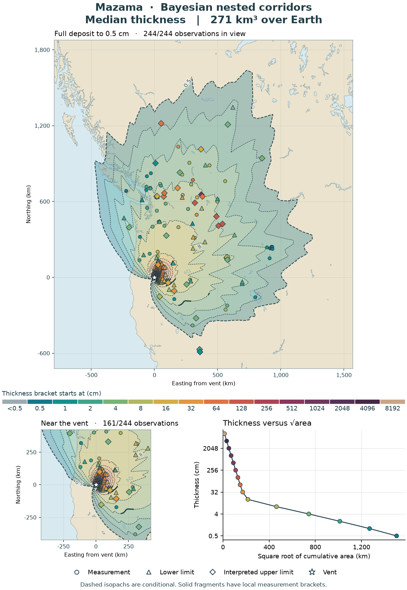

# Mazama principal models on 271 fitting positions

The reports below are completed model packets from the registered 271-position GitHub run. Every packet matches its published SHA-256 and every map uses the same numerical input. The full release also assembles the fifteen geological source comparisons. [Model calculation](https://github.com/siyulai21/tephra-fallout-isopachs/actions/runs/45300131932) · [Artifact identities and hashes](github-artifact-hashes.json) · [Field evidence and unresolved sources](../../../data/audits/Mazama/distal-review/README.md)

The 31 measured beds, 137 lower limits and 103 upper limits enter each fit. The regional hull covers 1,548,745 km². The whole-Earth integrations include extrapolation over unsampled areas. Conditional intervals give whole-deposit draw uncertainty under each model and its evidence assumptions. [Input](../../../data/eruptions/Mazama_reviewed.csv) · [Unrounded results](principal-volumes.csv)

| Family | Domain | Median-map km³ | Conditional 95%, km³ | Held-out score ↓ | Coverage of measured beds | Numerical qualifications |
|---|---|---:|---:|---:|---:|---|
| GP ensemble | observation hull | 281.79 | 199.09–592.71 | 0.719 | 77.4% | Passed |
| Cubic spline | observation hull | 1,107.29 | 755.95–36,824.90 | 1.738 | 77.4% | Passed |
| Bayesian nested isopachs | whole Earth | 175.29 | 106.13–604.87 | 0.430 | 87.1% | geographic fits provisional |

Circles on these model maps identify measurements, triangles minima and diamonds conditional ceilings. A diamond’s colour can encode a thick enclosing package. The underlying coloured field gives the inferred local thickness.

The earlier 244-position calculations use different source treatments and a different regional observation hull. The fixed-footprint refits compare the effect of the evidence choices directly. [Earlier maps and numerical reports](../../../archive/2026-11-24-mazama-distal-facies/README.md)

[Regional reports and fold membership](regional-report.json) · [Regional support, holes and rejected contours](regional-support.json.gz)

### Bayesian nested isopachs

No complete contour band qualified. Numerical fold checks passed in 3 of 4 geographic regions. [Integration](nested-map.json) · [Held-out comparisons](nested-extent.json) · [Support decisions](nested-support.json.gz)

## Distal sites with their geographic region withheld

The input column gives a measured bed or a conditional upper bound. The predictions use the other geographic regions. A model can predict a thick deposit where the field evidence allows only a much thinner bed. [Every regional prediction, interval and one-sided probability](regional-withheld-by-site.csv) · [Primary field accounts](../../../data/audits/Mazama/distal-review/FIELD_EVIDENCE.md)

| Site | Field input (cm) | Withheld GP median (cm) | Withheld spline median (cm) |
|---|---:|---:|---:|
| Johnson Lake | ≤156 | 0.312 | 0.321 |
| Windy Lake | ≤86 | 0.704 | 1.06 |
| Thunder Lake, BC | ≤32 | 0.183 | 0.232 |
| Sheep Mountain Bog | ≤42 | 12.9 | 8.08e+03 |
| Foy core A | ≤8 | 8.47 | 40.9 |
| Yellowstone Lake, central core | 0.5 | 7.06 | 0.0183 |

At Sheep Mountain Bog, the original diagram encloses about 40 cm of preserved tephra. The large spline prediction comes from withholding the entire region. It documents the instability of extrapolating that fit into an unsampled area.
