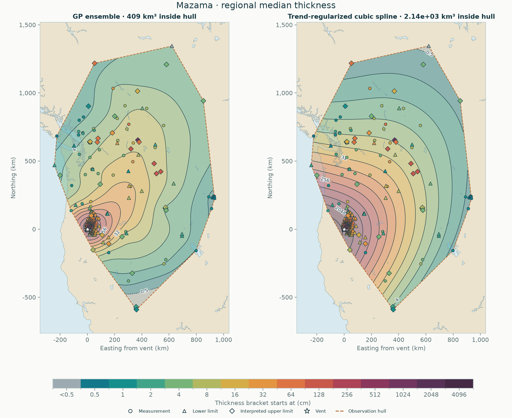
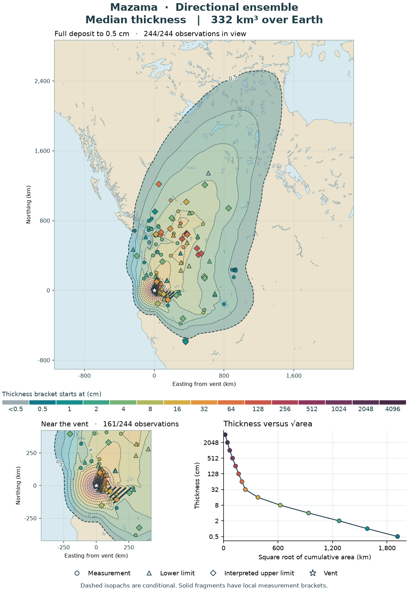
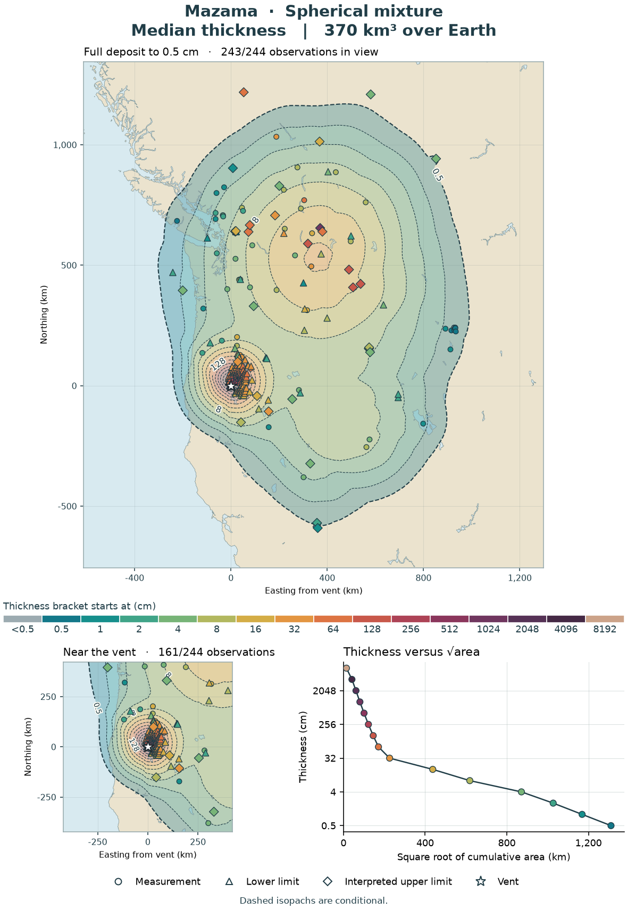
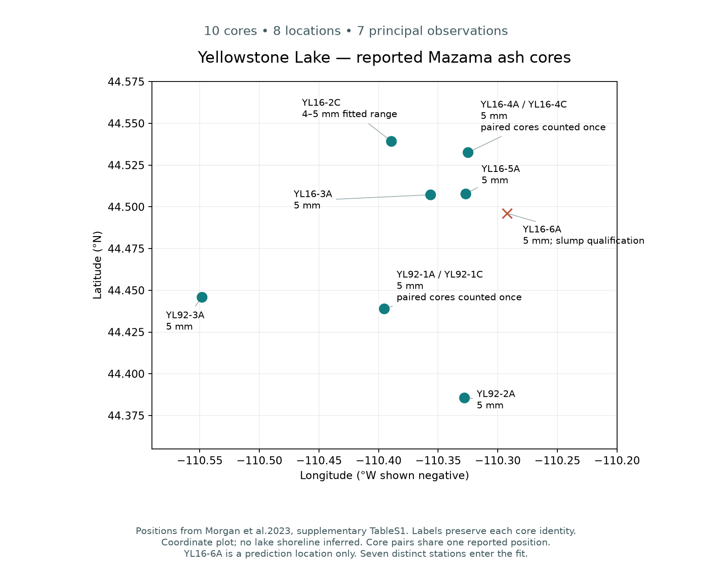

# Mazama fallout estimates from 244 locations

All five maps and numerical reports come from the GitHub calculation on 58 measured beds, 153 lower bounds and 33 upper bounds. The four downloaded model packets matched their published SHA-256 checksums. The source comparisons cover 33 alternative interpretations and are being assembled separately. [Reviewed input](../../../data/eruptions/Mazama_reviewed.csv) · [Source audit](../../../data/audits/Mazama/README.md) · [GitHub calculation](https://github.com/siyulai21/tephra-fallout-isopachs/actions/runs/45261422486) · [Four packet identities](github-artifact-hashes.json)

| Method | Domain | Median-map volume (km³) | Conditional 95% interval (km³) | Geographic score ↓ | Withheld bed coverage | Numerical checks |
|---|---|---:|---:|---:|---:|---|
| GP ensemble | 1,556,082 km² observation hull | 409.47 | 332.36–835.00 | 1.166 | 43/58 (74.1%) | Passed |
| Cubic spline | 1,556,082 km² observation hull | 2,138.33 | 1,125.17–4,716.92 | 2.634 | 47/58 (81.0%) | Passed |
| Directional | Earth, conditional continuation | 332.14 | 257.16–1,037.69 | 0.813 | 51/58 (87.9%) | Warning in volume draws, geographic fits |
| Spherical mixture | Earth, conditional continuation | 370.21 | 212.04–7,166.96 | 1.000 | 42/58 (72.4%) | Passed |
| Bayesian nested isopachs | Earth, conditional continuation | 270.95 | 186.94–724.35 | 1.011 | 42/58 (72.4%) | Passed |

Each estimate integrates its model’s median thickness surface. The conditional intervals omit uncertainty from untested source interpretations. A failed numerical check makes the affected interval or validation provisional. [Unrounded results and flags](principal-volumes.csv) · [Eight spherical prior settings](spherical-prior-sensitivity.json)

The directional fit passed all numerical checks in two of four withheld geographic regions. All five models covered fewer than 95% of withheld measured beds. The spherical report used the original eight prior fits and four geographic fits. All 21 stored sampling attempts and their records retained identical checksums. [Sampling evidence](spherical-recovery.json) · [Verified spherical report](https://github.com/siyulai21/tephra-fallout-isopachs/actions/runs/45276245987)

An independent calculation gave 327 km³ for the directional map and 354 km³ for the spherical map. Both runs retained the directional warning and the broad spherical interval. The GP, spline and nested map volumes agree to two decimal places. [Independent five-model calculation](https://github.com/siyulai21/tephra-fallout-isopachs/blob/5824a3b553a8db62e8cfe7acbb078fc70a4e7c0a/eruptions/mazama/audit-run/README.md)

[Regional fits and geographic folds](regional-report.json) · [Regional contour decisions](regional-support.json.gz)

**Directional**. No complete contour band qualified. [Map integration](directional-map.json) · [Held-out predictions](directional-extent.json) · [Contour decisions](directional-support.json.gz)

**Spherical mixture**. No complete contour band qualified. [Map integration](spherical-map.json) · [Held-out predictions](spherical-extent.json) · [Contour decisions](spherical-support.json.gz)

The spherical map’s 0.5 cm display window includes 243 of the 244 fitted locations. Lofty Lake in Alberta lies beyond its northern edge. Its lower bound enters the fit and appears on the full source map. [All source locations](../../../data/audits/Mazama/evidence-map.png)

**Bayesian nested isopachs**. No complete contour band qualified. [Map integration](nested-map.json) · [Held-out predictions](nested-extent.json) · [Contour decisions](nested-support.json.gz)

## Yellowstone Lake core detail

Morgan et al. reported 4–5 mm beds in ten cores at eight positions. Seven positions enter the fit. Two core pairs share positions, and the irregular YL16-6A slump-toe bed has a separate inclusion test. [Core coordinates, depths and identity](../../../data/audits/Mazama/YELLOWSTONE.md)

The principal input includes 8 cm at Overland Lake, 4 cm at Soldier Lake, 1 cm in Great Salt Lake hole 4A section 2H-2, and about 4 cm at Lyman Lake. [Lake core evidence](../../../data/audits/Mazama/FOLLOWUP_SEARCH.md) · [Lyman stratigraphy](../../../data/audits/Mazama/LATE_SOURCE_REVIEW.md) · [Young’s field sections](../../../data/audits/Mazama/YOUNG_AND_FIELD_SECTIONS.md)
