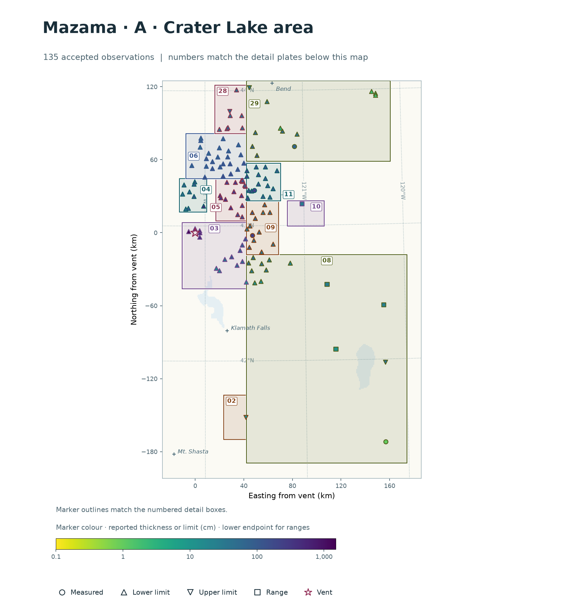

# Mazama · principal input observations

All 301 accepted rows have a symbol at their registered coordinates on the overview and a labelled reading on one numbered detail plate. Box A on the overview marks the area shown in the near-vent detail index. Other numbered boxes lead directly to detail plates. A star marks the vent. Positions use a vent-centred equal-area grid in kilometres. The basemap uses Natural Earth land and coastlines.

[Go to the near-vent map](#near-vent-detail-index) · [Accepted input CSV](../../../data/eruptions/Mazama_bolan_lake_minimum_fit.csv) · [Reported CSV](../../../data/eruptions/Mazama_bolan_lake.csv) · [Audit provenance](../../../data/audits/Mazama/principal-ranges/bolan-lake-provenance.json) · [Site index with coordinates and full input precision](sites.csv) · [Input hashes and panel bounds](manifest.json)

The table shows the evidence ID and source citation alongside the reported or interpreted reading. A dash marks an unavailable evidence ID. Complete citations and unrounded values are in the site index. A reported lower limit appears as ≥ on these evidence figures and as a point at that value in the fit. Upper limits and ranges retain their respective events. Marker colour represents the displayed thickness or limit, using the lower endpoint for ranges. Where rows share coordinates, a single diamond uses the first CSV row as its map key and the adjacent table lists each row.

## Near-vent detail index

**Box A · Crater Lake area** contains 135 accepted observations. Match a numbered box to the links below for its site locations and readings. [02](detail-02.png), [03](detail-03.png), [04](detail-04.png), [05](detail-05.png), [06](detail-06.png), [08](detail-08.png), [09](detail-09.png), [10](detail-10.png), [11](detail-11.png), [28](detail-28.png), [29](detail-29.png)

Sites previously grouped in [Detail 07](detail-07.png) now have a separate [Detail 28](detail-28.png) inside Box A.

Sites previously grouped in [Detail 12](detail-12.png) now have a separate [Detail 29](detail-29.png) inside Box A.

## All detail plates

| Detail plate | Input rows | Easting × northing span |
|---|---:|---:|
| [01](detail-01.png) | 1 | 36.6 × 36.6 km |
| [02](detail-02.png) · A | 1 | 18.8 × 36.6 km |
| [03](detail-03.png) · A | 15 | 53.1 × 54.2 km |
| [04](detail-04.png) · A | 9 | 22.4 × 27.5 km |
| [05](detail-05.png) · A | 22 | 25.3 × 34.8 km |
| [06](detail-06.png) · A | 24 | 50 × 37 km |
| [07](detail-07.png) | 10 | 179 × 95.2 km |
| [08](detail-08.png) · A | 14 | 132 × 171 km |
| [09](detail-09.png) · A | 13 | 26.3 × 44.3 km |
| [10](detail-10.png) · A | 1 | 30.1 × 20.8 km |
| [11](detail-11.png) · A | 16 | 27.9 × 30.8 km |
| [12](detail-12.png) | 1 | 0.0041 × 0.0041 km |
| [13](detail-13.png) | 11 | 262 × 963 km |
| [14](detail-14.png) | 23 | 485 × 589 km |
| [15](detail-15.png) | 2 | 105 × 94.9 km |
| [16](detail-16.png) | 12 | 163 × 113 km |
| [17](detail-17.png) | 12 | 77.4 × 520 km |
| [18](detail-18.png) | 4 | 33.4 × 107 km |
| [19](detail-19.png) | 9 | 5.2 × 3.85 km |
| [20](detail-20.png) | 1 | 25.2 × 36.6 km |
| [21](detail-21.png) | 12 | 116 × 502 km |
| [22](detail-22.png) | 2 | 80.3 × 114 km |
| [23](detail-23.png) | 24 | 288 × 511 km |
| [24](detail-24.png) | 11 | 236 × 502 km |
| [25](detail-25.png) | 16 | 433 × 195 km |
| [26](detail-26.png) | 6 | 55.7 × 167 km |
| [27](detail-27.png) | 9 | 512 × 411 km |
| [28](detail-28.png) · A | 8 | 26.2 × 39.8 km |
| [29](detail-29.png) · A | 12 | 118 × 66.2 km |
